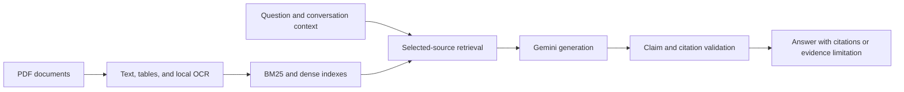

# CampusAI

**Evidence-grounded conversations with your PDF documents.**

[](https://github.com/trbk07/campusai-university-rag/actions/workflows/ci.yml)


CampusAI is a local web application for asking questions across PDFs in
Vietnamese and English. It combines text and table extraction, background OCR,
hybrid retrieval, and answer validation to connect responses to the documents
and physical pages that support them.

Built around university regulations and student handbooks, CampusAI also accepts
other PDF content. Document identity and scope come from the selected sources;
when a request is ambiguous or evidence is insufficient, the application asks
for clarification or explains what is missing.

**Status:** actively developed, single-user local MVP. Final release acceptance
and representative quality evaluation remain in progress. See the
[quality overview](docs/PROJECT_OVERVIEW.md) and [roadmap](plan.md) for measured
results, limitations, and remaining work.

[Capabilities](#capabilities) · [Quick start](#quick-start-windows) ·
[Architecture](#how-it-works) · [Docker](#docker) ·
[Development](#development) · [Documentation](#documentation)

## Capabilities

| Area | What CampusAI provides |
|---|---|
| Document library | Upload, select, and delete PDFs. Add up to **5 PDFs per upload batch**, then add further batches to the same library. |
| Extraction and OCR | Read native text and tables; process scanned pages and image regions in the background, with checkpoints, cancellation, and coverage tracking. |
| Document Q&A | Retrieve from selected sources and return answers with document names, physical page references, and source excerpts. |
| Multi-document reasoning | Compare source-specific rules while keeping citations and supported values attached to their documents. |
| Conversation context | Carry the topic into follow-up questions and resolve source changes; request clarification when the intended source is unclear. |
| Grounding | Check claims, citations, numeric values, and supported conditions before presenting an answer. Explain insufficient evidence rather than infer an unsupported fact. |
| Provider management | Automatically rotate across configured independent Gemini projects, or use one project when only one credential is configured. Quota and cooldown state persist locally. |

There is no fixed 100-question session limit. Available provider quota,
cooldowns, document coverage, and workload determine how many requests can be
served. Multiple keys from the same project do not provide independent quota.

## Quick start (Windows)

The primary local workflow targets **Windows x64**. Use Python **3.14** and
`uv` for the setup below. The package declares Python 3.11–3.14 support;
environment-specific validation is documented separately.

You will need Git, `uv`, Internet access for initial dependency/model setup,
and a Gemini API key. The pinned retrieval model download is approximately
**2.3 GB**, in addition to Python dependencies and OCR assets.

### 1. Clone and install

Run in PowerShell:

```powershell
git clone https://github.com/trbk07/campusai-university-rag.git
cd campusai-university-rag
uv sync --frozen --python 3.14 --extra feasibility --extra ocr
Copy-Item .env.example .env
```

These steps are for a fresh installation. For an existing installation, retain
your configuration and state directory and follow the
[update instructions](docs/operations/local-install.md).

### 2. Configure the provider

Open `.env` in your editor and set `GEMINI_API_KEY` to your own key. If all
distinct project credentials listed in the pool profile are present, the local launcher automatically
selects `configs/free_multi_project.yaml` and rotates requests across them;
otherwise it uses `configs/free_llm.yaml`.

The current pool profile uses six **independent Google projects**. Supply
`GEMINI_API_KEY` and `GEMINI_API_KEY_2` through `GEMINI_API_KEY_6`, or use the
ignored credential file described below. The pool supports 2–16 explicitly
configured projects; adjust its bindings when using a different count. Set
`CAMPUSAI_LLM_CONFIG` only if you want to explicitly override profile selection.
See the [multi-project setup](docs/operations/local-install.md)
for credential-file support and quota behavior.

### 3. Install local model assets

```powershell
$modelCache = Join-Path $env:LOCALAPPDATA 'CampusAI/models'
.venv/Scripts/python.exe -m scripts.operations.setup_encoder --model-cache "$modelCache"
.venv/Scripts/python.exe -m scripts.operations.setup_ocr --output "$modelCache/ocr/tessdata_fast"
```

Setup downloads the pinned encoder and Vietnamese/English OCR language data and
verifies their checksums. If you choose a custom model cache, configure the same
absolute path in `.env` as `CAMPUSAI_MODEL_CACHE`.

### 4. Check and launch

```powershell
.venv/Scripts/python.exe -m scripts.operations.local --check
.\start-campusai.cmd
```

The preflight check verifies local prerequisites without calling Gemini.
Open **[http://127.0.0.1:8000](http://127.0.0.1:8000)** and keep the launcher
window open. Use **Ctrl+C** in that window to stop the server.

Upload your PDFs, select the sources for your question, and start a conversation.
For scanned or mixed PDFs, follow OCR progress and page coverage; searchable
content becomes available progressively. Open citations to inspect the original
source pages.

The frontend uses bundled HTML, CSS, and JavaScript; running the application
requires no Node.js installation or frontend build step.

### Resource-conscious local operation

The local launcher defaults to one ingestion job, one Tesseract recognition
worker, one table-decoding worker, and two CPU inference threads. Tokenizer
parallelism is disabled. Existing OCR checkpoints and unchanged embeddings are
reused; no additional OCR or document-conversion framework is required.

Large documents expose a small searchable snapshot first, then continue in the
background. A partial document is labeled with its actual readable pages; it
does not imply that the remaining pages have been checked. Full completion
depends on document complexity and hardware, rather than a fixed ten-second
promise. The pinned retrieval model still requires the local model assets and
memory described above.

| Optional setting | Default | Purpose |
|---|---|---|
| `CAMPUSAI_CPU_THREADS` | `2` | CPU inference budget; use `1` on a constrained machine, maximum `4` |
| `CAMPUSAI_INGESTION_WORKERS` | `1` | Number of documents processed concurrently |
| `CAMPUSAI_TABLE_WORKERS` | `1` | Table-decoding workers; explicit opt-in up to `4` |

Keep the defaults when responsiveness and lower CPU load matter more than
maximum background throughput. Restart the launcher after changing settings.

### Resource-conscious local operation

The local launcher defaults to one ingestion job, one Tesseract recognition
worker, one table-decoding worker, and two CPU inference threads. Tokenizer
parallelism is disabled. Existing OCR checkpoints and unchanged embeddings are
reused; no additional OCR or document-conversion framework is required.

Large documents expose a small searchable snapshot first, then continue in the
background. A partial document is labeled with its actual readable pages; it
does not imply that the remaining pages have been checked. Full completion
depends on document complexity and hardware, rather than a fixed ten-second
promise. The pinned retrieval model still requires the local model assets and
memory described above.

| Optional setting | Default | Purpose |
|---|---|---|
| `CAMPUSAI_CPU_THREADS` | `2` | CPU inference budget; use `1` on a constrained machine, maximum `4` |
| `CAMPUSAI_INGESTION_WORKERS` | `1` | Number of documents processed concurrently |
| `CAMPUSAI_TABLE_WORKERS` | `1` | Table-decoding workers; explicit opt-in up to `4` |

Keep the defaults when responsiveness and lower CPU load matter more than
maximum background throughput. Restart the launcher after changing settings.

## How it works

A typical generated answer follows this path:



Retrieval uses BM25 and a pinned BGE-M3 encoder. OCR runs locally with bounded
workers, and indexing reuses unchanged embeddings when their input and model
identity match. Some lookups verified against the source and validated cache
hits complete locally without a generation request.

### Data and privacy

- Uploaded PDFs, extracted content, indexes, job state, and answer caches are
  stored locally. A fresh Windows installation uses `%LOCALAPPDATA%/CampusAI`
  as its default state root.
- Answer generation sends the question and retrieved context to Gemini. When
  document-scope follow-ups are enabled, additional source text or PDF content
  may also be sent to the provider.
- Keep `.env`, `configs/key.yaml`, personal PDFs, model weights, databases, and
  logs out of Git and shared support bundles.
- Back up the state directory before updates. Quota and cooldown records are
  persistent and should be preserved with application state.

The application is intended for private local use. Public hosting requires
additional authentication, TLS, and deployment review.

## Docker

Docker provides a separate **CPU-based** runtime with persistent state in the
`campusai-state` volume. Set `GEMINI_API_KEY` in your local environment or `.env`,
then run from the repository root:

```sh
docker compose build
docker compose --profile setup run --rm assets
docker compose up -d --wait --wait-timeout 180 app
```

The setup service installs verified model assets into the volume. Images do not
include credentials, uploaded PDFs, or model weights. Stop an existing local
CampusAI server before using the same port for Docker.

See [CI/CD and Docker operations](docs/operations/ci-cd.md) for prerequisites,
logs, deployment configuration, health checks, and rollback behavior.

## Development

Install development dependencies alongside the application extras:

```powershell
uv sync --frozen --extra dev --extra feasibility --extra ocr
uv run --no-sync python -m pytest -q tests
uv run --no-sync python -m scripts.dev.secret_scan
```

Node.js is used by frontend regression checks in development and CI.
GitHub Actions runs offline tests on Windows and Linux, scans tracked files for
credentials, builds Python packages, and builds and smoke-tests the CPU image.
CI success covers those checks; semantic answer quality and real-PDF OCR
evaluation are tracked separately.

Publishing a GitHub Release triggers the container release workflow. Automated
deployment is opt-in and requires a configured Linux runner and production
environment; it is not enabled by cloning the repository.

### Repository layout

| Path | Purpose |
|---|---|
| `src/campusai/` | Application API, ingestion/OCR, retrieval, grounding, and bundled web UI |
| `scripts/operations/` | Local launcher, preflight checks, and model setup |
| `scripts/release/` | Source packaging and release verification tools |
| `scripts/dev/` | Development utilities, including credential scanning |
| `configs/` | Provider profiles and pinned model manifests |
| `tests/` | Maintained regression tests |
| `.github/workflows/` | CI, container release, and deployment automation |
| `Dockerfile`, `compose.yaml` | Container image and local Compose services |
| `pyproject.toml`, `uv.lock` | Package metadata and locked dependencies |
| `plan.md` | Project roadmap and task status |

## Documentation

The operational guides and roadmap are currently maintained in Vietnamese.

- [Local installation, configuration, backup, and troubleshooting](docs/operations/local-install.md)
- [CI/CD, Docker, and deployment](docs/operations/ci-cd.md)
- [Quality measurements and known limitations](docs/PROJECT_OVERVIEW.md)
- [Third-party runtime and model notices](docs/operations/local-third-party.md)
- [Roadmap and remaining work](plan.md)
