# CampusAI — Evidence-Grounded University Knowledge Assistant

GitHub publication preparation (2026-10-05): publish the current storage-migrated source tree as one commit descending from the existing CampusAI `main` (`c7c706deabb26163527f0b9a93085e494d55830b`), preserving the published remote history. The 23 unpublished Phase 7 commits and storage migration are retained locally on an archive branch and in an ignored Git bundle; heavy unpublished raw blobs must not be sent to GitHub. Historical evidence hashes and ancestry gates remain unchanged. Publication checkout QA identified EOL conversion in benchmark/corpus/evidence files; broad byte-preserving `.gitattributes` rules retain their original frozen bytes in clean clones. See `evaluation/results/storage-audit-20261005/publication-preparation.json` for the parent and retained history reference.

Storage update (2026-10-05): Phase 6/7 raw observations, index/source archives and corpus PDFs are now hash-bound in `evaluation/artifacts/manifest.json` and held outside Git in the ignored local artifact store. Canonical summaries and all human benchmark/gold references remain in Git. Shared evidence readers and the Phase 6/7 validators support verified external raw bytes and fail closed on missing/corrupt evidence. See [storage architecture](docs/operations/artifact_storage.md) and [size/history audit](docs/operations/storage_audit_20261005.md). This storage task does not advance Phase 7 release gates or change quality thresholds. Existing history is preserved; cleanup of historical large Git objects is a separate, reviewable step described in the audit.

Phase 7 update (2026-10-05): P7-03 is DONE for successor F0. The separate BGE-M3 index has 15 documents and preserves every original baseline document byte. Owner-authorized source/question review validates 93 new questions plus 804 consumed r18 records inherited strictly into dev: 829 dev / 35 test / 33 holdout, 13 independent groups in each primary split, zero row/review/exposure/cross-split errors, 30 reviewed contextual inputs, and three dev folds with absence/partial/sufficient support. Evidence: `evaluation/results/phase7-completion-20261004/p7-03_artifact_manifest-v11.json`; F0 benchmark: `data/benchmark/phase7_review_cycles/phase7-successor-20261005-r19b`. P7-09 resumes on authorized dev only. Expanded-index Phase 6 baseline provenance, live provider/target measurements and a jointly feasible configuration remain required before F1; the historical r18 M2 FAIL and all release thresholds remain unchanged.

Phase 7 progress snapshot (2026-10-05): 6/20 tasks DONE (30% by task count; partial subtasks excluded). Latest actual 829-dev baseline has Recall@5 0.9852 and negative FPR 1/356; nested dev routing meets its standalone thresholds, but native reranker ranking has not passed joint feasibility. A source-only semantic gold screen confirms one inherited incomplete/misaligned gold and leaves other flags pending review. Frozen r19b/old measurements remain unchanged; any correction needs a separately reviewed dev version. Evidence: `evaluation/results/phase7-completion-20261004/phase7_progress_snapshot_20261005.json`. Historical official status remains 3/19 gates PASS, M2 FAIL.

## 1. Quyết định sản phẩm

Tên dự án chính thức: **CampusAI**.

Tên mô tả: **Evidence-Grounded University Knowledge Assistant**.

Slug repository/package: `campusai-evidence-rag` / `campusai`.

CampusAI là trợ lý hỏi đáp tri thức đại học. Người dùng tải lên các tài liệu có nguồn rõ ràng như quy chế đào tạo, chương trình đào tạo, đề cương học phần, sổ tay sinh viên, thông báo học vụ và bảng học phí. Hệ thống trích xuất nội dung, lập chỉ mục, trả lời bằng tiếng Việt hoặc tiếng Anh, luôn dẫn nguồn đến tài liệu/trang và từ chối khi không có đủ bằng chứng.

Phạm vi cốt lõi:

- học phần, mã môn, tín chỉ, học kỳ, điều kiện tiên quyết;
- quy chế, thời hạn đăng ký, điều kiện tốt nghiệp, thủ tục học vụ;
- so sánh chương trình hoặc quy định giữa các năm;
- truy vấn nhiều tài liệu và câu hỏi cần nối nhiều mảnh bằng chứng;
- bảng biểu có thể kiểm tra được, không để LLM tự đoán số liệu.

Không còn coi báo cáo tài chính là domain sản phẩm. Các fixture PDF và report
finance-only đã được xóa; khi cần đo lại Task 2, benchmark phải chạy trên corpus
đại học được cung cấp và review lại từ đầu.

## 2. Mục tiêu và tiêu chí hoàn thành

### Mục tiêu người dùng

Một sinh viên có thể mở website, tải 5–10 tài liệu của trường, chờ hệ thống xử lý nền, hỏi một câu tự nhiên và nhận được:

1. câu trả lời ngắn, rõ, đúng phạm vi tài liệu;
2. citation dạng `[Tên tài liệu, trang N]` cho từng kết luận quan trọng;
3. đoạn trích/preview để kiểm tra ngay;
4. nhãn thời gian hoặc phiên bản tài liệu;
5. câu trả lời “chưa đủ bằng chứng” khi không tìm thấy thông tin đáng tin cậy.

### Definition of Done

- Có website public chạy được bằng hạ tầng free-tier.
- Upload PDF text-based, hiển thị progress và trạng thái job.
- Parse, chunk, metadata, index và cache thành công.
- Tìm kiếm BM25 + dense; query đơn giản không phải chờ reranker nặng.
- Có chế độ rerank cho câu hỏi khó.
- LLM chỉ được trả lời từ context đã chọn, có citation và abstention.
- Có bộ benchmark university 100–300 câu hỏi, tách dev/test, không test trên corpus đã tune.
- Báo cáo Recall@k, MRR/nDCG, citation precision, groundedness, abstention precision, p50/p95 latency và chi phí/token.
- Có câu hỏi so sánh năm 2025/2026 và multi-hop trong benchmark.
- Có dashboard tối thiểu để xem tài liệu, câu hỏi, nguồn và điểm đánh giá.
- Deploy public bằng các dịch vụ free; có giới hạn abuse và không lưu secret trong repo.

## 3. Kiến trúc mục tiêu

```text
Browser
  │ upload / progress / chat / citations
  ▼
Web app/API
  ├── rate limit + file validation + tenant/user quota
  ├── document registry + job status
  └── query router
        ├── easy: BM25 hoặc cache
        ├── normal: BM25 + dense + RRF
        └── hard: hybrid → cross-encoder rerank
  │
  ├── object storage: PDF, parsed markdown, tables, manifests
  ├── metadata DB: users, documents, versions, jobs, feedback
  └── background worker
        ├── validate PDF
        ├── PyMuPDF page extraction
        ├── academic metadata detection
        ├── structure-aware chunking + provenance
        ├── BM25 / dense index
        └── ready / failed / review-required
  │
  ▼
Grounded answer service
  ├── evidence selection
  ├── citation validation
  ├── deterministic table/calculation path
  ├── LLM answer generation
  └── abstention if evidence is insufficient
```

### Sơ đồ hệ thống CampusAI

Sơ đồ dưới đây mô tả luồng chính từ lúc người dùng upload tài liệu đến khi nhận câu trả
lời có provenance. Nhánh `review_required` dừng trước indexing; chỉ tài liệu ở trạng thái
`ready` mới được phép truy vấn.

```mermaid
flowchart LR
    U[Người dùng / Browser]
    API[Web API<br/>Upload · Query · Poll job]
    SEC[Validation & Security<br/>Magic bytes · quota · rate limit<br/>path safety · size/page limits]
    JOB[Ingestion Job Manager<br/>Queue · progress · retry · cancel<br/>dedupe · bounded workers]

    subgraph ING[Phase 1 — Ingestion]
        PARSE[PyMuPDF parser<br/>page-level text extraction]
        META[Academic metadata detector<br/>value · confidence · evidence]
        TABLE[Table extractor<br/>raw values · headers · table ID]
        CHUNK[Phase 2 chunker<br/>heading · section · page range]
        PERSIST[(Document Registry<br/>SHA-256 · versions · manifests)]
        STORE[(Artifact Store<br/>PDF · parsed text · chunks · tables)]
        REVIEW[review_required<br/>ocr_required<br/>no indexing]
    end

    subgraph IDX[Indexing & Retrieval]
        BM25[BM25 index]
        DENSE[Dense index<br/>optional model / fallback]
        FUSION[Hybrid fusion<br/>RRF · filters · dedupe]
        RERANK[Optional reranker<br/>hard queries only]
    end

    subgraph ANSWER[Grounded answer service]
        EVIDENCE[Evidence selection<br/>context budget]
        VALIDATE[Citation validator<br/>chunk · document · page · range]
        TABLECALC[Deterministic table/calculation path]
        LLM[LLM JSON generation<br/>context-only · schema validation]
        ABSTAIN[Abstention<br/>insufficient evidence]
        RESP[Answer + citations<br/>source/page preview]
    end

    U --> API
    API --> SEC
    SEC -->|valid PDF| JOB
    SEC -->|invalid| ERR[Structured error<br/>error_code · action]
    JOB --> PARSE
    PARSE -->|text available| META
    PARSE -->|scan-only / parse risk| REVIEW
    META --> TABLE
    TABLE --> CHUNK
    CHUNK --> PERSIST
    CHUNK --> STORE
    PERSIST -->|ingestion complete| JOB
    STORE --> BM25
    STORE --> DENSE
    BM25 --> FUSION
    DENSE --> FUSION
    FUSION -->|normal query| EVIDENCE
    FUSION -->|hard query| RERANK --> EVIDENCE
    API -->|query only when ready| EVIDENCE
    EVIDENCE --> TABLECALC
    EVIDENCE --> LLM
    TABLECALC --> VALIDATE
    LLM --> VALIDATE
    VALIDATE -->|valid evidence| RESP
    VALIDATE -->|missing / invalid evidence| ABSTAIN
    ABSTAIN --> RESP
    RESP --> U

    classDef phase1 fill:#e8f3ff,stroke:#2878b5,color:#12344d;
    classDef phase2 fill:#eef9ee,stroke:#3b8f4c,color:#183d20;
    classDef safety fill:#fff4df,stroke:#c27a00,color:#4d3100;
    classDef answer fill:#f3eaff,stroke:#8355b5,color:#32184d;
    class SEC,JOB,REVIEW,ERR safety;
    class PARSE,META,TABLE,PERSIST,STORE phase1;
    class CHUNK phase2;
    class EVIDENCE,VALIDATE,TABLECALC,LLM,ABSTAIN,RESP answer;
```



#### Các invariant quan trọng trong sơ đồ

| Điểm kiểm soát | Invariant nghiệm thu |
|---|---|
| Validation | File không hợp lệ bị chặn trước khi parse; không tin filename để xác định PDF. |
| Ingestion | Job có progress/stage/error; retry idempotent; dedupe theo SHA-256. |
| Scan/OCR | Scan-only kết thúc `review_required/ocr_required`, không sinh chunk/index. |
| Chunking | `len(chunk.content) <= _MAX_CHARS`; heading path, page range và table boundary được giữ. |
| Persistence | Registry/artifact có source hash, parser/chunker/schema version và có thể delete đầy đủ. |
| Retrieval | Chỉ tài liệu `ready` được truy vấn; hybrid/reranker không làm mất provenance. |
| Answer | Citation phải trỏ đến evidence tồn tại và page hợp lệ; nếu không thì abstain. |

### Các quyết định kỹ thuật đã chốt

1. **Parser mặc định là PyMuPDF.** Đây là đường nhanh cho PDF có text, hiện đã có cache SHA-256, progress theo trang và kiểm tra scan. Docling chỉ chạy trong explicit review job cho layout/table khó; không dùng cho request thông thường.
2. **Retrieval mặc định là `hybrid`.** `BM25 + dense + RRF` đủ nhanh cho web free. `hybrid_rerank` là chế độ opt-in cho câu hỏi khó, giới hạn tối đa 8 candidate.
3. **Model phải load một lần mỗi process.** Runtime singleton và LRU query cache được giữ lại; không load encoder/reranker trong mỗi request.
4. **Reranker không nằm trên free web request path.** CPU reranker hiện có peak memory khoảng 4.5 GB và load khoảng 56 giây trên máy benchmark; chỉ dùng worker có RAM phù hợp hoặc bật theo feature flag.
5. **Không đưa Knowledge Graph vào MVP.** Chỉ triển khai sau khi benchmark chứng minh hybrid/multi-hop chưa giải quyết được quan hệ prerequisite hoặc version.
6. **Không thêm framework RAG nặng ở giai đoạn đầu.** Các component hiện tại minh bạch, dễ benchmark và đã có test; có thể học pattern ingestion/index/store của LlamaIndex hoặc Haystack sau khi có nhu cầu, nhưng không đổi framework chỉ vì xu hướng.
7. **FAISS là hướng scale-up, không bắt buộc ở MVP.** Corpus nhỏ dùng index hiện tại để giảm dependency và cold start; khi vector count tăng, benchmark FAISS với cosine bằng normalized inner product trước khi chuyển.

## 4. Code hiện tại: giữ lại, sửa và xây mới

### Giữ lại và tái sử dụng trực tiếp

| Thành phần | Giá trị với CampusAI |
|---|---|
| `src/campusai/ingestion/validate.py` | giới hạn file/trang, nhận diện PDF scan, lỗi rõ ràng |
| `docling_parser.py` / PyMuPDF path | parse page-level nhanh, giữ số trang và progress |
| `table_extractor.py` | bảng có schema, raw preservation, cảnh báo không phá dữ liệu |
| `chunker.py` | chunk theo heading/page/table, kế thừa metadata và provenance |
| `documents/registry.py` | đăng ký tài liệu, cache theo hash, tránh ingest lặp |
| `ingestion/jobs.py` | background job, retry, dedupe, bounded executor, progress |
| `retrieval/bm25.py`, `dense_index.py`, `fusion.py`, `hybrid.py` | nền tảng retrieval nhanh, RRF, filter theo document |
| `retrieval/model_runtime.py` | singleton encoder/reranker, tránh cold load lặp |
| `llm/client.py`, `cache.py`, `rate_limiter.py`, `factory.py` | provider-neutral client, cache, retry/backoff, giới hạn request |
| `evaluation/`, `scripts/benchmarks/validate_benchmark_data.py` | khung đánh giá và kiểm tra benchmark |
| Task 2 benchmark/tests | engine đánh giá parser/retrieval có thể chạy lại trên corpus đại học |

### Đối chiếu riêng với Task 1 cũ

Task 1 cũ không bị bỏ đi và không cần viết lại từ đầu. Nó trở thành lớp gọi
LLM dùng chung cho CampusAI:

- `client.py`: giữ nguyên transport Gemini/OpenAI-compatible, `complete`,
  `generate`, `generate_json`, phân loại lỗi và retry;
- `cache.py`: giữ SQLite cache, response metadata và single-flight ở client;
- `rate_limiter.py`: giữ giới hạn request và backoff;
- `factory.py`: giữ cấu hình provider, environment-only secret và fallback YAML;
- `tests/test_llm*.py`, `tests/integration/test_gemini.py`: giữ làm acceptance
  contract, chỉ đổi import namespace `finrag` → `campusai`;
- `docs/llm/provider_acceptance.md`: giữ làm báo cáo acceptance, cập nhật tên sản phẩm;
- `rag/grounding.py` mới dùng trực tiếp `generate_json` của Task 1 để trả về
  answer/citations/abstention; LLM không được bypass citation validator.

Không đưa API key, cache response hoặc provider-specific payload vào layer
retrieval. Nếu sau này đổi Gemini sang provider free khác, chỉ factory/client
được thay; ingestion, retrieval và citation contract không đổi.

### Đã sửa để phù hợp domain mới

- Đổi package từ `finrag` thành `campusai`; đổi project/lock metadata thành `campusai-evidence-rag`.
- Đổi metadata detector từ tài chính-only thành academic: `domain`, `document_type`, `academic_years`, `years`, `semesters`, `language`, `currency` và `units` dùng cho học phí/tín chỉ.
- Xóa các alias tài chính-only như `fiscal_years` và `consolidation`; benchmark finance cũ đã được dọn khỏi repository.
- Đổi table schema để mang metadata academic, không còn field tài chính-only.
- Đổi numeric normalizer thành parser số dùng chung cho tín chỉ, học phí, phần trăm và bảng; không tự đoán đơn vị.
- Đổi warm-up query sang prerequisite/semester.
- Đổi `data/benchmark/dev.jsonl` thành seed benchmark university gồm fact, table, calculation, comparison và multi-hop.
- Đổi `configs/default.yaml` có app domain, quota web và tên CampusAI.

### Chưa cần thay đổi

- Contract `Document`, `Chunk`, `Table`: provenance hiện tại đúng với citation.
- SHA-256 cache, page number, `content_type`, heading path.
- Fallback dense deterministic cho môi trường không có model.
- LLM transport, schema validation, retry và cache vì đây là hạ tầng dùng chung.
- giới hạn benchmark Task 2 50 MB/218 trang; đây là giới hạn đo năng lực, không phải quota public web.

### Phải xây thêm

1. `academic_metadata` chuẩn hóa institution/program/course/academic-year/version/effective-date; trường nào không có bằng chứng thì để `null`.
2. Answer pipeline có prompt grounding, context budget, citation validator và abstention policy.
3. Temporal resolver: chọn bản hiện hành theo `effective_date`, trả lời so sánh khi user hỏi “khác gì giữa năm X/Y”.
4. Multi-document retrieval và evidence set để không trộn nhầm hai chương trình.
5. Deterministic table/calculation executor cho tín chỉ, tỷ lệ, học phí; LLM chỉ diễn giải kết quả.
6. Web UI/API, storage adapter, authentication nhẹ, quota, health check và job polling.
7. Evaluation dashboard, feedback “citation đúng/sai”, trace latency theo từng stage.

## 5. Lộ trình triển khai theo phase

### Phase 0 — Đổi tên, contract và baseline

Trạng thái: **đang thực hiện**.

- hoàn tất tên CampusAI, package `campusai`, README và plan này;
- chạy import scan không còn `finrag` trong code production;
- giữ Task 2 artifacts để regression;
- tạo `ARCHITECTURE.md`, `.env.example`, policy dữ liệu.

Exit criteria: test suite pass; import public là `campusai.*`; benchmark validator pass.

### Phase 1 — Ingestion đại học (10/10 gate)

#### Chiến lược đã chọn

Phase 1 dùng pipeline deterministic-first: PyMuPDF cho PDF text-based là đường mặc định,
Docling/OCR chỉ là nhánh review opt-in cho tài liệu khó. Không gọi LLM để parse metadata,
không index tài liệu chưa đạt validation, và không coi fixture sinh tự động là corpus thật.
Mỗi tài liệu được xử lý qua một job idempotent, có registry, version, provenance và trạng
thái rõ ràng. Đây là lựa chọn tối ưu cho free-tier vì giảm cold start, chi phí và bề mặt lỗi,
đồng thời vẫn mở đường cho OCR/layout parser ở worker riêng.

#### Contract đầu vào và corpus nghiệm thu

- [ ] Có tối thiểu **5 PDF đại học thật**, ưu tiên UET/VNU; corpus phải đa dạng loại/layout
  và không dùng synthetic fixture để thay thế coverage thật.
- [ ] Corpus bao phủ regulation, curriculum, syllabus, handbook, course catalog, tài liệu
  nhiều trang, tài liệu có bảng, tiếng Việt có dấu, tiếng Anh/song ngữ và ít nhất hai
  phiên bản/năm khác nhau.
- [ ] Có `supplied_real_corpus`, `generated_test_fixtures` và `holdout_corpus` tách biệt.
- [ ] Mỗi PDF có manifest gồm tên, nguồn, năm, số trang, loại tài liệu, ngôn ngữ,
  SHA-256 và trạng thái quyền sử dụng; corpus và manifest được version/hash trong report.
- [ ] Holdout không được dùng để tune parser/chunker; acceptance phải chạy được từ workspace
  sạch và không đọc dữ liệu ngoài repository mà không khai báo.

#### Pipeline và lifecycle bắt buộc

Trạng thái canonical:

```text
queued → validating → parsing → detecting_metadata → extracting_tables
       → chunking → persisting → indexing → succeeded
       ↘ review_required / failed / cancelled
```

- [ ] Mỗi stage có `started_at`, `finished_at`, progress, duration và error có cấu trúc:
  `error_code`, `message`, `stage`, `retryable`, `action`.
- [ ] Tách rõ `ingestion_complete` và `index_ready`; scan-only không được gắn
  `succeeded` hoặc đưa vào index.
- [ ] Retry chỉ dành cho lỗi retryable, có backoff/idempotency key và không tạo bản ghi,
  file, chunk hay index trùng.
- [ ] Có cancel an toàn, cleanup khi fail/cancel, bounded worker theo CPU/RAM, và phục hồi
  registry sau process restart.
- [ ] Concurrent upload cùng SHA-256 được dedupe; hai file khác nhau cùng filename vẫn
  được lưu độc lập.

#### Validation và an toàn file

- [ ] Kiểm tra PDF magic bytes/signature, không tin filename/suffix; giới hạn file size,
  page count, tổng text/table size và thời gian parse.
- [ ] Upload root được cô lập; filename được normalize; chặn path traversal, symlink và
  đường dẫn ngoài root.
- [ ] Từ chối hoặc chuyển review đối với PDF rỗng, hỏng, encrypted, scan-only và
  decompression bomb; có memory guard và timeout.
- [ ] Temporary files luôn được dọn sau success/fail/cancel; log không chứa toàn bộ nội
  dung tài liệu nhạy cảm.
- [ ] Có test cho file giả, file hỏng, encrypted, file quá lớn, zip/decompression abuse,
  symlink/path traversal và timeout.

#### Metadata học thuật có bằng chứng

Detector phải trả về schema ổn định cho `institution`, `faculty/school`, `program`,
`course`, `course_code`, `document_type`, `academic_year`, `semester`, `version`,
`effective_date`, `issue_date`, `language`. Mỗi field có thể có:

```json
{
  "value": "Kỹ thuật Cơ điện tử",
  "confidence": 0.92,
  "evidence": "Chương trình đào tạo ngành Kỹ thuật Cơ điện tử",
  "source_page": 1
}
```

- [ ] Không suy diễn field khi thiếu bằng chứng: trả `null`, confidence thấp và warning.
- [ ] Regex/context phân biệt tên chương trình với số tín chỉ; `155 tín chỉ` không được
  nhận là `program`.
- [ ] Ưu tiên bìa, quyết định ban hành, header/footer có kiểm soát; hỗ trợ tiếng Việt có
  dấu/không dấu và tiếng Anh.
- [ ] Có unit test positive/negative cho từng field và integration test trên toàn corpus;
  không có metadata nghiêm trọng sai trên holdout.

#### Scan/OCR và persistence

- [ ] Scan-only trả `review_required` với error code `ocr_required`, không gọi LLM và
  không index text rỗng.
- [ ] OCR là background job opt-in, có page/time/cost limit và test cho PDF scan một trang,
  nhiều trang và PDF trộn text/image; Phase 1 không phụ thuộc OCR production để pass.
- [ ] Registry dedupe theo SHA-256 nhưng vẫn lưu source metadata, ingestion config,
  parser/chunker/schema version; pipeline version khác không ghi đè artifact cũ.
- [ ] Delete document xóa PDF, parsed text, chunks, tables, index, cache và metadata;
  có TTL/cache cleanup và test xác nhận xóa thật.

#### Definition of Done Phase 1

- [ ] Corpus thật tối thiểu đạt coverage: ít nhất 5 PDF, tối thiểu 3 loại tài liệu,
  có tài liệu nhiều trang, có bảng, có tiếng Việt/Anh nếu scope hỗ trợ, và có ít nhất
  một PDF scan hoặc layout lỗi; report phân biệt real corpus/fixtures/holdout.
- [ ] Mọi chunk hợp lệ có `doc_id`, source, page/page range, `content_type`, source hash,
  parser/chunker version và citation; scan không làm worker treo.
- [ ] Job progress/retry/dedupe/cancel/cleanup/restart pass integration/concurrency tests.
- [ ] Validation, metadata evidence, registry, delete/TTL và security scan không còn P0/P1.
- [ ] Acceptance report được regenerate từ code hiện tại; không được sửa tay để biến fail
  thành pass.
- [ ] Sửa `scripts/ingestion/validate_ingestion.py` để acceptance dùng coverage gate thực tế; fixture
  chỉ được báo riêng cho regression, không thay thế corpus thật. Report phải có holdout
  và phải fail closed khi regression test tương ứng fail.

### Phase 2 — Chunking và cấu trúc (10/10 gate)

#### Chiến lược đã chọn

Phase 2 dùng structure-aware chunking với section làm đơn vị ngữ nghĩa, page provenance
làm đơn vị citation, và table là content type độc lập. Heading được nhận diện bằng rule
deterministic có normalization Unicode; không dùng LLM để đoán section. Mọi chunk phải
đạt invariant trước khi persist: kích thước tuyệt đối, section boundary đúng, provenance
đủ và citation mở được đúng trang.

#### P0: golden fixtures và section correctness

- [ ] Golden `Điều kiện tốt nghiệp` và `Học phần tiên quyết` pass trên các biến thể: viết
  hoa, đánh số, dấu câu, heading bị tách dòng và heading kéo qua trang.
- [ ] Golden test xác nhận đúng heading, section, page, page range, citation và nội dung;
  không ăn sang section kế bên. Bắt buộc pass:
  `test_graduation_golden_fixture_keeps_section_and_citation_page`.
- [ ] Heading tiếng Việt có dấu được giữ nguyên bản gốc; normalized form dùng cho search
  (`ĐIỀU KIỆN` → `dieu kien`) nhưng không làm mất numbering.
- [ ] Mục lục, header/footer, tên bảng, câu viết hoa dài và mã học phần phải được loại
  khỏi heading bằng context/page-frequency/numbering checks.

#### Heading và section inheritance

- [ ] Hỗ trợ Markdown, `1/1.1/1.1.1`, `Điều/Khoản/Mục/Chương`, `Article/Section/Chapter`,
  heading có `: . -`, heading qua dòng và qua trang.
- [ ] Heading record có `text`, `normalized`, `level`, `source_page`, `confidence`.
- [ ] `heading_path` kế thừa đúng document → page → section → chunk; heading cấp thấp
  không làm mất cấp cao, heading mới chỉ thay level tương ứng.
- [ ] Section tiếp tục đúng qua page break; không gán text trước heading vào section sau;
  page range và nested headings phải chính xác.
- [ ] Có test section liền kề, nested headings, heading cuối trang, bảng xen giữa section
  và tài liệu layout hỗn hợp.

#### Chunk-size invariant và overlap

- [ ] Tính budget sau khi biết context header: `body_budget = MAX_CHARS - header_len -
  safety_margin`; áp dụng cho text và table.
- [ ] Final guard chạy sau khi ghép header/content/overlap; nếu vượt thì split lại cho đến
  khi `len(final_chunk.content) <= _MAX_CHARS`.
- [ ] Unicode được đo ổn định; overlap không được làm chunk vượt giới hạn; input hợp lệ
  luôn có `diagnostics["chunks_over_limit"] == []`.
- [ ] Chỉ ghi overflow khi một đơn vị không thể chia nhỏ hơn, kèm warning và reason rõ ràng;
  không dùng `allowed_margin` để che lỗi splitter.

#### Table chunk contract

- [ ] Mỗi table là chunk độc lập, giữ raw values, header đầy đủ, `table_id` ổn định,
  section path, source, page range và `content_type="table"`.
- [ ] Table nhiều trang được nối đúng, lặp header khi cần, không trộn với section kế tiếp;
  không tự diễn giải/normalize làm mất dữ liệu.
- [ ] Schema tối thiểu: `headers`, `rows`, `units`, `page`, `page_range`, `table_id`,
  `section`, `source`; test cột không đều, ô trống, merged cells, thiếu header và split
  nhiều trang. Bắt buộc pass:
  `test_prerequisite_golden_fixture_preserves_table_header_and_section_boundary`.

#### Provenance, citation và metric

- [ ] Mọi chunk có `doc_id`, source name, page, page range, content type, chunk ID,
  heading path, table ID nếu có, parser/chunker version và source hash.
- [ ] Citation validator kiểm tra chunk/document tồn tại, page/page range hợp lệ, table ID
  tồn tại và không trỏ vào chunk đã xóa; test end-to-end:
  `query → retrieved chunk → citation → source document/page`.
- [ ] Báo cáo corpus thật có chunk count/document, min/mean/p50/p95/max length, overflow,
  overlap, duplicate rate, thiếu heading/citation, sai page range, section boundary failure
  và table mất header.

#### Definition of Done Phase 2

- [ ] Hai golden fixture pass; chunk overflow bằng 0 trên corpus hợp lệ.
- [ ] Không mất heading, numbering, section path, table header/id hoặc page range; không
  trộn section liền nhau.
- [ ] Citation validator pass 100%; mọi chunk có provenance đầy đủ.
- [ ] Metric report trên corpus thật và holdout có version/hash; layout thực tế, bảng nhiều
  trang, font lỗi, page rỗng và heading tách dòng đều có test.
- [ ] Acceptance JSON, test runtime, tài liệu và code không còn mismatch.

### Phase 1/2 acceptance gate chung

Chỉ đóng Phase 1 và Phase 2 khi tất cả lệnh sau cùng pass trong workspace sạch:

```powershell
.\.venv\Scripts\python.exe -m pytest -q
.\.venv\Scripts\python.exe -m scripts.ingestion.validate_ingestion --input-dir data\corpus\university --holdout data\corpus\university\uet_admission_2025.pdf --output evaluation\results\ingestion_acceptance.json
.\.venv\Scripts\python.exe -m scripts.dev.secret_scan
.\.venv\Scripts\python.exe -m compileall -q src scripts tests
.\.venv\Scripts\python.exe -m scripts.ingestion.benchmark_pdf_pipeline --input-dir data\corpus\university --output evaluation\results\pdf_pipeline_benchmark.json --holdout data\corpus\university\uet_admission_2025.pdf --run-docling --docling-max-pages 30 --run-models --device cpu --batch-size 2 --repeats 1 --model-text-count 8 --memory-budget-mb 8192
.\.venv\Scripts\python.exe -m scripts.ingestion.create_table_review evaluation\results\pdf_pipeline_benchmark.json --output evaluation\results\pdf_table_review.json --complete
.\.venv\Scripts\python.exe -m scripts.ingestion.validate_pdf_benchmark evaluation\results\pdf_pipeline_benchmark.json --acceptance --review evaluation\results\pdf_table_review.json
```

Acceptance report phải được tạo lại từ runtime hiện tại và phải fail closed: nếu regression
test tương ứng fail, report không được ghi nhận `true`. Release note phải ghi commit/version,
Python/OS/package versions, parser/chunker version, corpus hash, holdout hash và thời gian
chạy. Bất kỳ P0/P1 security, reliability, provenance hoặc reproducibility nào còn mở đều
giữ phase ở trạng thái chưa đạt.

### Phase 3 — Embedding và vector search

- dùng fallback hash cho test/dev không tải model;
- production benchmark một embedding model multilingual nhẹ;
- persist index theo corpus/version, không build lại mỗi query;
- thêm FAISS chỉ khi benchmark corpus vượt ngưỡng hiện tại.

Exit criteria: Recall@5 và p95 query được ghi theo từng corpus; restart process không mất index.

### Phase 4 — Basic RAG

- lấy top-k context, dựng prompt tiếng Việt/Anh;
- trả lời ngắn và nêu rõ document/page;
- cache câu hỏi giống nhau theo corpus version;
- context budget không vượt giới hạn model/provider.

Exit criteria: câu hỏi fact có answer/evidence; câu ngoài corpus không được bịa.

Phase 4 acceptance: completed with bilingual prompts, provenance-preserving
context/token budgets, versioned query-answer cache, deterministic abstention
tests and offline report in `evaluation/results/basic_rag_report.json`.

### Phase 5 — Citation, grounding và abstention

- output schema bắt buộc `answer`, `citations`, `confidence`, `abstained`;
- citation phải trỏ đến chunk tồn tại và page hợp lệ;
- claim không có evidence bị loại hoặc chuyển thành abstention;
- phân biệt “không tìm thấy” với “tài liệu không đề cập”.

Exit criteria: citation precision và abstention precision được đo tự động trên test set.

### Phase 6 — BM25 + hybrid + RRF

- query routing: exact code/course trước, hybrid sau;
- filter theo document/program/year khi người dùng chọn;
- normalize score, RRF, dedupe chunk và giới hạn candidate;
- đo latency riêng BM25, dense, fusion.

Exit criteria: hybrid thắng từng retriever đơn trên Recall@k mà p95 vẫn phù hợp free CPU.

### Phase 7 — Reranker

Kế hoạch hoàn thành cập nhật ngày 04/10/2026, dựa trên trạng thái r18 và gói dev nguồn mới: [Phase 7 — kế hoạch từng task với chuẩn đầu ra 10/10](docs/reranker/phase7_completion_plan_20261004.md). Tài liệu này bổ sung thứ tự thực thi và tiêu chí bàn giao cho P7-01–P7-20; không thay thế evidence nghiệm thu hoặc tự nâng trạng thái gate.


Historical release candidate (superseded by r18): benchmark `phase7-release-20261003-r11`, results `phase7-source-context-20261003-r17`; see `configs/phase7_release_cycle.json`. M0-M3 and S1-S2 PASS on current source `aabac461`; M3 was physically remeasured on the pinned CUDA model, with deterministic score delta 0.0 and provider fault contract PASS. The S2 response observations were preserved byte-for-byte apart from the source/commit binding metadata; no Gemini calls were added. See [the M3/S2 current-source receipt](docs/benchmarks/phase7_m3_source_rebind.md). M4 now FAILS: its pre-existing immutable route freeze binds the prior M3 smoke artifact and source `618a6ef`; replacing M3 evidence invalidates that exact freeze. Do not rerun or rewrite the consumed test/holdout lock. The independent S2 source-range audit is documented [here](docs/benchmarks/phase7_s2_rebind_audit.md). M5 remains blocked pending M4; the prior calibration attempt measured only two primary no-evidence queries and primary negative FPR 3.77% (required <=1%). The auxiliary integrity task is complete: full-document source proofs, owner/AI provenance, common-template connected grouping, explicit exploratory-only loading and separate primary metrics. Four of the original eight records lack the conservative whole-document absence proof; the corrected four-record bank forms one connected group. Actual cap-8 inference yields classes 6/14/65, primary Recall@5 96.23%, primary FPR 3.77%, combined/OOF FPR 10.53%, no inference errors; this is not M5 PASS. Related checks: 80 passed. Raw failed experiments, source snapshot delta and checksums are archived in [the task summary](evaluation/results/phase7-source-context-20261003-r17/dev_auxiliary_integrity_task/task_summary.json). Runtime evidence schema changes remain pending specific permission after automatic approval review rejected their serving blast radius. No M6/M7 measurement has started on r17. Prior r15 M6 failure remains retained and unretuned; its consumed machine heldout bytes are not fresh. No 10/10 score is claimed.


Cycle lịch sử `phase7-dev-extension-20261003-r12` (đã được thay bởi candidate ở trên). Task dev evidence đã
hoàn thành: thêm 13 câu source-checked vào dev (193 dev, 60 test, 60 holdout),
giữ nguyên byte test/holdout, ghi rõ AI origin và phê duyệt của owner. M1/S1 đã
freeze/đo lại PASS. Chia fold cân bằng lớp và giữ connected groups đã sửa việc
dồn nhóm âm hiếm vào cùng fold. Replay dev đạt Recall@5 96,30%, FPR 0% ở cả
OOF và fitted; chưa phải M5 PASS vì cần đo mới và đủ năm cap. Full suite trên
source của task r12: **687 passed, 2 skipped, coverage 89,31%**. M2 của r12 FAIL ở
fact stratum, dù aggregate holdout Recall@40 đạt 98,29%; cần sửa đọc nội dung
bảng và đo cycle mới trước M3/S2, M4 và M5. Hai skip là integration opt-in; hai test đó đã chạy
thật PASS khi đổi model Gemini. Evidence và cả lần calibration FAIL được giữ ở
[task dev r12](evaluation/results/phase7-dev-extension-20261003-r12/dev_extension_task_summary.json).

Task lớn trước đã sửa routing theo thao tác thật của câu hỏi, retrieval từ nội dung
gốc/bảng học kỳ, orchestration M6/M7/S6 và measurement receipts đã hoàn thành.
Router dev đo lại trên source ổn định đạt hard recall 96,55% và easy unnecessary
12,50%, cả fitted và grouped OOF; không phải M4 PASS.
Retrieval dev khảo sát đã tăng Recall@5 từ 76,30% lên 95,56%; lượt này còn FPR
8,89%, đang đo tiếp calibration sau sửa guard điểm cá nhân. Full suite mới nhất
**655 passed, 2 skipped, coverage 89,31%**. M5 probe đạt Recall@5 96,30% nhưng
fit bị từ chối vì chỉ có 4 mẫu lớp no-evidence trong các query được score.
Task tiếp theo bổ sung dev source-checked cho đủ lớp evidence. Raw các lần đo,
JUnit, coverage và receipt được giữ ở
[task r11](evaluation/results/phase7-source-routing-task-20261003-r11/task_summary.json).
Source đã đổi,
vì vậy bindings r10 dưới đây là evidence của commit `7529608`, cần đo lại trước
release. Chưa freeze route/mở heldout M4. Đang làm task dev evidence extension
r12: dùng 13 cặp course facts đã được nhắc trong dev, không đọc heldout để tạo
dữ liệu calibration còn thiếu. Gemini đã đổi sang `gemini-3-flash-preview`
bằng probe HTTP200 và **2 live integration PASS**. File key cục bộ đã chuẩn
hóa từ dòng `api_key` mới do owner cung cấp; không ghi key vào báo cáo hay Git.
[Provider evidence r12](evaluation/results/phase7-dev-extension-20261003-r12/provider_switch_verification.json).

Cycle lịch sử `phase7-dev-metadata-20261003-r10` tại commit `7529608` đã đo lại **M0–M3/S1–S2 PASS**:
sửa thiếu topic và followup có history, sửa 14 nhãn difficulty dev gán theo
ordinal bằng source audit có thể replay. Snapshot gốc và allocation dev trước
sửa được hash-bind; câu hỏi/gold/scope và byte test/holdout được giữ nguyên.
Full suite **596 passed, 2 skipped, coverage 89,32%**. Hai integration Gemini
mới FAIL quota HTTP 429; S2 cho phép cache của client Gemini, chưa thay phép đo
answer quality uncached. M4 chưa có grouped dev fit feasible, chưa freeze route
hay mở heldout cho M4. Hiện đã đạt 6/19 gate; chưa có điểm release 10/10.

Trạng thái hiện tại ngày **03/10/2026: chưa hoàn thành acceptance**: cycle
`phase7-owner-20261003-r8` đã **M0/M1/S1 PASS**. Chủ dự án Trương Bảo Kiên đã duyệt
toàn bộ đầu vào, cho phép tạo dữ liệu còn thiếu và yêu cầu ghi tên tác giả là mình.
180 câu gốc đã xác minh exposure từ report thật và được giữ ở dev. 120 câu mới
được tạo từ bảng học phần trong index vật lý, chia test/holdout 60/60, 15 nhóm
source-fact riêng mỗi split. Nguồn gốc AI vẫn khai báo rõ dưới tên tác giả/owner.
Profile `personal_owner_source_checked_ai` không tuyên bố review human độc lập.
[Evidence r8](evaluation/results/phase7-owner-20261003-r8/human_benchmark_manifest.json)
đã freeze. Run r8 M2 FAIL được giữ lại; cycle `phase7-candidate-20261003-r9`
đã M2 PASS trên GPU: Recall@40 và all-gold recall test/holdout đều 1,0.
Sửa retrieval theo dev, giữ nguyên test/holdout. Full offline suite 548 passed,
2 skipped, coverage 89,29%; hai integration Gemini thật PASS riêng. Hai lần full
live suite có một lỗi HTTP 503 mỗi lần, chưa được tính là full suite PASS.
M3/S2 đã PASS trong validator trên cùng identity GPU, task lớn commit `b0c3175`.
M4 fit đầu tiên chỉ trên dev chưa feasible: hard recall 97,59% nhưng easy rerank
thừa 76,67%; grouped OOF hard recall 93,98% và easy rerank thừa 90,00%.
Chưa freeze route, chưa mở test/holdout cho M4. Các thử nghiệm feature/decision tree
trên dev chưa đạt đồng thời 95% hard recall và ≤20% easy rerank thừa; giữ raw và
tiếp tục cải thiện router/context. Chưa tuyên bố 10/10.
Key local `configs/gemini.yaml` được ignore; lệnh release dùng active cycle selector.
Các gate answer/citation/HTTP cần cấu hình LLM thật.

Trạng thái lịch sử trước khi xử lý owner approval/exposure/fresh cycle: validator trả
`score=null`, **M0 PASS, M1 FAIL, M2–M12 BLOCKED; S1 FAIL, S2 PASS, S3–S6 BLOCKED**.
Full suite: **480 passed, 0 failed, 2 live-LLM tests skipped, coverage 89,28%** (yêu cầu 85%).
Compile, diff check và secret scan PASS. Probe BGE FP16 thật trên RTX 4060 PASS startup,
singleton, determinism và shutdown; đây là dev diagnostic, chưa thay M3/M7.
Điểm audit 5,5/10 và kết quả 385 tests/88,85% trước phiên này là historical.
Không suy điểm nghiệm thu từ số tests hoặc tự nâng điểm khi còn thiếu gates.

Cập nhật từ chủ dự án ngày **02/10/2026**: các query trong candidate pool do chủ dự án
tự viết theo cách hỏi human-natural và đã kiểm chứng. Dùng bộ hiện có làm đầu vào;
không yêu cầu viết lại hoặc mặc định xem chúng là AI-authored chỉ vì trùng bộ khác.
Cần đồng bộ metadata/lineage, chuẩn hóa schema, kiểm tra exposure và freeze splits.
Chủ dự án xác nhận review là nhóm nghiên cứu cùng soạn/thảo luận/đồng thuận; chưa có
hồ sơ xác nhận riêng. Chủ dự án **Trương Bảo Kiên** đã
[duyệt bản xác nhận qua chat](docs/benchmarks/human_review_confirmation.draft.md)
ngày 02/10/2026; review/scope/exposure phục vụ nghiệm thu vẫn cần artifacts riêng.
Hồ sơ cũ để nhóm review được giữ làm lịch sử. Theo chỉ đạo 03/10, chủ dự án có thể
tự duyệt; cycle mới ghi tường minh `owner_self_review` và để mọi record pending cho
đến khi có quyết định thực. Scope 10 PDF cho 45 negative chỉ là đề xuất cần owner
kiểm chứng; 91 exposure histories vẫn pending. Không coi duyệt policy/hồ sơ là duyệt
nhãn/gold.
Target nghiệm thu là **local RTX 4060 trước, public sau**. Chuẩn hóa giữ nguyên bytes
180 câu gốc: 59 connected groups, 155 overlap văn bản, 89 đã exposure dev được xác minh,
91 còn pending history audit và 45 negative cần explicit document scope.
Không dùng overlap để suy authorship; không tự đổi nhóm đã exposure thành held-out.
Code đã tích hợp S1–S6, context/scope/cache, mandatory warm-up/readiness/lifecycle,
trace/throughput, all-gold recall, group bootstrap và paired live answer harness.
Luồng resume M1/S1 đã tự đọc owner policy, kiểm tra audit trước freeze và build S1
trước validation M1. `scripts.phase7_release_pipeline preflight` liệt kê lỗi theo
qid và split proposal an toàn. [Input diagnostic r6](evaluation/results/phase7_review_inputs_20261003_r6.json)
xác nhận 180 review chưa hợp lệ, 45 scope negative chưa duyệt và 91 history chưa rõ;
với bằng chứng hiện có, toàn bộ 180 câu phải ở dev, chưa có coverage test/holdout độc lập.
Chi tiết và evidence: [audit triển khai](docs/reranker/phase7_audit_20261002.md),
[verification](evaluation/results/phase7_code_verification_20261003_r5.json),
[readiness report](evaluation/results/phase7_readiness_20261003_r5.json) và
[task ledger](evaluation/results/phase7_task_ledger.json).

Kế hoạch thực hiện chi tiết, đầu ra, owner, lệnh và cách xử lý khi gate fail nằm tại
[`docs/reranker/release_plan.md`](docs/reranker/release_plan.md).
Checklist từng bước **P7-01.1–P7-20.6**, file cần sửa/bàn giao, dependencies,
chuẩn metric, freeze protocol và Definition of Done nằm tại
[`đặc tả thực thi Phase 7`](docs/reranker/phase7_task_spec.md).
Các lệnh đo vận hành xem [release runbook](docs/reranker/reranker_release_runbook.md).
`plan.md` tiếp tục là roadmap gốc và phải được giữ, theo dõi trong Git.

#### Phạm vi và điều kiện đóng phase

- Sinh tối đa 40 candidate từ Phase 6; chỉ rerank subset đã calibration thuộc
  **8/10/12/16/20**, trên route hard và worker hữu hạn.
- Warm model một lần lúc startup; readiness chặn request Phase 7 trước khi warm thành công.
- Provider lỗi/timeout/thiếu tài nguyên trả chính xác Phase 6; abstention vì thiếu
  bằng chứng là policy riêng, phải được calibration và đánh giá.
- Trace phân biệt route selected, inference thực sự chạy, rerank được áp dụng,
  fallback/abstention, queue/inference/end-to-end latency và model/policy identity.
- Human benchmark có nguồn gốc; mỗi record được duyệt bởi owner hoặc reviewer độc lập
  có role khai báo rõ (không gọi owner review là độc lập), scope/evidence hợp lệ, split
  đóng băng và không tái dùng dữ liệu đã tune làm held-out mới.
- Đo ranking, answer/citation, tải và staging trên đúng source/runtime/model đã freeze.
- Chỉ đóng khi M0–M12 đều PASS, working tree sạch, mọi binding khớp và validator trả
  `status=pass`, `score=10.0`, `all_release_gates_pass=true`; các gate bổ sung trong
  kế hoạch chi tiết cũng phải có evidence. Không bật production khi còn thiếu gate.
- Chuẩn bổ sung S1–S6 phải được tích hợp vào validator/manifest trước final source
  freeze: lineage/leakage, context/readiness, group statistics, semantic answer/citation,
  đủ evidence multi-hop và trace/deployment. Mục tiêu citation precision/groundedness
  ≥98%, answer accuracy/citation recall giảm tối đa 0,5 điểm %; all-gold@5 không giảm.
  `Recall@k` hiện là hit ít nhất một gold, không thay cho kiểm tra đủ mọi hop.

#### Backlog Phase 7 theo thứ tự thực hiện

| Task / checklist chi tiết | Ưu tiên | Công việc | Đầu ra / chuẩn hoàn tất | Trạng thái |
|---|---|---|---|---|
| [P7-01](docs/reranker/phase7_task_spec.md#p7-01) | P0 | Audit, bảo toàn baseline | Inventory/exposure registry; M0 kiểm chứng trên index vật lý | DONE audit ban đầu; history gaps ghi rõ |
| [P7-02](docs/reranker/phase7_task_spec.md#p7-02) | P0 | Chuẩn hóa candidate/schema/summary | Stable qid, correction log, summary hash đúng và tái sinh deterministic | DONE staging; regeneration/verify PASS |
| [P7-03](docs/reranker/phase7_task_spec.md#p7-03) | P0 | Tiếp nhận benchmark, đối chiếu review/gold/scope | Owner review và origin khai báo, source validation, split/family coverage | DONE r8: 180 human dev + 120 owner-directed AI test/holdout; M1/S1 PASS |
| [P7-04](docs/reranker/phase7_task_spec.md#p7-04) | P0 | Validator/leakage/splits/group statistics | Tamper/leakage fail closed; exposure-aware splits; canonical/split/review hashes khớp; supplemental gates tích hợp | REVIEW: code và tamper tests PASS; chưa F1 |
| [P7-05](docs/reranker/phase7_task_spec.md#p7-05) | P0 | Context/selection/scope/cache contract | Adapters và tests không context/scope leakage, clarification đúng | REVIEW: runtime/adapters/tests PASS; chờ pilot |
| [P7-06](docs/reranker/phase7_task_spec.md#p7-06) | P0 | Paired answer/citation harness và rubric | Raw claims/reviews, recomputable metrics, frozen S4/S5; dev pilot pass | REVIEW: harness/semantic tests PASS; thiếu live pilot/review |
| [P7-07](docs/reranker/phase7_task_spec.md#p7-07) | P0 | Mandatory warm-up/readiness/lifecycle | Zero request-path load, singleton/process, warm fail giữ Phase 6, không rò resources | REVIEW: unit + real RTX probe PASS; chờ bound M3/S2 |
| [P7-08](docs/reranker/phase7_task_spec.md#p7-08) | P1 | Trace/resources/errors/throughput | Raw stages/PID/RSS/VRAM/counters reconcile; successful throughput đúng | REVIEW: instrumentation/tests PASS; thiếu full workload |
| [P7-09](docs/reranker/phase7_task_spec.md#p7-09) | P0 | Joint dev feasibility | Một config cùng đạt route/quality/FPR/latency; decision record và failed attempts | BLOCKED F0/dev eligibility; study cũ chưa joint PASS |
| [P7-10](docs/reranker/phase7_task_spec.md#p7-10) | P0 | Freeze source/runtime/data | F1 identities, canonical/splits/review manifests; M0/M1 PASS | BLOCKED P7-03/P7-09/F1 |
| [P7-11](docs/reranker/phase7_task_spec.md#p7-11) | P0 | Coverage + model/provider contract | Coverage/smoke/provider reports; M2/M3 PASS, all-gold strata đạt | BLOCKED M1/S1 |
| [P7-12](docs/reranker/phase7_task_spec.md#p7-12) | P0 | Fit/freeze routing | Calibration/confusion/F2 lock; M4 PASS, zero feature leakage | BLOCKED M3/S2 |
| [P7-13](docs/reranker/phase7_task_spec.md#p7-13) | P0 | Five-cap sweep/evidence calibration | Five raw trials, selected policy/refit; M5 PASS, dev-only | BLOCKED M4 |
| [P7-14](docs/reranker/phase7_task_spec.md#p7-14) | P0 | Paired held-out ranking/answer/citation | F3 lock, quality/regression/answer/review reports; M6 + S3–S5 PASS | BLOCKED M5/rubric/live LLM |
| [P7-15](docs/reranker/phase7_task_spec.md#p7-15) | P0 | Capacity/resources + live HTTP/LLM | Capacity/performance/resource/HTTP raw reports; M7 + S6 PASS đúng target | BLOCKED M6/S3–S5/live LLM |
| [P7-16](docs/reranker/phase7_task_spec.md#p7-16) | P1 | Adversarial/grounding regression | ≥50 cases/12 nhóm và required XML không skip/fail; M8 PASS | BLOCKED M7/S6 |
| [P7-17](docs/reranker/phase7_task_spec.md#p7-17) | P1 | Controlled faults/recovery | Failure matrix + follow-up calls/permits; exact Phase 6 fallback, M9 PASS | BLOCKED M8 |
| [P7-18](docs/reranker/phase7_task_spec.md#p7-18) | P1 | Rollback hai process/shared cache | Two-PID probes, namespace/index hashes, ≤300s/zero new inference; M10 PASS | BLOCKED M9 |
| [P7-19](docs/reranker/phase7_task_spec.md#p7-19) | P0 | Staging canary/auto-rollback | ≥15 windows/1.500 requests + tám fault exercises; M11 + S6 PASS | BLOCKED M10; target local staging |
| [P7-20](docs/reranker/phase7_task_spec.md#p7-20) | P0 | Release bundle/reproduction/handoff | Clean-checkout evidence, archive/manifest/runbook; M12 + S1–S6 PASS, score 10.0 | BLOCKED evidence/clean-checkout/live tests |

Luồng thực hiện: **P7-01–09 (dữ liệu và code/dev) → freeze P7-10 → P7-11–20
(acceptance tuần tự)**. Thu dữ liệu/review và sửa runtime có thể tiến hành độc lập;
các gate chính thức phải chạy đúng thứ tự. REVIEW ở trên nghĩa là code đã kiểm thử,
chưa đạt đủ evidence nghiệm thu của task; P7-10–20 đang BLOCKED dependency và chưa chạy.
Trước P7-09 phải chốt group/split proposal và dev eligibility; final dataset freeze ở
P7-10. M2/M4 có đọc held-out để nghiệm thu riêng: ghi exposure, không dùng kết quả
theo qid để tune cap/model/policy ở các task sau. Tiếp theo chủ dự án ghi quyết định
review từng record trong [cycle P7-03](docs/benchmarks/phase7_review_cycles/phase7-release-20261003-r3/phase7_review_questions.draft.md),
đối chiếu scope/exposure rồi chốt F0 và đo joint dev feasibility P7-09.
Sau mỗi task, cập nhật trạng thái, evidence path và lỗi còn mở trong roadmap này và
[báo cáo tiến độ](docs/reranker/reranker_progress.md).

### Phase 8 — Evaluation và benchmark

Tối thiểu 100–300 câu hỏi do người tạo và review, phân phối:

- 30% fact/definition;
- 20% table/filter/calculation;
- 20% prerequisite/multi-hop;
- 15% temporal/comparison;
- 15% unanswerable/ambiguous/adversarial.

Đo Recall@3/5/10, MRR hoặc nDCG, answer exact/semantic, citation precision/recall, groundedness, abstention precision/recall, p50/p95 end-to-end, peak RAM và cache hit. Có ablation: BM25-only, dense-only, hybrid, hybrid+rerank, có/không metadata filter.

Exit criteria: có report versioned; mọi tối ưu sau đó phải không làm xấu answer/citation metrics.

### Phase 9 — Temporal RAG

- version document theo academic year/effective date;
- query “hiện hành”, “năm 2025”, “khác gì” phải chọn đúng version;
- citation hiển thị ngày hiệu lực và trạng thái superseded;
- không merge hai phiên bản nếu user không yêu cầu comparison.

### Phase 10 — Multi-document và multi-hop

- evidence set có `doc_id` và role cho từng hop;
- truy vấn course → prerequisite → rule → answer;
- tách retrieval của từng document rồi mới fusion khi cần;
- đánh giá contamination giữa các chương trình.

### Phase 11 — Knowledge Graph (deferred)

Chỉ làm khi Phase 8 cho thấy lỗi còn lại chủ yếu là quan hệ entity, không phải retrieval/citation. Schema dự kiến: `Course`, `Program`, `Prerequisite`, `Semester`, `Regulation`, `EffectiveDate`. Không xây graph trước benchmark.

### Phase 12 — Web app

- dashboard tài liệu: upload, loại tài liệu, version, trạng thái, lỗi;
- progress job và nút retry/review;
- chat với source cards, page preview, copy citation;
- filter program/year/semester;
- feedback citation đúng/sai;
- giới hạn file, user, concurrency và câu hỏi/phút.

### Phase 13 — Deploy free

MVP public nên tách:

- **Streamlit Community Cloud** cho UI/demo nhẹ;
- storage/database free-tier cho metadata và PDF nhỏ;
- worker CPU riêng hoặc Hugging Face Space nếu cần process dài;
- LLM provider free quota với cache bắt buộc;
- không tải BGE-m3/reranker nặng trong Streamlit request path.

Nếu chỉ dùng một service để demo, chấp nhận giới hạn: tài liệu nhỏ, một worker, queue ngắn, không đảm bảo SLA. Tài liệu lớn và OCR không nên chạy đồng bộ trong web request.

### Phase 14 — Production polish

- structured logs, request/job id, stage timings;
- health/readiness check và graceful shutdown;
- secret từ platform environment, không commit API key;
- xóa file theo TTL, privacy notice, export/delete user data;
- smoke test sau deploy, rollback image, backup manifest;
- README deploy một lệnh và public demo URL.

## 6. Hạ tầng free được chọn

| Nhu cầu | Lựa chọn MVP | Giới hạn cần chấp nhận |
|---|---|---|
| UI | Streamlit Community Cloud | tài nguyên khoảng 2 core/2.7 GB RAM/50 GB; phù hợp demo nhẹ |
| Worker/model nặng | Hugging Face Spaces CPU hoặc Space phù hợp | cold start và quota; GPU free không mặc định đảm bảo |
| File | local ephemeral cho demo hoặc Cloudflare R2 | free tier có quota; cần TTL và giới hạn upload |
| Metadata | Supabase Postgres | free project có quota; không lưu embedding khổng lồ vô hạn |
| LLM | free-tier provider, mặc định Gemini-compatible adapter | RPM/TPM/RPD thay đổi; phải cache và rate-limit |
| Vector | file index trong artifact/storage | rebuild theo corpus version; FAISS khi scale |

Các giới hạn trên phải được kiểm tra lại lúc deploy vì free-tier thay đổi theo thời gian. Không hứa “miễn phí vô hạn” hay SLA production.

## 7. Thứ tự việc phải làm ngay

1. Hoàn tất import/namespace scan và chạy toàn bộ test sau rename.
2. Thêm test academic metadata và test table schema mới.
3. Thêm `answer/grounding/citation` module, chưa cần UI.
4. Tạo corpus university nhỏ có bản 2025/2026 và 20–30 câu hỏi vàng.
5. Kết nối answer pipeline với `HybridRetriever` ở mode fast.
6. Đo baseline answer/citation/latency; sau đó mới bật reranker.
7. Tạo web app tối thiểu upload → job → chat → citation.
8. Deploy demo free; giới hạn quota trước khi chia sẻ public.
9. Mở rộng benchmark lên 100–300 câu hỏi và tạo evaluation dashboard.

## 8. Nguồn tham khảo kỹ thuật

- [Microsoft MarkItDown](https://github.com/microsoft/markitdown): tham khảo mô hình converter pipeline và optional dependencies; không dùng thay parser layout chính.
- [FAISS](https://github.com/facebookresearch/faiss): tham khảo dense similarity search và lựa chọn index khi corpus lớn.
- [LlamaIndex ingestion](https://docs.llamaindex.ai/en/stable/module_guides/loading/ingestion_pipeline/): tham khảo pipeline loader → transformations → index/store và metadata lineage.
- [Haystack ranker](https://docs.haystack.deepset.ai/docs/ranker): tham khảo vị trí reranker sau retriever và trade-off latency.
- [Jmhzbmcn2/med_rag](https://github.com/Jmhzbmcn2/med_rag): tham khảo API chat/health,
  source cards (`title`, `section`, `text`, `score`), giới hạn input, fallback khi
  reranker lỗi, context header cho chunk và metric retrieval theo loại tài liệu.
- [Hugging Face Spaces](https://huggingface.co/docs/hub/spaces-overview): tham khảo hardware/deployment options.
- [Streamlit Community Cloud](https://docs.streamlit.io/deploy/streamlit-community-cloud/manage-your-app): tham khảo giới hạn tài nguyên khi chọn route free.

Các repo trên là nguồn học pattern. CampusAI giữ code path nhỏ, có benchmark và provenance riêng thay vì sao chép nguyên framework.
## 9. Phase 1/2 regenerated acceptance evidence

- Full suite: 71 passed, 1 skipped (live Gemini integration requires an external secret).
- Phase 1/2 acceptance: all 16 exit criteria are true in `evaluation/results/ingestion_acceptance.json`.
- Corpus: 8 real UET/VNU PDFs with manifest SHA-256, a declared holdout, Vietnamese/English, scan/image, and mixed-layout coverage.
- Provenance validator: fail-closed checks for chunk/document/page/page-range/table/source hash; delete and lifecycle checks pass.
- T2 report: schema-2 extended report, Docling comparison, model benchmark and completed table review all validate with `scripts/ingestion/validate_pdf_benchmark.py --acceptance`.
- OCR policy: scan-only inputs use the bounded RapidOCR ONNX worker when explicitly enabled; default ingestion remains fail-closed with `review_required/ocr_required`.


## Phase 7 benchmark preparation update — 2026-10-04

Historical r17 status before the r18 measurement: **6/19 release gates PASS (31.6%)**; no final score is available while M4?M12 and S3?S6 remain unresolved. M0?M3 and S1?S2 passed in the prior validated cycle; M4 failed because its frozen route evidence was bound to older source/data, so that consumed lock remains unchanged.

A source-checked successor cycle, `phase7-release-20261004-r18`, now has 804 records: 180 previously exposed owner-confirmed rows kept in dev, plus 624 owner-directed AI rows with origin disclosed and corpus-bound negative proofs. Grouped split counts are dev 478 / test 164 / holdout 162 with no cross-split groups. The owner-authorized freeze produced **M1 PASS and S1 PASS** under `evaluation/results/phase7-source-context-20261004-r18/`; independent-human-review status is explicitly false.

The active release selector now points to r18. Next: commit this benchmark/generator task, rerun source-bound M3/S2 on the committed tree, then measure M2 and fit a new M4 route on r18 before proceeding in gate order. Do not reuse the r17 M4 lock or previously measured heldout rows.


### Phase 7 M2 measurement update — 2026-10-04

The first r18 M2 candidate-coverage run completed against the pinned local BGE-M3 snapshot with network access disabled. It returned test/holdout candidate recall 1.00, but M2 is **FAIL**: `human_test` hard all-gold recall is 0.9286, below the 0.95 floor (26/28); other measured human-test rows bring the split aggregate to 0.9762. r18 test and holdout are now exposed/consumed and must not be reused as future heldout data. The conditional report and measurement receipt are retained under `evaluation/results/phase7-source-context-20261004-r18/`.

Active r18 status after this measurement: M0, M1 and S1 PASS (3/19 = 15.8%); M2 FAIL; later milestones are blocked. The next cycle must inventory r18 questions/evidence as history, use new source facts, and prove retrieval changes on dev before a fresh M2 heldout run.

### Phase 7 dev candidate study — 2026-10-04

The active goal requires M0–M12 and S1–S6 PASS, validator `status=pass`,
`score=10.0`, `all_release_gates_pass=true`, and physical source/runtime/model/index/calibration
bindings. The gate count is still **3/19**; the following research does not promote M2.

The candidate-only configuration in this historical study recognizes named curriculum
rows with explicit subject-name columns, including tables without course codes.
The later dev feasibility study below also changes normal fast answer retrieval.
The offline dev comparison measured both configurations on all 478 r18 dev rows
(315 positive, 163 negative). Both have all-gold coverage@40 of 1.0 with zero
scope/provenance/duplicate violations. In the prefixes of the recorded candidate
order, all-gold coverage@5 improved from 0.615873 to 0.876190 and @10 from
0.958730 to 0.965079. These are candidate-order diagnostics, not reranker Recall@5,
M6 quality or performance acceptance. Raw observations and recomputation scripts
are in [the dev study](evaluation/results/phase7-dev-candidate-link-20261004/comparison.json).
The measurement's source identities are historical; subsequent successor-preparation
and test changes require a new official source-bound cycle before acceptance.

[The successor exposure inventory](evaluation/results/phase7-source-context-20261004-r18/successor_exposure_inventory.json)
matches the report and exact split bytes for 478 dev / 164 test / 162 holdout rows.
All 804 are exposed; none is eligible as fresh successor heldout. Existing r18
dataset, report and locks remain unchanged. Successor preparation accepts completed
failed M2 observations as exposure only, verifies exact dev pairing, and never
labels them passing evidence. Related tests: **67 passed**, archived JUnit XML
in the dev study directory. Next: prepare fresh independent source-fact coverage
and benchmark history for the successor, then freeze and measure gates in order.

### Phase 7 joint dev feasibility — 2026-10-04

Query-only route grammar v3 corrects single-lookups with slashes, commas and
"find and report" wording while retaining actual multi-output operations.
Normal fast retrieval now prioritizes full subject phrases in explicit source
table columns without a cross-encoder. Source-scope checks require local
graduation-grade / grade-registration relationships. These implementation
changes require new source-bound release measurements; previous receipts are
historical. No serving evidence schema change was applied.

Actual offline CUDA cap-10 measurements on all 478 r18 dev rows improved
Recall@5 from 211/315 to 309/315. The final source-scope run has FPR 1/163.
Primary dev alone still lacks the five scored absence examples needed for M5.
A separate, explicitly exposed-dev probe combines those 478 dev rows with 13
previously audited r12 dev-only absent-field rows, preserving authorization,
AI origin and three connected template families. It leaves r18 frozen data,
M2 evidence and consumed heldout unchanged.

[The 491-row measured probe](evaluation/results/phase7-dev-feasibility-20261004/joint_dev_feasibility.json)
has routing hard recall 124/126 and easy unnecessary rate 15/168 in fitted and
grouped OOF. Its v1 evidence-probability model has 10 absent / 15 partial /
125 sufficient scored examples. Both fitted and five-fold grouped OOF retain
Recall@5 309/315 and FPR 1/176. There were 150 actual inference calls, no errors,
and rerank p95 163.18 ms. This is **conditional dev feasibility**, not M4/M5,
a five-cap sweep, M6 uplift, performance/staging acceptance or 10/10.

Final regression verification: **763 passed, 2 skipped, coverage 89.51%**.
The archive retains exact-byte gzip raw outputs, source/runtime snapshots,
hashes, reproduction helpers, JUnit and coverage. The skipped opt-in LLM tests
are not live-provider acceptance. Current release remains **3/19 gates PASS**,
M2 FAIL, score unavailable. Root `plan.md` remains tracked.

The dev candidate-comparison hook now forwards the new table option, and a
regression test verifies its restoration. This script-only change after GPU
collection does not rebind old observations; their source snapshot is archived.

Next: review and commit this source/evidence task, audit enough independent
successor source-fact families, and carry exposed data only in dev. The current
unlabelled source audit finds 24 corroborated unused text triples but only 15
connected subject groups, insufficient for at least 10 positive groups in
each future heldout split. Expand source-proof coverage, complete semantic
exposure audit, freeze the new source/benchmark/protocol, then measure gates
in order. Never remove consumed locks or reuse failed heldout as fresh data.

### Phase 7 original-source expansion — 2026-10-04

[Source preparation evidence](evaluation/results/phase7-source-expansion-20261004/README.md)
archives three original public UET PDFs. Robot 2020 and Electronics masters
2022 are text-readable; Nano biology is scan-only and excluded. Actual offline
CUDA BGE-M3 indexing creates a separate 12-document index with 158 added chunks,
preserving every original document byte. Its physical snapshot is hash-verified
and restorable; source/runtime/model bindings are retained without rebinding r18.

Explicit header/row extraction corroborates 95 course rows against source tables
and the index. A conservative screen of 27,957 historical question occurrences,
including wrapped bilingual aliases and spaced codes, proposes 43 connected
source groups. This is not semantic exposure approval or heldout eligibility.
No new benchmark or model evaluation has been created. Official status remains
**3/19 gates PASS, M2 FAIL**, score unavailable.

Source/audit regression verification: **786 passed, 2 opt-in live LLM tests
skipped, coverage 89.51%**. Restoring all 26 physical index files and rerunning
the history screen reproduces the same index hash and 43 proposal groups.

Next: retain all 804 consumed r18 records plus 13 exposed r12 absent-field records
only in successor dev with validated origin and unchanged source proofs; finish
semantic history/group audit, create source-checked owner-directed questions,
verify subgroup counts, and freeze the successor before any heldout measurement.

### Phase 7 dev inheritance — 2026-10-04

[Validated inheritance evidence](evaluation/results/phase7-dev-inheritance-20261004/README.md)
reconstructs all 804 consumed r18 records plus the 13 exposed r12 absent-field
records as **817 dev-only rows** (180 human / 637 AI). Historical authorizations,
review timestamps, source index bindings and semantic fields remain unchanged.
All 54 parent benchmark artifacts and all 22 original index files are checked.
The actual loader/audit replay rejects 817/817 heldout reassignments and reports
no row/review errors. The pool intentionally lacks fresh test/holdout data and
is not a successor freeze. Mixed provenance is now supported by M1/S1 validation.

The original parent index is restorable from exact-byte archives. r18's 16
normalized Git provenance blobs are stored with their existing physical CRLF
bytes under a directory `* -text` rule; no records, approvals or locks changed.
Final regression: **810 passed, 2 live LLM tests skipped, coverage 89.51%**.
The active r18 validator recheck through M2 still gives **M0/M1/S1 PASS,
M2 FAIL**, score null, `all_release_gates_pass=false` (3/19 gates PASS).

Next: finish semantic source/history review and obtain enough fresh independent
groups for novel dev plus both heldout splits; integrate this dev inheritance,
freeze successor source/benchmark/protocol, and measure gates in order.

### Phase 7 successor source batch b — 2026-10-04

[Measured source preparation](evaluation/results/phase7-successor-source-20261004b/README.md)
adds original Telecommunications masters 2022 and Engineering Mechanics PDFs.
The Mechanics URL publication year is 2019, with academic cohort unspecified.
Actual offline CUDA BGE-M3 adds 47 chunks to a separate 14-document index;
all earlier document bytes are preserved. All 30 physical files restore with
exact hashes and reproduce the final history screen.

Source renders corroborate 43 new explicit coded rows, for 138 total across
four readable sources. Uncoded elective placeholders and the scan-only Nano
biology source are excluded. History screening now propagates exposure through
shared codes and wrapped/bilingual aliases across all indexed source rows.
It checks 28,774 question occurrences in 177 datasets and leaves 47 connected
proposals; semantic exposure approval and split eligibility remain pending.

Final offline regression: **812 passed, 2 live LLM tests skipped, coverage
89.51%**. Build and final audit source/runtime snapshots stay separately bound.
Official status remains **3/19 PASS, M2 FAIL**, null score and all gates false.
No fresh benchmark freeze or heldout model scores have been created.

Next: finish semantic source/history review, implement strict source-question
validation for these column-role facts, validate 817-row dev inheritance under
the expanded index, preflight fresh independent groups and novel dev coverage,
freeze successor source/benchmark/protocol, then measure gates in order.

### Phase 7 task execution update — 2026-10-04

The task-by-task execution ledger is at
[`completion_task_ledger.json`](evaluation/results/phase7-completion-20261004/completion_task_ledger.json),
with its detailed outputs under `evaluation/results/phase7-completion-20261004/`.
P7-01 and P7-02 are DONE. P7-03 is BLOCKED pending actual semantic exposure
review, validated fresh split groups, and F0 reviewer sign-off. P7-04 validator
contract review is DONE (50 focused tests passed); P7-05 dev-only expanded-index
candidate study is DONE (99.60% all-gold recall, zero provenance/scope errors;
78 retrieval tests passed). P7-07 is now DONE after an actual RTX 4060 probe
and CUDA regression suite; P7-08 has contract tests but its live telemetry
pilot remains blocked as recorded below.
These task results do not alter the active r18 release result: M2 remains FAIL,
other unreached gates remain blocked, and no release score is available.
P7-07 runtime contract tests passed (117 tests) and the real RTX 4060 lifecycle
probe passed: four concurrent providers shared one load, requests caused no
load, hash mismatch was rejected, and repeated shutdown released the runtime.
CUDA PyTorch 2.14.0+cu126 is local to the ignored `.venv`. P7-08 telemetry
contract tests passed (42 tests), and a 400-request component HTTP/resource
pilot on the local GPU recomputes cleanly. Full RAG/grounding/live-LLM HTTP
traces remain missing; the report is explicitly not M7/S6 evidence. No public
deployment target is claimed. P7-06 offline answer/LLM contracts passed (47 tests), but live paired
calls and semantic citation review are missing. P7-16–19 offline adversarial,
fault, rollback, and canary contracts passed (133 tests); live release evidence
still depends on a frozen fresh benchmark and target runtime. P7-09–20 blockers
are tracked in the ledger and `p7-16-20_acceptance_blockers.json`.
A 42-group, 53-row reviewer queue is prepared at
`evaluation/results/phase7-completion-20261004/p7-03_semantic_review_queue.json`;
every decision and split remains pending an actual reviewer.


P7-09 dev-only diagnostic update (2026-10-04): using the frozen RTX 4060 CUDA model, expanded index, and 889-row dev packet, the reranker scored 18,873/18,873 available candidate chunks with finite scores; source identity stayed stable. A 36-case cap/weight ranking-only sweep selected cap 16 / rank weight 0.5: MRR uplift +0.75%, nDCG@5 uplift +1.44%, Recall@5 96.77%, all-gold@5 94.55%; negative FPR stayed 9.39%. A logit threshold/rank-fusion sweep found no feasible policy. See `evaluation/results/phase7-completion-20261004/p7-09_run_audit.json`, `p7-09-ranking-ablation.json`, and raw-score checksums in the audit. This is diagnostic only; grouped OOF, +3% uplift, reviewed F0 groups, paired answer evidence and full application telemetry are still missing. P7-09 remains BLOCKED; no test/holdout was used.


P7-09 input/evidence-policy update (2026-10-04): a controlled five-format reranker ablation on identical candidate pools found `body`, cap 40, rank weight 0.5 at MRR +10.65%, nDCG@5 +7.85%, Recall@5 96.36%, all-gold@5 93.94%; FPR remained 9.39%. A 57,348-trial threshold sweep across top-logit, top-margin and peak-over-mean found no policy meeting Recall@5 >=95% and FPR <=1%; the best dev Recall@5 under FPR <=1% was 25.66%. See `p7-09-input-format-ablation-v2.json`, `p7-09-body-policy-sweep.json`, and refreshed `p7-09_run_audit.json`. This same-dev study is diagnostic, not grouped OOF or release evidence; P7-09 remains BLOCKED.


P7-09 local component runtime measurement (2026-10-04): the exploratory `body` input on CUDA measured provider-score p50/p95/p99 of 71.2/115.7/149.8 ms across 530 nonempty queries, with 0 provider failures. Peak process RSS was 1950560256 bytes and peak CUDA allocated/reserved was 550529024/603979776 bytes. This is local provider-component timing only; no retrieval/HTTP/RAG/LLM. The policy remains infeasible because the body format cannot meet recall/FPR thresholds together. See `p7-09-body-runtime-replay.json`; P7-09 remains BLOCKED.


P7-09 dtype/batch ablation (2026-10-04): fixed body input, candidate pools, cap 40 and rank weight 0.5. FP16 batch 8 reached scorer p95 56.3 ms, BF16 batch 8 54.5 ms; ranking metrics stayed close to FP32 batch 8. FP32 batch sizes 1/16/32/64 were slower at p95 243/139/190/239 ms. Across all six variants, negative FPR stayed 9.39%; no result is a frozen route/evidence policy. Full report: `p7-09-dtype-batch-ablation.json`. P7-03 semantic review queue remains pending (42 groups), and no live LLM credential is present in the environment; P7-09 remains BLOCKED pending grouped OOF and joint acceptance evidence.


P7-09 grouped OOF update (2026-10-04): a five-fold connected-group route fit (262 dev groups) reaches hard recall 90.31% at 12.85% unnecessary easy rerank; meeting hard recall 95% would require reranking 80.30% of easy queries. A five-fold evidence-probability fit (68 scored groups, classes 37 absent/22 partial/471 sufficient) selects no feasible policy; OOF retrieval recall is 94.55% and negative FPR 9.14%. Group assignment is provisional pending P7-03 semantic/F0 review. See `p7-09-route-oof.json`, `p7-09-route-oof-frontier.json`, and `p7-09-body-probability-oof.json`; P7-09 remains BLOCKED.


P7-09 nested joint OOF update (2026-10-04): nested five-fold connected-group OOF selects format/cap/weight, route and evidence policy within each outer training fold; test folds are not used for selection. Aggregate MRR 0.5601 vs 0.5520 (+1.46% relative; paired-group 10,000-resample seed-7 absolute CI [0.00161, 0.01600], relative CI upper 2.90%); nDCG@5 uplift +1.08% (relative CI upper 2.15%). Nested OOF Recall@5 93.94%, all-gold@5 91.52%, FPR 9.39%; route and evidence feasibility failed in all five folds. Group assignments remain provisional pending P7-03/F0. Reproduce with `run_p7_09_nested_joint_oof.py`; evidence is in `p7-09-nested-joint-oof-v2.json`. P7-09 stays BLOCKED.


P7-09 quality/provenance recomputation (2026-10-04): independent `compare_split` recompute over nested group OOF confirms 0 provenance, scope, invalid-citation and duplicate-result violations. MRR relative uplift +1.46% (positive paired-group CI, relative 95% interval +0.29% to +2.90%, below +3%); nDCG@5 +1.08%; Recall@5 93.94%; all-gold@5 91.52%; negative FPR 9.39%. See `p7-09-nested-quality-recompute.json`; this is provisional dev evidence and does not pass M6/M8 or complete P7-09.


P7-09 serving-cohort route correction (2026-10-04): the earlier route OOF included exact/bypass/abstained requests and is retained only as an auxiliary diagnostic. Refit the current official threshold features on the actual `hybrid_rrf` route cohort, grouped by connected family (493 eligible; 67 groups; 396 bypassed), with outer-fold train-only thresholds. OOF hard recall is 62.68% and easy unnecessary rerank is 31.44%; all five training folds were infeasible. See `p7-09-serving-cohort-route-oof.json`; P7-09 remains BLOCKED.


P7-09 candidate ceiling and route learner ablations (2026-10-04): cap-40 candidate-generation oracle ceiling is Recall@5/all-gold@5 99.60% (gold-mass recall 99.62%); nested fold-selected caps have oracle Recall@5 99.39% and all-gold@5 98.38%, while actual OOF reaches 93.94%/91.52%. In 27 positive queries the selected cap contained gold but the applied policy missed every gold hit at top-5. On the proper serving cohort, a grouped logistic router over confidence/margin/agreement/constraints/etc. achieves hard recall 80.38% and easy rerank 22.35%, still infeasible. Evidence: `p7-09-candidate-ceiling.json` and `p7-09-route-logistic-oof.json`; P7-09 remains BLOCKED.
P7-09 candidate-pool replay update (2026-10-04): rescored both P7-05 candidate variants over the exact 889-query dev packet with the pinned CUDA body-input model (18,873/18,873 pairs each; source stable). `named_curriculum_rows` exactly reproduces all 889 P7-09 baseline candidate lists; `existing_code_rows` matches 569/889. At the common cap-40/weight-0.5 setting, named curriculum gives Recall@5 96.36%, MRR 0.61081 (+10.65%), nDCG@5 0.69020 (+7.85%), all-gold@5 93.94%; existing-code gives Recall@5 91.11%, MRR 0.47606 (-13.76%), nDCG@5 0.57359 (-10.37%), all-gold@5 88.69%. Both have negative FPR 9.39%. This paired same-dev pool comparison is diagnostic only and does not resolve nested OOF, F0/reviewer, feasible route/FPR, answer-pair, or live application evidence. Artifacts: `p7-09-named-curriculum-pool-ablation.json`, the two `p7-09-named-pool-*-scores.json.gz` files, and `run_p7_09_named_curriculum_pool_ablation.py`; P7-09 remains BLOCKED.
P7-16.4 offline regression subtask update (2026-10-04): current worktree passed the required grounding/citation contract suite, 133/133 passed with zero failures/errors/skips. Validation and JUnit are `evaluation/results/phase7-completion-20261004/p7-16_4_validation-v2.json` and `p7-16-19-offline-contract-tests-current-v2.xml`. This closes only P7-16.4; M8 and P7-16 still require reviewed adversarial cases plus frozen-successor held-out evidence.
P7-17.1 offline fault-injection subtask update (2026-10-04): isolated harness exercised all 15 required failure keys and every check passed. Evidence: `evaluation/results/phase7-completion-20261004/p7-17-1-current-fault-injection.json`. Runner status remains conditional in exploratory mode; no frozen target runtime/device recovery is claimed, so P7-17/M9 remain blocked.


P7-03 owner-authorized review update (2026-10-04): 53/53 candidate source rows and 42/42 connected groups received explicit question-history dispositions across 31,513 question occurrences; 9 thesis/project/practice or adjacent project-family groups remain dev/research. The group proposal contains 12 test, 11 holdout, and 10 dev eligible groups with zero group leakage. Active r18 reviewed rows remain 478/164/162 and current source/paraphrase group intersections are zero, but no question records from the new groups are assigned and active heldout ambiguous/contextual tags are absent. Owner review is attributed to explicit delegation; Codex is named as analyst and no independent reviewer is claimed. F0 is not frozen pending question-level M1/M2/M4/S3/S4 strata and final registry validation. Canonical evidence: `evaluation/results/phase7-completion-20261004/p7-03_artifact_manifest-v5.json`.

P7-16.4 regression recheck (2026-10-04): reran the required offline suite after the provider shutdown fix; 133 passed, zero failure/error/skip. JUnit: `evaluation/results/phase7-completion-20261004/p7-16-19-offline-contract-tests-current-v2.xml`. P7-16/M8 remain blocked on heldout adversarial and semantic review.


P7-17.3/.4 offline component update (2026-10-04): exact Phase 6 fallback matched for 20 dev groups on the active index/calibration; 22 transient timeout injections produced identical results. Eleven permanent-fault cases disabled/closed the test provider with zero follow-up inference, and a transient test-double failure recovered on the next call. P7-17.2 additionally ran a real pinned cross-encoder CUDA inference on RTX 4060 with the score result withheld through close; outstanding request/permit accounting reconciled and no post-close inference started. Evidence: `p7-17-2-current-cuda-late-result-v2.json`, `p7-17-3-current-phase6-fallback-v2.json`, and `p7-17-4_validation.json`. Native CUDA kernel/driver concurrency and production target-runtime fault evidence remain open, so M9/P7-17 are still BLOCKED.


P7-17.2?.4 local/CUDA subtask completion (2026-10-04): pinned CrossEncoder inference on RTX 4060 and a controlled CUDA kernel completed after close with active/queued callers; permits/counters reconciled after drain and no post-close inference began. On the active r18 index, 20 dev groups preserved exact Phase 6 fallback under 22 timeout injections; permanent and transient fault subtests passed, including a controlled permanent fault after real CUDA inference that closed the provider and preserved Phase 6. Validations: `evaluation/results/phase7-completion-20261004/p7-17-2_validation.json`, `p7-17-3_validation.json`, `p7-17-4_validation-v2.json`; manifest: `p7-17_artifact_manifest.json`. P7-17/M9 remains BLOCKED until the frozen release chain and measured production target profile are available.
