Phase 7 — phạm vi hiện hành 08/10/2026: **hoàn thiện chất lượng sản phẩm qua C7-01–C7-06; dừng qualification/bật optional reranker**. Yêu cầu 20/20 task và 19/19 gate được owner thay thế bằng phạm vi tinh gọn; giữ nguyên kiểm tra core quality, source/citation/scope, abstention, security, fallback và hiệu năng cấu hình bàn giao. Xem [kế hoạch hiện hành](#phase-7--hoàn-thiện-chất-lượng-sản-phẩm-phạm-vi-tinh-gọn) và [ledger](evaluation/results/phase7-completion-20261004/completion_task_ledger.json). Các checkpoint/goal cũ dưới đây được giữ làm lịch sử, không phải backlog hiện tại.

Historical Phase 7 goal 2026-10-08 (superseded by the owner-authorized product scope below): 20/20 tasks DONE and 19/19 M0–M12/S1–S6 PASS. Current verified progress remains 6/20 tasks and 3/19 gates; no new PASS is claimed. The prior owner-approved RELEASE-BLOCKED outcome and failed candidate remain historical evidence, not completion of this goal. At that checkpoint, the next item was the P7-09 baseline/comparator admission audit; that work is now deferred. Preserve thresholds, original baseline bytes, consumed locks and fresh heldout protection. One active work item, one candidate; no equivalent sweep or automatic provider continuation. Current execution state: [task ledger](evaluation/results/phase7-completion-20261004/completion_task_ledger.json).

# CampusAI — Evidence-Grounded University Knowledge Assistant

Phase 7 continuation (2026-10-07): 6/20 tasks DONE; historical r18 remains M0/M1/S1 PASS and M2 FAIL (3/19). The second specifically authorized eight-prompt Gemini pilot completed all eight calls with zero provider failures; original answer accuracy was 75% and citation precision 87.5%. Grounding repairs replay all four positive pairs at 100% accuracy/citation precision using captured final responses and no new calls; this is a local diagnostic, not final-policy acceptance. Deterministic source-headed credit sums pass 110 tests and four real-source component cases. Actual source-context BGE inference and independent audit are complete; nested MRR uplift is -0.01887%, below +3%, so it is not promoted. Verified GTE inference on the same 829 dev rows is complete: OOF MRR -0.09435%, independent audit PASS, no promotion. A fresh 12-prompt final-policy pilot with two multihop and two local negative controls is locked; the owner authorized it, but the first two unique attempts failed (second HTTP503); ten prompts remain unattempted and no retry was made. Two clean exact-source CPU4 historical reruns match every stable quality metric; the second fails the original 500ms p95 limit. Current routing limits even perfect cap20 ranking to +2.1323% MRR, so a nested utility-router study is running before further model tuning. Both eight-call permissions are exhausted. Fresh heldout stays closed and F1 is not frozen. See [continuation evidence and reproduction](docs/reranker/phase7_resume_20261007.md).

GitHub publication preparation (2026-10-05): publish the current storage-migrated source tree as one commit descending from the existing CampusAI `main` (`c7c706deabb26163527f0b9a93085e494d55830b`), preserving the published remote history. The 23 unpublished Phase 7 commits and storage migration are retained locally on an archive branch and in an ignored Git bundle; heavy unpublished raw blobs must not be sent to GitHub. Historical evidence hashes and ancestry gates remain unchanged. Publication checkout QA identified EOL conversion in benchmark/corpus/evidence files; broad byte-preserving `.gitattributes` rules retain their original frozen bytes in clean clones. See `evaluation/results/storage-audit-20261005/publication-preparation.json` for the parent and retained history reference.

Storage update (2026-10-05): Phase 6/7 raw observations, index/source archives and corpus PDFs are now hash-bound in `evaluation/artifacts/manifest.json` and held outside Git in the ignored local artifact store. Canonical summaries and all human benchmark/gold references remain in Git. Shared evidence readers and the Phase 6/7 validators support verified external raw bytes and fail closed on missing/corrupt evidence. See [storage architecture](docs/operations/artifact_storage.md) and [size/history audit](docs/operations/storage_audit_20261005.md). This storage task does not advance Phase 7 release gates or change quality thresholds. Existing history is preserved; cleanup of historical large Git objects is a separate, reviewable step described in the audit.

Phase 7 update (2026-10-05): P7-03 is DONE for successor F0. The separate BGE-M3 index has 15 documents and preserves every original baseline document byte. Owner-authorized source/question review validates 93 new questions plus 804 consumed r18 records inherited strictly into dev: 829 dev / 35 test / 33 holdout, 13 independent groups in each primary split, zero row/review/exposure/cross-split errors, 30 reviewed contextual inputs, and three dev folds with absence/partial/sufficient support. Evidence: `evaluation/results/phase7-completion-20261004/p7-03_artifact_manifest-v11.json`; F0 benchmark: `data/benchmark/phase7_review_cycles/phase7-successor-20261005-r19b`. P7-09 resumes on authorized dev only. Expanded-index Phase 6 baseline provenance, live provider/target measurements and a jointly feasible configuration remain required before F1; the historical r18 M2 FAIL and all release thresholds remain unchanged.

Phase 7 progress snapshot (2026-10-05): 6/20 tasks DONE (30% by task count; partial subtasks excluded). Latest actual 829-dev baseline has Recall@5 0.9852 and negative FPR 1/356; nested dev routing meets its standalone thresholds, but native reranker ranking has not passed joint feasibility. A source-only semantic gold screen confirms one inherited incomplete/misaligned gold and leaves other flags pending review. Frozen r19b/old measurements remain unchanged; any correction needs a separately reviewed dev version. Evidence: `evaluation/results/phase7-completion-20261004/phase7_progress_snapshot_20261005.json`. Historical official status remains 3/19 gates PASS, M2 FAIL.

## 1. Quyết định sản phẩm

Tên dự án chính thức: **CampusAI**.

Tên mô tả: **Evidence-Grounded University Knowledge Assistant**.

Slug repository/package: `campusai-evidence-rag` / `campusai`.

CampusAI là trợ lý hỏi đáp tri thức đại học. Người dùng tải lên các tài liệu có nguồn rõ ràng như quy chế đào tạo, chương trình đào tạo, đề cương học phần, sổ tay sinh viên, thông báo học vụ và bảng học phí. Hệ thống trích xuất nội dung, lập chỉ mục, trả lời bằng tiếng Việt hoặc tiếng Anh, luôn dẫn nguồn đến tài liệu/trang và từ chối khi không có đủ bằng chứng.

Phạm vi cốt lõi:

- học phần, mã môn, tín chỉ, học kỳ, điều kiện tiên quyết;
- quy chế, thời hạn đăng ký, điều kiện tốt nghiệp, thủ tục học vụ;
- so sánh chương trình hoặc quy định giữa các năm;
- truy vấn nhiều tài liệu và câu hỏi cần nối nhiều mảnh bằng chứng;
- bảng biểu có thể kiểm tra được, không để LLM tự đoán số liệu.

Không còn coi báo cáo tài chính là domain sản phẩm. Các fixture PDF và report
finance-only đã được xóa; khi cần đo lại Task 2, benchmark phải chạy trên corpus
đại học được cung cấp và review lại từ đầu.

## 2. Mục tiêu và tiêu chí hoàn thành

### Mục tiêu người dùng

Một sinh viên có thể mở website, tải 5–10 tài liệu của trường, chờ hệ thống xử lý nền, hỏi một câu tự nhiên và nhận được:

1. câu trả lời ngắn, rõ, đúng phạm vi tài liệu;
2. citation dạng `[Tên tài liệu, trang N]` cho từng kết luận quan trọng;
3. đoạn trích/preview để kiểm tra ngay;
4. nhãn thời gian hoặc phiên bản tài liệu;
5. câu trả lời “chưa đủ bằng chứng” khi không tìm thấy thông tin đáng tin cậy.

### Definition of Done

- Có website public chạy được bằng hạ tầng free-tier.
- Upload PDF text-based, hiển thị progress và trạng thái job.
- Parse, chunk, metadata, index và cache thành công.
- Tìm kiếm BM25 + dense; query đơn giản không phải chờ reranker nặng.
- Có chế độ rerank cho câu hỏi khó.
- LLM chỉ được trả lời từ context đã chọn, có citation và abstention.
- Có bộ benchmark university 100–300 câu hỏi, tách dev/test, không test trên corpus đã tune.
- Báo cáo Recall@k, MRR/nDCG, citation precision, groundedness, abstention precision, p50/p95 latency và chi phí/token.
- Có câu hỏi so sánh năm 2025/2026 và multi-hop trong benchmark.
- Có dashboard tối thiểu để xem tài liệu, câu hỏi, nguồn và điểm đánh giá.
- Deploy public bằng các dịch vụ free; có giới hạn abuse và không lưu secret trong repo.

## 3. Kiến trúc mục tiêu

```text
Browser
  │ upload / progress / chat / citations
  ▼
Web app/API
  ├── rate limit + file validation + tenant/user quota
  ├── document registry + job status
  └── query router
        ├── easy: BM25 hoặc cache
        ├── normal: BM25 + dense + RRF
        └── hard: hybrid → cross-encoder rerank
  │
  ├── object storage: PDF, parsed markdown, tables, manifests
  ├── metadata DB: users, documents, versions, jobs, feedback
  └── background worker
        ├── validate PDF
        ├── PyMuPDF page extraction
        ├── academic metadata detection
        ├── structure-aware chunking + provenance
        ├── BM25 / dense index
        └── ready / failed / review-required
  │
  ▼
Grounded answer service
  ├── evidence selection
  ├── citation validation
  ├── deterministic table/calculation path
  ├── LLM answer generation
  └── abstention if evidence is insufficient
```

### Sơ đồ hệ thống CampusAI

Sơ đồ dưới đây mô tả luồng chính từ lúc người dùng upload tài liệu đến khi nhận câu trả
lời có provenance. Nhánh `review_required` dừng trước indexing; chỉ tài liệu ở trạng thái
`ready` mới được phép truy vấn.

```mermaid
flowchart LR
    U[Người dùng / Browser]
    API[Web API<br/>Upload · Query · Poll job]
    SEC[Validation & Security<br/>Magic bytes · quota · rate limit<br/>path safety · size/page limits]
    JOB[Ingestion Job Manager<br/>Queue · progress · retry · cancel<br/>dedupe · bounded workers]

    subgraph ING[Phase 1 — Ingestion]
        PARSE[PyMuPDF parser<br/>page-level text extraction]
        META[Academic metadata detector<br/>value · confidence · evidence]
        TABLE[Table extractor<br/>raw values · headers · table ID]
        CHUNK[Phase 2 chunker<br/>heading · section · page range]
        PERSIST[(Document Registry<br/>SHA-256 · versions · manifests)]
        STORE[(Artifact Store<br/>PDF · parsed text · chunks · tables)]
        REVIEW[review_required<br/>ocr_required<br/>no indexing]
    end

    subgraph IDX[Indexing & Retrieval]
        BM25[BM25 index]
        DENSE[Dense index<br/>optional model / fallback]
        FUSION[Hybrid fusion<br/>RRF · filters · dedupe]
        RERANK[Optional reranker<br/>hard queries only]
    end

    subgraph ANSWER[Grounded answer service]
        EVIDENCE[Evidence selection<br/>context budget]
        VALIDATE[Citation validator<br/>chunk · document · page · range]
        TABLECALC[Deterministic table/calculation path]
        LLM[LLM JSON generation<br/>context-only · schema validation]
        ABSTAIN[Abstention<br/>insufficient evidence]
        RESP[Answer + citations<br/>source/page preview]
    end

    U --> API
    API --> SEC
    SEC -->|valid PDF| JOB
    SEC -->|invalid| ERR[Structured error<br/>error_code · action]
    JOB --> PARSE
    PARSE -->|text available| META
    PARSE -->|scan-only / parse risk| REVIEW
    META --> TABLE
    TABLE --> CHUNK
    CHUNK --> PERSIST
    CHUNK --> STORE
    PERSIST -->|ingestion complete| JOB
    STORE --> BM25
    STORE --> DENSE
    BM25 --> FUSION
    DENSE --> FUSION
    FUSION -->|normal query| EVIDENCE
    FUSION -->|hard query| RERANK --> EVIDENCE
    API -->|query only when ready| EVIDENCE
    EVIDENCE --> TABLECALC
    EVIDENCE --> LLM
    TABLECALC --> VALIDATE
    LLM --> VALIDATE
    VALIDATE -->|valid evidence| RESP
    VALIDATE -->|missing / invalid evidence| ABSTAIN
    ABSTAIN --> RESP
    RESP --> U

    classDef phase1 fill:#e8f3ff,stroke:#2878b5,color:#12344d;
    classDef phase2 fill:#eef9ee,stroke:#3b8f4c,color:#183d20;
    classDef safety fill:#fff4df,stroke:#c27a00,color:#4d3100;
    classDef answer fill:#f3eaff,stroke:#8355b5,color:#32184d;
    class SEC,JOB,REVIEW,ERR safety;
    class PARSE,META,TABLE,PERSIST,STORE phase1;
    class CHUNK phase2;
    class EVIDENCE,VALIDATE,TABLECALC,LLM,ABSTAIN,RESP answer;
```



#### Các invariant quan trọng trong sơ đồ

| Điểm kiểm soát | Invariant nghiệm thu |
|---|---|
| Validation | File không hợp lệ bị chặn trước khi parse; không tin filename để xác định PDF. |
| Ingestion | Job có progress/stage/error; retry idempotent; dedupe theo SHA-256. |
| Scan/OCR | Scan-only kết thúc `review_required/ocr_required`, không sinh chunk/index. |
| Chunking | `len(chunk.content) <= _MAX_CHARS`; heading path, page range và table boundary được giữ. |
| Persistence | Registry/artifact có source hash, parser/chunker/schema version và có thể delete đầy đủ. |
| Retrieval | Chỉ tài liệu `ready` được truy vấn; hybrid/reranker không làm mất provenance. |
| Answer | Citation phải trỏ đến evidence tồn tại và page hợp lệ; nếu không thì abstain. |

### Các quyết định kỹ thuật đã chốt

1. **Parser mặc định là PyMuPDF.** Đây là đường nhanh cho PDF có text, hiện đã có cache SHA-256, progress theo trang và kiểm tra scan. Docling chỉ chạy trong explicit review job cho layout/table khó; không dùng cho request thông thường.
2. **Retrieval mặc định là `hybrid`.** `BM25 + dense + RRF` đủ nhanh cho web free. `hybrid_rerank` là chế độ opt-in cho câu hỏi khó, giới hạn tối đa 8 candidate.
3. **Model phải load một lần mỗi process.** Runtime singleton và LRU query cache được giữ lại; không load encoder/reranker trong mỗi request.
4. **Reranker không nằm trên free web request path.** CPU reranker hiện có peak memory khoảng 4.5 GB và load khoảng 56 giây trên máy benchmark; chỉ dùng worker có RAM phù hợp hoặc bật theo feature flag.
5. **Không đưa Knowledge Graph vào MVP.** Chỉ triển khai sau khi benchmark chứng minh hybrid/multi-hop chưa giải quyết được quan hệ prerequisite hoặc version.
6. **Không thêm framework RAG nặng ở giai đoạn đầu.** Các component hiện tại minh bạch, dễ benchmark và đã có test; có thể học pattern ingestion/index/store của LlamaIndex hoặc Haystack sau khi có nhu cầu, nhưng không đổi framework chỉ vì xu hướng.
7. **FAISS là hướng scale-up, không bắt buộc ở MVP.** Corpus nhỏ dùng index hiện tại để giảm dependency và cold start; khi vector count tăng, benchmark FAISS với cosine bằng normalized inner product trước khi chuyển.

## 4. Code hiện tại: giữ lại, sửa và xây mới

### Giữ lại và tái sử dụng trực tiếp

| Thành phần | Giá trị với CampusAI |
|---|---|
| `src/campusai/ingestion/validate.py` | giới hạn file/trang, nhận diện PDF scan, lỗi rõ ràng |
| `docling_parser.py` / PyMuPDF path | parse page-level nhanh, giữ số trang và progress |
| `table_extractor.py` | bảng có schema, raw preservation, cảnh báo không phá dữ liệu |
| `chunker.py` | chunk theo heading/page/table, kế thừa metadata và provenance |
| `documents/registry.py` | đăng ký tài liệu, cache theo hash, tránh ingest lặp |
| `ingestion/jobs.py` | background job, retry, dedupe, bounded executor, progress |
| `retrieval/bm25.py`, `dense_index.py`, `fusion.py`, `hybrid.py` | nền tảng retrieval nhanh, RRF, filter theo document |
| `retrieval/model_runtime.py` | singleton encoder/reranker, tránh cold load lặp |
| `llm/client.py`, `cache.py`, `rate_limiter.py`, `factory.py` | provider-neutral client, cache, retry/backoff, giới hạn request |
| `evaluation/`, `scripts/benchmarks/validate_benchmark_data.py` | khung đánh giá và kiểm tra benchmark |
| Task 2 benchmark/tests | engine đánh giá parser/retrieval có thể chạy lại trên corpus đại học |

### Đối chiếu riêng với Task 1 cũ

Task 1 cũ không bị bỏ đi và không cần viết lại từ đầu. Nó trở thành lớp gọi
LLM dùng chung cho CampusAI:

- `client.py`: giữ nguyên transport Gemini/OpenAI-compatible, `complete`,
  `generate`, `generate_json`, phân loại lỗi và retry;
- `cache.py`: giữ SQLite cache, response metadata và single-flight ở client;
- `rate_limiter.py`: giữ giới hạn request và backoff;
- `factory.py`: giữ cấu hình provider, environment-only secret và fallback YAML;
- `tests/test_llm*.py`, `tests/integration/test_gemini.py`: giữ làm acceptance
  contract, chỉ đổi import namespace `finrag` → `campusai`;
- `docs/llm/provider_acceptance.md`: giữ làm báo cáo acceptance, cập nhật tên sản phẩm;
- `rag/grounding.py` mới dùng trực tiếp `generate_json` của Task 1 để trả về
  answer/citations/abstention; LLM không được bypass citation validator.

Không đưa API key, cache response hoặc provider-specific payload vào layer
retrieval. Nếu sau này đổi Gemini sang provider free khác, chỉ factory/client
được thay; ingestion, retrieval và citation contract không đổi.

### Đã sửa để phù hợp domain mới

- Đổi package từ `finrag` thành `campusai`; đổi project/lock metadata thành `campusai-evidence-rag`.
- Đổi metadata detector từ tài chính-only thành academic: `domain`, `document_type`, `academic_years`, `years`, `semesters`, `language`, `currency` và `units` dùng cho học phí/tín chỉ.
- Xóa các alias tài chính-only như `fiscal_years` và `consolidation`; benchmark finance cũ đã được dọn khỏi repository.
- Đổi table schema để mang metadata academic, không còn field tài chính-only.
- Đổi numeric normalizer thành parser số dùng chung cho tín chỉ, học phí, phần trăm và bảng; không tự đoán đơn vị.
- Đổi warm-up query sang prerequisite/semester.
- Đổi `data/benchmark/dev.jsonl` thành seed benchmark university gồm fact, table, calculation, comparison và multi-hop.
- Đổi `configs/default.yaml` có app domain, quota web và tên CampusAI.

### Chưa cần thay đổi

- Contract `Document`, `Chunk`, `Table`: provenance hiện tại đúng với citation.
- SHA-256 cache, page number, `content_type`, heading path.
- Fallback dense deterministic cho môi trường không có model.
- LLM transport, schema validation, retry và cache vì đây là hạ tầng dùng chung.
- giới hạn benchmark Task 2 50 MB/218 trang; đây là giới hạn đo năng lực, không phải quota public web.

### Phải xây thêm

1. `academic_metadata` chuẩn hóa institution/program/course/academic-year/version/effective-date; trường nào không có bằng chứng thì để `null`.
2. Answer pipeline có prompt grounding, context budget, citation validator và abstention policy.
3. Temporal resolver: chọn bản hiện hành theo `effective_date`, trả lời so sánh khi user hỏi “khác gì giữa năm X/Y”.
4. Multi-document retrieval và evidence set để không trộn nhầm hai chương trình.
5. Deterministic table/calculation executor cho tín chỉ, tỷ lệ, học phí; LLM chỉ diễn giải kết quả.
6. Web UI/API, storage adapter, authentication nhẹ, quota, health check và job polling.
7. Evaluation dashboard, feedback “citation đúng/sai”, trace latency theo từng stage.

## 5. Lộ trình triển khai theo phase

### Phase 0 — Đổi tên, contract và baseline

Trạng thái: **đang thực hiện**.

- hoàn tất tên CampusAI, package `campusai`, README và plan này;
- chạy import scan không còn `finrag` trong code production;
- giữ Task 2 artifacts để regression;
- tạo `ARCHITECTURE.md`, `.env.example`, policy dữ liệu.

Exit criteria: test suite pass; import public là `campusai.*`; benchmark validator pass.

### Phase 1 — Ingestion đại học (10/10 gate)

#### Chiến lược đã chọn

Phase 1 dùng pipeline deterministic-first: PyMuPDF cho PDF text-based là đường mặc định,
Docling/OCR chỉ là nhánh review opt-in cho tài liệu khó. Không gọi LLM để parse metadata,
không index tài liệu chưa đạt validation, và không coi fixture sinh tự động là corpus thật.
Mỗi tài liệu được xử lý qua một job idempotent, có registry, version, provenance và trạng
thái rõ ràng. Đây là lựa chọn tối ưu cho free-tier vì giảm cold start, chi phí và bề mặt lỗi,
đồng thời vẫn mở đường cho OCR/layout parser ở worker riêng.

#### Contract đầu vào và corpus nghiệm thu

- [ ] Có tối thiểu **5 PDF đại học thật**, ưu tiên UET/VNU; corpus phải đa dạng loại/layout
  và không dùng synthetic fixture để thay thế coverage thật.
- [ ] Corpus bao phủ regulation, curriculum, syllabus, handbook, course catalog, tài liệu
  nhiều trang, tài liệu có bảng, tiếng Việt có dấu, tiếng Anh/song ngữ và ít nhất hai
  phiên bản/năm khác nhau.
- [ ] Có `supplied_real_corpus`, `generated_test_fixtures` và `holdout_corpus` tách biệt.
- [ ] Mỗi PDF có manifest gồm tên, nguồn, năm, số trang, loại tài liệu, ngôn ngữ,
  SHA-256 và trạng thái quyền sử dụng; corpus và manifest được version/hash trong report.
- [ ] Holdout không được dùng để tune parser/chunker; acceptance phải chạy được từ workspace
  sạch và không đọc dữ liệu ngoài repository mà không khai báo.

#### Pipeline và lifecycle bắt buộc

Trạng thái canonical:

```text
queued → validating → parsing → detecting_metadata → extracting_tables
       → chunking → persisting → indexing → succeeded
       ↘ review_required / failed / cancelled
```

- [ ] Mỗi stage có `started_at`, `finished_at`, progress, duration và error có cấu trúc:
  `error_code`, `message`, `stage`, `retryable`, `action`.
- [ ] Tách rõ `ingestion_complete` và `index_ready`; scan-only không được gắn
  `succeeded` hoặc đưa vào index.
- [ ] Retry chỉ dành cho lỗi retryable, có backoff/idempotency key và không tạo bản ghi,
  file, chunk hay index trùng.
- [ ] Có cancel an toàn, cleanup khi fail/cancel, bounded worker theo CPU/RAM, và phục hồi
  registry sau process restart.
- [ ] Concurrent upload cùng SHA-256 được dedupe; hai file khác nhau cùng filename vẫn
  được lưu độc lập.

#### Validation và an toàn file

- [ ] Kiểm tra PDF magic bytes/signature, không tin filename/suffix; giới hạn file size,
  page count, tổng text/table size và thời gian parse.
- [ ] Upload root được cô lập; filename được normalize; chặn path traversal, symlink và
  đường dẫn ngoài root.
- [ ] Từ chối hoặc chuyển review đối với PDF rỗng, hỏng, encrypted, scan-only và
  decompression bomb; có memory guard và timeout.
- [ ] Temporary files luôn được dọn sau success/fail/cancel; log không chứa toàn bộ nội
  dung tài liệu nhạy cảm.
- [ ] Có test cho file giả, file hỏng, encrypted, file quá lớn, zip/decompression abuse,
  symlink/path traversal và timeout.

#### Metadata học thuật có bằng chứng

Detector phải trả về schema ổn định cho `institution`, `faculty/school`, `program`,
`course`, `course_code`, `document_type`, `academic_year`, `semester`, `version`,
`effective_date`, `issue_date`, `language`. Mỗi field có thể có:

```json
{
  "value": "Kỹ thuật Cơ điện tử",
  "confidence": 0.92,
  "evidence": "Chương trình đào tạo ngành Kỹ thuật Cơ điện tử",
  "source_page": 1
}
```

- [ ] Không suy diễn field khi thiếu bằng chứng: trả `null`, confidence thấp và warning.
- [ ] Regex/context phân biệt tên chương trình với số tín chỉ; `155 tín chỉ` không được
  nhận là `program`.
- [ ] Ưu tiên bìa, quyết định ban hành, header/footer có kiểm soát; hỗ trợ tiếng Việt có
  dấu/không dấu và tiếng Anh.
- [ ] Có unit test positive/negative cho từng field và integration test trên toàn corpus;
  không có metadata nghiêm trọng sai trên holdout.

#### Scan/OCR và persistence

- [ ] Scan-only trả `review_required` với error code `ocr_required`, không gọi LLM và
  không index text rỗng.
- [ ] OCR là background job opt-in, có page/time/cost limit và test cho PDF scan một trang,
  nhiều trang và PDF trộn text/image; Phase 1 không phụ thuộc OCR production để pass.
- [ ] Registry dedupe theo SHA-256 nhưng vẫn lưu source metadata, ingestion config,
  parser/chunker/schema version; pipeline version khác không ghi đè artifact cũ.
- [ ] Delete document xóa PDF, parsed text, chunks, tables, index, cache và metadata;
  có TTL/cache cleanup và test xác nhận xóa thật.

#### Definition of Done Phase 1

- [ ] Corpus thật tối thiểu đạt coverage: ít nhất 5 PDF, tối thiểu 3 loại tài liệu,
  có tài liệu nhiều trang, có bảng, có tiếng Việt/Anh nếu scope hỗ trợ, và có ít nhất
  một PDF scan hoặc layout lỗi; report phân biệt real corpus/fixtures/holdout.
- [ ] Mọi chunk hợp lệ có `doc_id`, source, page/page range, `content_type`, source hash,
  parser/chunker version và citation; scan không làm worker treo.
- [ ] Job progress/retry/dedupe/cancel/cleanup/restart pass integration/concurrency tests.
- [ ] Validation, metadata evidence, registry, delete/TTL và security scan không còn P0/P1.
- [ ] Acceptance report được regenerate từ code hiện tại; không được sửa tay để biến fail
  thành pass.
- [ ] Sửa `scripts/ingestion/validate_ingestion.py` để acceptance dùng coverage gate thực tế; fixture
  chỉ được báo riêng cho regression, không thay thế corpus thật. Report phải có holdout
  và phải fail closed khi regression test tương ứng fail.

### Phase 2 — Chunking và cấu trúc (10/10 gate)

#### Chiến lược đã chọn

Phase 2 dùng structure-aware chunking với section làm đơn vị ngữ nghĩa, page provenance
làm đơn vị citation, và table là content type độc lập. Heading được nhận diện bằng rule
deterministic có normalization Unicode; không dùng LLM để đoán section. Mọi chunk phải
đạt invariant trước khi persist: kích thước tuyệt đối, section boundary đúng, provenance
đủ và citation mở được đúng trang.

#### P0: golden fixtures và section correctness

- [ ] Golden `Điều kiện tốt nghiệp` và `Học phần tiên quyết` pass trên các biến thể: viết
  hoa, đánh số, dấu câu, heading bị tách dòng và heading kéo qua trang.
- [ ] Golden test xác nhận đúng heading, section, page, page range, citation và nội dung;
  không ăn sang section kế bên. Bắt buộc pass:
  `test_graduation_golden_fixture_keeps_section_and_citation_page`.
- [ ] Heading tiếng Việt có dấu được giữ nguyên bản gốc; normalized form dùng cho search
  (`ĐIỀU KIỆN` → `dieu kien`) nhưng không làm mất numbering.
- [ ] Mục lục, header/footer, tên bảng, câu viết hoa dài và mã học phần phải được loại
  khỏi heading bằng context/page-frequency/numbering checks.

#### Heading và section inheritance

- [ ] Hỗ trợ Markdown, `1/1.1/1.1.1`, `Điều/Khoản/Mục/Chương`, `Article/Section/Chapter`,
  heading có `: . -`, heading qua dòng và qua trang.
- [ ] Heading record có `text`, `normalized`, `level`, `source_page`, `confidence`.
- [ ] `heading_path` kế thừa đúng document → page → section → chunk; heading cấp thấp
  không làm mất cấp cao, heading mới chỉ thay level tương ứng.
- [ ] Section tiếp tục đúng qua page break; không gán text trước heading vào section sau;
  page range và nested headings phải chính xác.
- [ ] Có test section liền kề, nested headings, heading cuối trang, bảng xen giữa section
  và tài liệu layout hỗn hợp.

#### Chunk-size invariant và overlap

- [ ] Tính budget sau khi biết context header: `body_budget = MAX_CHARS - header_len -
  safety_margin`; áp dụng cho text và table.
- [ ] Final guard chạy sau khi ghép header/content/overlap; nếu vượt thì split lại cho đến
  khi `len(final_chunk.content) <= _MAX_CHARS`.
- [ ] Unicode được đo ổn định; overlap không được làm chunk vượt giới hạn; input hợp lệ
  luôn có `diagnostics["chunks_over_limit"] == []`.
- [ ] Chỉ ghi overflow khi một đơn vị không thể chia nhỏ hơn, kèm warning và reason rõ ràng;
  không dùng `allowed_margin` để che lỗi splitter.

#### Table chunk contract

- [ ] Mỗi table là chunk độc lập, giữ raw values, header đầy đủ, `table_id` ổn định,
  section path, source, page range và `content_type="table"`.
- [ ] Table nhiều trang được nối đúng, lặp header khi cần, không trộn với section kế tiếp;
  không tự diễn giải/normalize làm mất dữ liệu.
- [ ] Schema tối thiểu: `headers`, `rows`, `units`, `page`, `page_range`, `table_id`,
  `section`, `source`; test cột không đều, ô trống, merged cells, thiếu header và split
  nhiều trang. Bắt buộc pass:
  `test_prerequisite_golden_fixture_preserves_table_header_and_section_boundary`.

#### Provenance, citation và metric

- [ ] Mọi chunk có `doc_id`, source name, page, page range, content type, chunk ID,
  heading path, table ID nếu có, parser/chunker version và source hash.
- [ ] Citation validator kiểm tra chunk/document tồn tại, page/page range hợp lệ, table ID
  tồn tại và không trỏ vào chunk đã xóa; test end-to-end:
  `query → retrieved chunk → citation → source document/page`.
- [ ] Báo cáo corpus thật có chunk count/document, min/mean/p50/p95/max length, overflow,
  overlap, duplicate rate, thiếu heading/citation, sai page range, section boundary failure
  và table mất header.

#### Definition of Done Phase 2

- [ ] Hai golden fixture pass; chunk overflow bằng 0 trên corpus hợp lệ.
- [ ] Không mất heading, numbering, section path, table header/id hoặc page range; không
  trộn section liền nhau.
- [ ] Citation validator pass 100%; mọi chunk có provenance đầy đủ.
- [ ] Metric report trên corpus thật và holdout có version/hash; layout thực tế, bảng nhiều
  trang, font lỗi, page rỗng và heading tách dòng đều có test.
- [ ] Acceptance JSON, test runtime, tài liệu và code không còn mismatch.

### Phase 1/2 acceptance gate chung

Chỉ đóng Phase 1 và Phase 2 khi tất cả lệnh sau cùng pass trong workspace sạch:

```powershell
.\.venv\Scripts\python.exe -m pytest -q
.\.venv\Scripts\python.exe -m scripts.ingestion.validate_ingestion --input-dir data\corpus\university --holdout data\corpus\university\uet_admission_2025.pdf --output evaluation\results\ingestion_acceptance.json
.\.venv\Scripts\python.exe -m scripts.dev.secret_scan
.\.venv\Scripts\python.exe -m compileall -q src scripts tests
.\.venv\Scripts\python.exe -m scripts.ingestion.benchmark_pdf_pipeline --input-dir data\corpus\university --output evaluation\results\pdf_pipeline_benchmark.json --holdout data\corpus\university\uet_admission_2025.pdf --run-docling --docling-max-pages 30 --run-models --device cpu --batch-size 2 --repeats 1 --model-text-count 8 --memory-budget-mb 8192
.\.venv\Scripts\python.exe -m scripts.ingestion.create_table_review evaluation\results\pdf_pipeline_benchmark.json --output evaluation\results\pdf_table_review.json --complete
.\.venv\Scripts\python.exe -m scripts.ingestion.validate_pdf_benchmark evaluation\results\pdf_pipeline_benchmark.json --acceptance --review evaluation\results\pdf_table_review.json
```

Acceptance report phải được tạo lại từ runtime hiện tại và phải fail closed: nếu regression
test tương ứng fail, report không được ghi nhận `true`. Release note phải ghi commit/version,
Python/OS/package versions, parser/chunker version, corpus hash, holdout hash và thời gian
chạy. Bất kỳ P0/P1 security, reliability, provenance hoặc reproducibility nào còn mở đều
giữ phase ở trạng thái chưa đạt.

### Phase 3 — Embedding và vector search

- dùng fallback hash cho test/dev không tải model;
- production benchmark một embedding model multilingual nhẹ;
- persist index theo corpus/version, không build lại mỗi query;
- thêm FAISS chỉ khi benchmark corpus vượt ngưỡng hiện tại.

Exit criteria: Recall@5 và p95 query được ghi theo từng corpus; restart process không mất index.

### Phase 4 — Basic RAG

- lấy top-k context, dựng prompt tiếng Việt/Anh;
- trả lời ngắn và nêu rõ document/page;
- cache câu hỏi giống nhau theo corpus version;
- context budget không vượt giới hạn model/provider.

Exit criteria: câu hỏi fact có answer/evidence; câu ngoài corpus không được bịa.

Phase 4 acceptance: completed with bilingual prompts, provenance-preserving
context/token budgets, versioned query-answer cache, deterministic abstention
tests and offline report in `evaluation/results/basic_rag_report.json`.

### Phase 5 — Citation, grounding và abstention

- output schema bắt buộc `answer`, `citations`, `confidence`, `abstained`;
- citation phải trỏ đến chunk tồn tại và page hợp lệ;
- claim không có evidence bị loại hoặc chuyển thành abstention;
- phân biệt “không tìm thấy” với “tài liệu không đề cập”.

Exit criteria: citation precision và abstention precision được đo tự động trên test set.

### Phase 6 — BM25 + hybrid + RRF

- query routing: exact code/course trước, hybrid sau;
- filter theo document/program/year khi người dùng chọn;
- normalize score, RRF, dedupe chunk và giới hạn candidate;
- đo latency riêng BM25, dense, fusion.

Exit criteria: hybrid thắng từng retriever đơn trên Recall@k mà p95 vẫn phù hợp free CPU.

<a id="phase-7--reranker-release-qualification"></a>
<a id="phase-7--reranker"></a>
### Phase 7 — Hoàn thiện chất lượng sản phẩm, phạm vi tinh gọn

**Quyết định hiện hành — 08/10/2026:** theo yêu cầu trực tiếp của owner, thay mục tiêu **20 task DONE/19 gate PASS** bằng **6 hạng mục chất lượng sản phẩm C7-01–C7-06**. Dừng nghiệm thu/bật optional reranker trong phase này. Luồng truy xuất và hỏi đáp hiện có tiếp tục phục vụ; `RERANKER_ENABLED=false`. Giữ các sửa lỗi nguồn, bảng, context, citation, cache và fallback đã có giá trị. Đây là thay phạm vi, không phải hạ ngưỡng hoặc đổi tên gate FAIL thành PASS.

**Mục tiêu mới:** bàn giao luồng CampusAI hiện có trả lời đúng bằng chứng, đúng tài liệu/trang/phạm vi, từ chối khi thiếu nguồn, cache/fallback an toàn, chạy ổn trên cấu hình thực đo và có thể tái hiện. Không còn yêu cầu chứng minh reranker tăng MRR/nDCG 3% để hoàn thành Phase 7 hiện tại. Tính năng chưa chứng minh lợi ích được để tắt thay vì kéo dài nghiên cứu.

#### 7.1 Những phần bỏ khỏi Phase 7 hiện tại

| Phần cũ | Quyết định và lý do |
|---|---|
| P7-09: nghiên cứu model/input, BGE/GTE, router/forest/learned ranking, tìm uplift +3% | **DEFERRED** toàn bộ nhánh tối ưu reranker. Chưa được bật, chưa chứng minh lợi ích; không cần cho luồng sản phẩm hiện có. |
| P7-12/13: fit/freeze hard routing, sweep 8/10/12/16/20, probability calibration riêng reranker | **DEFERRED** cùng tính năng reranker; không thêm router hoặc chạy lại sweep. |
| Phần reranker của P7-10/11/14: F1/F2/F3, provider GPU qualification, paired Phase6/7 ranking và bootstrap chứng minh uplift | **DEFERRED**. Thay bằng một snapshot/protocol sản phẩm, kiểm tra retrieval và answer thực tế; không chạy hai arm chỉ để đánh giá reranker đang tắt. |
| P7-15: nhiều profile/cap/concurrency 1/5/10/20 và đo trên nhiều runtime | **THU GỌN** về đúng cấu hình bàn giao và tải sử dụng dự kiến, khóa trước chạy. Giữ HTTP/LLM thật và resource/error budgets; không suy local PASS thành public PASS. |
| P7-18/19: rollback reranker hai process, canary 0/1/5/10/25%, 15 windows/1.500 requests, tám rollout exercises | **DEFERRED** với reranker. Giữ restart/cache/fallback của sản phẩm; kiểm tra nhiều worker nếu cấu hình thực tế dùng nhiều worker. Không bỏ nghiệm thu deployment trước khi nhận traffic tương ứng. |
| P7-01–04, phần source/schema của 05, lifecycle của 07, fault components đã kiểm chứng | **TÁI SỬ DỤNG** evidence phù hợp identity. Không review lại toàn corpus, tạo thêm nguồn/benchmark, lặp inventory/archive hay chạy lại tests đã đạt khi không có thay đổi liên quan. |
| Nhánh source/gold expansion, credit-sum study, storage/history cleanup, UI/framework/vector DB mới | **NGOÀI PHẠM VI**. Chỉ sửa lỗi sản phẩm được tái hiện bằng dev/source proof; không mở chương trình nghiên cứu mới. |

Giữ code, validator M0–M12/S1–S6, locks, raw failures và historical baseline để audit. **19 gate cũ vẫn bắt buộc trước bất kỳ lần bật reranker production nào trong tương lai**; không sửa activation guard hoặc tạo manifest PASS để bỏ qua chúng. Cycle r18 vẫn có **3/19 PASS, M2 FAIL**; không tự chuyển thành thành tích của phạm vi mới.

#### 7.2 Sáu hạng mục bắt buộc

| ID | Công việc và bằng chứng cần có | Điều kiện hoàn thành |
|---|---|---|
| **C7-01** | Baseline/source/index/calibration inventory, snapshot cấu hình sản phẩm, flag và namespace cache; chỉ một target acceptance. Bảo toàn baseline 10 documents và index 15 documents hiện có. | Hash/physical files hợp lệ; reranker mặc định tắt và production guard còn nguyên; khai báo đúng corpus/runtime/model sẽ bàn giao. Baseline lịch sử không tự nghiệm thu index/source mới. |
| **C7-02** | Sửa lỗi retrieval/context/scope có source proof; kiểm tra mã môn/tên môn/bảng/số liệu/nhiều hop/selected text/doc-year-program scope, budget và cache. | Recall@5 test ≥98%, holdout ≥95%; candidate all-gold coverage human ≥95% theo overall/strata; không hồi quy retrieval/evidence trên baseline tương thích; provenance/scope/duplicate/invalid citation = 0. Thiếu mẫu/gold hợp lệ là thiếu evidence, không PASS. |
| **C7-03** | Một final-policy answer-quality protocol và packet: rubric/claims/source coordinates khóa trước outputs, LLM thật uncached, review theo đúng role, raw/prompt/context/usage/cost và failures. | Citation precision và groundedness ≥98% trên từng primary split; answer FPR ≤1%; accuracy/citation recall không giảm quá 0,5 điểm % so baseline tương thích; citation precision/all-gold/hard-multihop coverage không giảm, mọi claim multi-hop có đủ hop support. Báo denominator/group/CI và false abstention. Không có baseline phù hợp thì chưa được tuyên bố không hồi quy. |
| **C7-04** | Security/grounding regression, cache isolation, lỗi provider/index/malformed evidence, timeout, restart và fallback của cấu hình thực dùng. Tái sử dụng fault evidence đủ identity. | Giữ ≥50 adversarial cases/12 categories và required regressions; zero provenance/scope/citation leak; lỗi được kiểm soát, cache không trả nhầm nguồn/version, restart/fallback hoạt động. Bỏ GPU fault probes chỉ phục vụ reranker tắt. |
| **C7-05** | Đo HTTP end-to-end có LLM thật trên **một profile** bàn giao; khóa workload, concurrency dự kiến, timeout/error/resource budget trước đo; raw stages/usage đầy đủ. | HTTP p95 ≤10 s; timeout ≤0,5%; RSS ≤75% RAM; không error regression hoặc lỗi chưa giải thích. Không bỏ cold/warm hay cache-on/off ảnh hưởng người dùng. Thiếu quota, số mẫu hoặc target evidence thì giữ BLOCKED; không dùng fake LLM để chứng minh live latency. |
| **C7-06** | Một handoff có source/config snapshot, raw/checksums, commands tái hiện, known limitations, restart/fallback instructions và cleanup có kiểm tra bindings. | C7-01–05 đều đạt; full suite không fail, coverage ≥85%, required live integrations chạy thật, secret/diff checks đạt. Không đòi bundle/approval/report trùng nhau; dùng artifact store hiện có. Không nhận là reranker release hoặc 19/19 PASS. |

Các ngưỡng trên là mức tối thiểu của Phase 7. Với cùng metric và population, ngưỡng sản phẩm đã khóa trong `configs/grounding_release.json` nghiêm hơn thì dùng ngưỡng nghiêm hơn (citation precision/grounded claim precision ≥99%, citation recall/completeness ≥98%, coordinate validity 100%, zero unsupported/contradicted claim leakage và schema-invalid outputs). Thay phạm vi không cho phép hạ ngưỡng, giảm mẫu bắt buộc hay dùng pilot dev thay nghiệm thu primary.

Quality thresholds cốt lõi ở trên được giữ từ kế hoạch cũ; không dùng việc bỏ nghiên cứu reranker để lược bỏ answer/citation/negative, bằng chứng nhiều hop, scope, security hoặc kiểm tra vận hành thật. Nếu metric không đạt thì sửa đúng lỗi đó, không bỏ case/strata để làm đẹp số.

#### 7.3 Protocol và thứ tự làm

1. **C7-01 → C7-02:** chốt inventory/current serving identity; tận dụng 829 dev observations và source facts hiện có. Sửa từng lỗi tái hiện được; không model/router sweep, không thêm corpus. Regression suite sau thay đổi liên quan; không lặp full suite khi chỉ đổi docs.
2. **C7-03:** chuẩn bị rubric/packet offline. Tái sử dụng F0 đã review và ≥10 independent groups/split. Owner ngày 09/10 đã duyệt nghiệm thu lặp bộ 35 test/33 holdout hiện có sau khi công khai exposure do sửa lỗi; bộ này không được nhận là fresh. Giữ nguyên source rubric/gold/ngưỡng; không tune theo outputs nghiệm thu. Yêu cầu fresh mặc định vẫn áp dụng cho mọi qualification mới ngoài lần nghiệm thu lặp đã duyệt này. Một snapshot final source/index/prompt/model/params trước mở acceptance. Thu quality qua HTTP và ghi stages/resources ngay từ đầu để cùng raw có thể phục vụ C7-05 nếu đúng identity/workload; không gọi LLM lại chỉ để tạo report trùng. Exposure/failed outputs luôn được lưu. Không tự retry/continuation provider packet cũ đã bị chặn. Nếu cần thu baseline mới, chỉ paired phần cần chứng minh không hồi quy, không thu reranker arm.
3. **C7-04/05:** dùng đúng final configuration và expected load. Target khởi đầu **local, một process** theo lựa chọn local trước đã có; public hoặc nhiều worker phải được đo riêng trước bàn giao/tăng traffic trên target đó. Không thay model/index/prompt giữa quality và performance rồi ghép report.
4. **C7-06:** chạy một lượt final checks, đối soát evidence, giữ source/config/tests/baseline/raw audit cần tái hiện, xóa đúng temporary files không còn bindings. Report cũ khác identity chỉ là history.

**Giới hạn công việc:** một owner, một active item, một serving configuration; chỉ mở lại measurement khi source/runtime/data liên quan đổi hoặc có failure cần xử lý. Không thêm phase/framework/feature để giải thích metric yếu. Hạng mục chưa đo live vẫn BLOCKED, không tự DONE bằng unit tests.

#### 7.4 Lộ trình thực thi để chốt Phase 7

Mục tiêu tiến độ là hoàn tất đúng C7-01–C7-06 trên một cấu hình local một process. Đi theo thứ tự dưới đây; mỗi bước tạo một bộ bằng chứng gắn với cùng source/config identity. Không mở nhánh reranker, benchmark mới, model/router sweep, nhiều runtime profile hay nhiều vòng provider chỉ để tạo thêm manifest. Nếu provider chưa sẵn sàng, dừng tại C7-03 và báo blocker cụ thể thay vì tiêu thời gian/phí vào các lượt lặp không có thông tin mới.

| Bước | Làm gì | Điều kiện để đi tiếp |
|---|---|---|
| **0. Khóa phạm vi** | Dùng ledger làm trạng thái thực thi; xác nhận `RERANKER_ENABLED=false`, local một process, runtime hiện hành và các ngưỡng ở 7.2. Giữ C7-02 DONE nếu binding không đổi. | Không đổi target/profile giữa các phép đo; mọi sai khác identity được xử trước khi nghiệm thu. |
| **1. C7-01 — snapshot cuối** | Tạo đúng một snapshot source/index/config/model/prompt/runtime/cache/calibration; kiểm tra baseline, hash, secret scan và serving guard. Không đọc/in key ra log. | Snapshot hợp lệ, khóa đủ binding; profile không còn thay đổi dự kiến. |
| **2. C7-04 — runtime/security** | Chạy bộ regression tập trung trên profile đã khóa: lỗi 503 và Retry-After dài, timeout/deadline, malformed output, cache isolation, restart/fallback, secret/public-claim leaks. Chỉ chạy lại ca liên quan khi có sửa. | Tất cả required checks pass, không lỗi provenance/scope/citation hoặc lộ secret/claim; cập nhật evidence cùng snapshot. |
| **3. C7-03 — chất lượng answer thật** | Trước khi chuẩn bị packet, kiểm tra key/provider readiness và preflight cục bộ một lần. Review source/rubric/gold đã khóa; tái dùng bộ 35 test/33 holdout đã được duyệt cho lần nghiệm thu lặp, ghi rõ không fresh. Tạo một packet gắn snapshot và chạy một đợt primary theo giới hạn được duyệt; lưu mọi output, lỗi, usage và exposure. | Đạt toàn bộ threshold C7-03 trên từng split/stratum với denominator/CI. Nếu provider trả 503/timeout hoặc key lỗi, đóng lượt, giữ raw, không chạy lại packet trong lúc nguyên nhân chưa đổi; chỉ tiếp tục sau khi provider sẵn sàng và có identity/authorization phù hợp. Không tạo packet phiên bản mới chỉ để đổi số phiên bản. |
| **4. C7-05 — hiệu năng** | Chỉ sau C7-03 PASS, chạy một workload đã khóa trên đúng profile, ghi HTTP/LLM stages, cold/warm, cache và RSS; dùng output/raw quality cùng identity nếu đủ điều kiện, không gọi LLM lại để nhân đôi acceptance. | HTTP p95 ≤10 giây, timeout ≤0,5%, RSS ≤75% RAM; không có regression/lỗi chưa giải thích. |
| **5. C7-06 — integration và đóng hồ sơ** | Chạy hai live integration bắt buộc sau khi primary pass; sau đó chạy một full offline suite, coverage, secret/diff/artifact-binding checks. Tạo handoff ngắn gồm lệnh tái hiện, cấu hình, giới hạn và fallback; cập nhật ledger một lần. | C7-01–05 có evidence PASS cùng identity; full suite không fail, coverage ≥85%, integrations thật pass, cleanup không xóa artifact còn binding. Đánh dấu 6/6 DONE chỉ khi từng điều kiện đạt. |

**Quy tắc tiết kiệm thời gian:** không chạy lại full suite sau mỗi sửa nhỏ; dùng targeted tests rồi một lần full suite cuối. Không chạy performance/integration khi primary chưa đạt. Không nâng retry/call budget để vượt provider overload; giới hạn retry và deadline của profile là một phần của chất lượng sản phẩm. Nếu provider vẫn unavailable sau lần readiness check, giữ C7-03/05/06 chưa DONE và báo đúng blocker — không giả PASS.

#### 7.5 Trạng thái và định nghĩa hoàn tất mới

**Checkpoint 10/10/2026 - 3/6 items DONE (50%); Phase 7 incomplete.** C7-01 snapshot v15 and C7-02 retrieval/context rebound use source `6003f0fc?`; C7-04 passes 60/60 faults; full offline suite is 1,312 passed, 2 live skips, 90.60% coverage. V30 stopped on sandbox `URLError`; v31 stopped on HTTP 400 `API_KEY_INVALID` using key1. Owner approved v32 for key2, but the runner passed the entire `key_2=...` line rather than its value; Gemini returned HTTP 400 `INVALID_ARGUMENT / API_KEY_INVALID`, with 0 accepted answers, no retry, and a terminal v32 budget. This does not establish whether key2 itself is valid. V33 is prepared with only the key value selected locally and the exact same prompt bodies, population, rubric, gold, thresholds, source identity, model and Free Tier limits; its budget has not been initialized and it has sent 0 requests. The v33 manifest needs exact authorization, and shard 1 must wait until the next Pacific quota date. See [v33 manifest](evaluation/results/phase7-completion-20261004/product-primary-retry-manifest-20261010-v33.json), [v32 shard 1 summary](evaluation/results/phase7-completion-20261004/product-primary-live-20261010-v32-parent/shard-01/summary.json), [v31 shard 1 summary](evaluation/results/phase7-completion-20261004/product-primary-live-20261010-v31-parent/shard-01/summary.json), and [v30 summary](evaluation/results/phase7-completion-20261004/product-primary-live-20261010-v30-parent/shard-01/summary.json). C7-05 and live C7-06 remain gated on complete primary review.

**Checkpoint 09/10/2026 — 3/6 items DONE (50%); Phase 7 incomplete.** C7-01 is rebound to current source/runtime/config/cache/index/calibration in [snapshot v12](evaluation/results/phase7-completion-20261004/product-serving-snapshot-20261009-v12.json). C7-02 remains DONE. C7-04 passes 60 offline fault/restart cases across 12 categories and 96 focused regression tests on the current profile. The current full offline suite passes 1,305 tests, skips two opt-in live integrations, and reports 90.59% coverage. C7-03 is blocked because two metadata-only requests returned HTTP 400 `INVALID_ARGUMENT` (`API key not valid`); no benchmark data or generation tokens were sent. Replace the key in ignored `configs/key.yaml`, then perform one readiness check before preparing a single source-bound primary packet. Do not execute stale v25 or mint packets while the key is invalid. C7-05 and the live portion of C7-06 wait for C7-03 PASS. See [readiness result](evaluation/results/phase7-completion-20261004/product-gemini-metadata-readiness-20261009.json), [current full-suite report](evaluation/results/phase7-completion-20261004/product-c7-final-offline-tests-20261009-v1.xml), [coverage](evaluation/results/phase7-completion-20261004/product-c7-final-coverage-20261009-v1.json), and [ledger](evaluation/results/phase7-completion-20261004/completion_task_ledger.json).

| Hạng mục | Trạng thái | Bằng chứng / phần còn lại |
|---|---|---|
| C7-01 | DONE | [Snapshot v15](evaluation/results/phase7-completion-20261004/product-serving-snapshot-20261010-v15.json) binds current source/runtime, product profile, indexes, calibration and cache identity; source `6003f0fc?` / runtime `2ac74741?`. |
| C7-02 | DONE | [Current-identity rebound](evaluation/results/phase7-completion-20261004/product-c7-02-rebind-20261010-v2.json): all 136 baseline/current requests, provider bodies and retrieval evidence byte-match v28; prior Recall@5/all-gold/FPR/scope metrics remain bound. |
| C7-03 | BLOCKED - V33 AUTHORIZATION / QUOTA WINDOW | [V33 bundle](evaluation/results/phase7-completion-20261004/product-primary-retry-manifest-20261010-v33.json), SHA-256 `482de5afde5bfbc4013ea24c2715977453ae98bd14b3cc20cd1f1ac12538ba75`; 68 planned POSTs + 1 global HTTP 503 retry (69 max), shards 14/13/13/14/14, at most 1 shard per Pacific date. Same frozen inputs as v32; corrected runner selects only key_2 value. 0 requests; awaits exact authorization and next Pacific quota date. Free Tier only; billing off. |
| C7-04 | DONE | [Current-identity fault/restart v2](evaluation/results/phase7-completion-20261004/product-runtime-faults-finalprofile-20261010-shards-v2/summary.json): 60/60 cases across 12 categories and two processes; no provider calls. |
| C7-05 | BLOCKED ? UPSTREAM C7-03 | Run the single frozen performance workload only after a complete primary source review passes; no performance calls were started. |
| C7-06 | IN PROGRESS | [Current-identity full suite v4](evaluation/results/phase7-completion-20261004/product-c7-final-offline-tests-20261010-v4.xml): 1,312 passed, 2 live opt-in skips; [coverage](evaluation/results/phase7-completion-20261004/product-c7-final-coverage-20261010-v4.json): 90.60%. Secret scan passed. Live integrations and final reconciliation still wait on C7-03/C7-05. |

- Security remediation (09/10/2026, historical checkpoint): removed the embedded credential from ignored `configs/gemini.yaml`; the scanner now checks that file as well as tracked files. At that checkpoint, focused LLM/key tests passed 43 cases and the full offline suite passed 1,295 with 2 live skips and 90.57% coverage. The credential has since been replaced by the owner and metadata readiness v2 returned HTTP 200 for Gemini 3.8 Flash; this metadata check sent no project prompt and does not prove answer quality. See `evaluation/results/phase7-completion-20261004/product-gemini-metadata-readiness-20261009-v2.json`. Any live packet must bind the current identity in snapshot v13.
- **Nguyên nhân 503 đã xác minh:** [request schema tổng hợp owner duyệt](evaluation/results/phase7-completion-20261004/product-schema-diagnostic-result-20261009.json) trả `503 UNAVAILABLE`, provider báo model đang high demand; 1 request, 0 retry, không tài liệu/câu hỏi dự án/test/holdout. Không có dấu hiệu cần key mới. Không kết luận schema sai hoặc provider availability đã được sửa.
- **Hai lỗi sản phẩm đã sửa trước đó:** lỗi provider nay thông báo đúng dịch vụ gặp lỗi theo ngôn ngữ yêu cầu; public abstention loại claims/citations bị từ chối, giữ diagnostics nội bộ. [Finding trước sửa](evaluation/results/phase7-completion-20261004/product-security-independent-finding-20261009.json) giữ 10 raw cases đã lộ claims dù harness ghi PASS. [Report sửa lỗi](evaluation/results/phase7-completion-20261004/product-http503-resolution-20261009.json) và [full suite tại thời điểm sửa](evaluation/results/phase7-completion-20261004/product-final-offline-tests-20261009-v2.xml) giữ làm history; nghiệm thu runtime hiện hành dùng bảng trên.
- **V6 đã tiêu thụ đúng phê duyệt owner:** SHA-256 `e070dbbfedc788598855aed5ed70fcc89efa194dec294837933d6aae7443cc37`; đủ 8 case dev/6 call thành công, 0 retry, 15.460 token được provider báo; source/config ổn định, không mở/gửi test/holdout trong lần chạy v6. [Source review](evaluation/results/phase7-completion-20261004/product-dev-quality-source-review-20261009-v6.json) đã đạt dev; chưa thay primary acceptance hoặc performance PASS. Giữ raw/failure history trong artifact store; v5 đã rút và mọi packet đã tiêu thụ không được rerun. Owner đã duyệt phương pháp nghiệm thu lặp và toàn bộ manifest v2; lượt tiếp theo ghi riêng dưới đây, không gộp với dev v6.
- **Chuẩn bị nghiệm thu offline (09/10):** adapter comparator cách ly đã qua cả 8 case dev (398 source files đúng archive, cùng tọa độ/request, 6 call giả lập, 0 call ngoài). [Workload hiệu năng khóa trước đo](evaluation/results/phase7-completion-20261004/product-performance-workload-20261009.json): đúng 100 HTTP requests, 54 LLM calls dự kiến, cân bằng course-code/table/multi-hop; 18 cold/off + 18 warm/off + 18 cache-on miss + 36 cache hits + 10 negatives. Collector/resource sampler đã qua preflight runtime mới; còn exact egress approval và nghiệm thu LLM thật, không phải performance PASS.

- **Primary exposure được ghi rõ:** [rubric gốc](evaluation/results/phase7-completion-20261004/product-primary-source-rubric-20261009.json) giữ nguyên 35 test/33 holdout, 13 groups/split, 74 claims, 42 dòng nguồn duy nhất/5 PDF gốc. Phép đo retrieval đầu tiên đạt; sau đó phát hiện 16 câu so sánh bị chặn sai trước provider. Lỗi tổng quát được tái hiện bằng hai nguồn độc lập cùng ghi “3 credits and 30 study hours”, sửa bằng regression fixtures; không thay gold/threshold/ranking/model. [Finding](evaluation/results/phase7-completion-20261004/product-primary-preprovider-finding-20261009.json) và raw trước/sau giữ nguyên. Bộ 68 câu không còn được nhận là fresh sau sửa; câu hỏi lựa chọn phương pháp nghiệm thu đã gửi owner, owner đã duyệt ngoại lệ nghiệm thu lặp này tại mục 7.3, không nhận là fresh.
- **Manifest v4 đã được owner duyệt và đóng đúng giới hạn:** [Phê duyệt](evaluation/results/phase7-completion-20261004/product-acceptance-owner-authorization-20261009-v4.json), [execution](evaluation/results/phase7-completion-20261004/product-acceptance-execution-20261009-v4.json). Primary v7 gửi1POST đúngpayload, GeminiHTTP503, dừng cả đợt; performancev5/integrationv5 chưa chạy, không continuation. Tổng2attemptstừphêduyệttoànbộv2,0successfuloutputs; usage/cost của request lỗi chưa xác định.
- **Hoàn tất Phase 7 tinh gọn** chỉ khi C7-01–06 đủ bằng chứng trên cấu hình bàn giao, known limitations rõ và reranker vẫn tắt. Báo cáo owner trước khi mở rộng; không giả 20/20 hoặc 19/19 PASS. Raw trước/sau sửa được lưu nguyên byte trong artifact store, giữ baseline và failure history; chỉ dọn temporary DB không còn bindings.

- **Sửa collector trước egress:** [Regression và raw trước/sau](evaluation/results/phase7-completion-20261004/product-primary-collector-fault-fix-20261009.json) tái hiện việc mất observation khi HTTP timeout sau provider; nay giữ attempt, UTC timestamp, mã HTTP 503 và timing, dừng không retry. 25 test collector PASS, full suite 1.240 PASS/2 live SKIP, runtime/payload/ngưỡng/workload không đổi. [Manifest v1 đã rút trước gửi](evaluation/results/phase7-completion-20261004/product-acceptance-egress-withdrawal-20261009-v1.json); [manifest v2](evaluation/results/phase7-completion-20261004/product-acceptance-egress-bundle-20261009-v2.json) chỉ cập nhật binding collector, sau đó đã được duyệt và dừng trước egress; giữ receipt/failure history. Không phát sinh API call trong lần sửa này.

- **Owner đã duyệt tiếp tục (09/10):** [Phê duyệt toàn bộ manifest v2](evaluation/results/phase7-completion-20261004/product-acceptance-owner-authorization-20261009-v2.json): nghiệm thu lặp 68 câu với exposure công khai, nguyên gold/ngưỡng; tối đa 124 call theo đúng giới hạn manifest. Chạy primary trước, review nguồn rồi performance/integration; dừng cả đợt khi provider/HTTP/transport/harness lỗi, không retry/resume.

- **Thực thi phê duyệt và sửa triệt để collector (09/10):** [Lượt manifest v2](evaluation/results/phase7-completion-20261004/product-acceptance-execution-20261009-v2.json) dừng ở parent đọc file worker rỗng, 0 API calls. [Sửa parent](evaluation/results/phase7-completion-20261004/product-primary-parent-fix-20261009.json) nay có 27 test collector PASS và rehearsal đủ 136 HTTP observations/68 provider responses giả lập trên hai worker source cách ly, 0 egress, không tính latency/quality PASS. Source-only replacement giữ nguyên payload/trần được thực thi theo phê duyệt toàn bộ đang có; [lượt thật](evaluation/results/phase7-completion-20261004/product-acceptance-execution-20261009-v3.json) gặp HTTP503 ở call đầu tiên, dừng cả đợt, 1 attempt/0 successful outputs/0 retry, không chạy performance/integration. Manifest v4 sau đó đã được owner duyệt và thực thi, cũng gặp503 ởcallđầu; xem checkpoint mới dưới đây. Giữ ngưỡng/source/model/workload. Không nhận lỗi provider là câu trả lời negative đúng hoặc PASS.

- **Proposal503 trước sửa — lịch sử, đã thay bằng bản sửa bên dưới:** [Proposal giới hạn](evaluation/results/phase7-completion-20261004/product-provider503-resilience-proposal-20261009.json) chỉ là phương án chưa executable/chưa cấp quyền egress: retry chỉ503 tối đa1lần/request, tối đa3extraattempts/toànđợt;127callmới/tổng129gồm2đãlỗi. Giữ toàn bộ payload/model/gold/ngưỡng; lỗi và backoff phải nằm trong raw/HTTPtiming. [Google](https://ai.google.dev/gemini-api/docs/troubleshooting) khuyến nghị bounded backoff cho503. Owner chọn chuẩn bị/test phương án này hoặc giữ0retry/chờprovider; chưa sửa activeconfig, không tự lặp thêm đợt124call0retry.
- **Kiểm tra hành vi trước sửa retry (09/10) — lịch sử:** [9 tình huống transport giả lập](evaluation/results/phase7-completion-20261004/product-provider503-offline-characterization-20261009.json) đều đúng hành vi hiện có, 0 API calls, source/config không đổi. Bật `max_retries=1` nguyên trạng sẽ retry cả429/500/timeout nên chưa đáp ứng phương án chỉ503. Nếu owner chọn retry, cần guard503 riêng, ngân sách3extraattempts chung xuyên các worker/packet và deadline quan sát đủ hai attempt/backoff; toàn bộ chờ vẫn tính vào HTTP latency. Không dùng thử nghiệm này làm live quality/performance PASS.

- **503 và nghiệm thu thật (09/10):** v6 sent3attempts/1success, output false-abstain from spacing bug; fixed with synthetic regression. Fullsuite1.292PASS/2liveSKIP/90,57%, currentsecurityPASS. Owner-approved v7 stopped after7attempts/4HTTP503; owner-approved v8 stopped after4attempts/2HTTP503 on baseline INT7016 after its one retry. V8 retained2correct current positives, but only1/68 paired question complete. Combined cycle16attempts/6successes. Performance/integration did not run; no full quality PASS. Raw/budgets archived. Each consumed bundle cannot resume; key works, new exact approval required after provider recovery.

### Phase 8 — Evaluation và benchmark

Git publication 2026-10-12: source, configuration without credentials, regression
tests, benchmark references and compact evidence are included. Large Phase 7/8
payloads are hash-catalogued in the ignored local artifact store; restore them
for historical audit as described in `docs/operations/artifact_storage.md`.
Publication does not change evaluation completion or release gate status.

**Trạng thái mới nhất 12/10/2026: nội dung và regression ứng dụng DONE; Phase 8 IN PROGRESS.** Đã DONE 4/5 bước (**80% theo số bước đã đóng**); sáu nhóm đo hoàn tất trong phạm vi công bố. **Đã đo Gemini thật:** [lượt runtime](evaluation/results/phase8-live-runtime-20261012/measurement.json) có 4 POST, 3 HTTP 200/JSON gốc hợp schema và 1 HTTP 503; dừng đúng lỗi đầu, không retry/đổi key. Workload live **3/18 thành công (16,67%)**, chưa đủ mẫu để đóng bước hiệu năng/format. [Baseline nội dung](evaluation/results/phase8-chat-replay-complete-20261012/baseline-review.json) vẫn có **300/300 phản hồi ứng dụng: 145 output Chat + 155 nhánh local thật**; AI source review chấp nhận **145/145 đáp án**, negative abstention đúng **155/155**, **0 câu thiếu, 0 false abstention**. Chỉ Free Tier theo khai báo owner, không bật billing hoặc phương án trả phí. Không thay đổi kết luận release Phase 7.

**Phương thức hiện hành theo owner:** dùng **Gemini Chat 3.8 Flash** cho kiểm chứng nội dung thay vì tiếp tục gọi API/key. Codex xuất file gộp nhiều câu; owner gửi file trên Gemini Chat rồi chuyển nguyên output về để chấm. Mỗi câu giữ riêng qid/prompt/evidence/schema, không kèm gold; tên model thực tế ghi theo giao diện, không tự nhận đã xác minh. Không có API/job nền tự chạy cho bước này. Các kết quả và giới hạn API dưới đây là lịch sử, không phải yêu cầu chờ reset để tiếp tục kiểm chứng nội dung.

**Điều chỉnh theo owner 12/10:** chia câu chưa hoàn thành theo `key_2 → key_3 → key_1`, dùng chung checkpoint; sáu attempt/key trong cùng trần 18 attempt/ngày tổng cộng, giữ trần 160 cả đợt. Không gửi lại câu đã có output hợp lệ, không chuyển key để retry 503. Profile sản phẩm tắt retry tự động và dùng cooldown lưu trên đĩa, chung giữa key/process: 60–300 giây hoặc lâu hơn theo `Retry-After`; sau cooldown chỉ một truy vấn thật thử phục hồi. Dừng shard nghiệm thu ở lỗi đầu như cũ. Binding runtime mới phải được kiểm tra bằng preflight offline tương đương payload trong [amendment v5](evaluation/results/phase8-product-credential-amendment-v5.json), giữ nguyên manifest/budget/lịch sử đã gửi; không tạo thêm vòng duyệt bundle.

**Kết quả sửa 503 — lịch sử:** [111/111 test PASS](evaluation/results/phase8-reliability-final-tests.xml). [Preflight reliability](evaluation/results/phase8-product-preflight-v5-reliability.json) đối chiếu 300/300 request/evidence và 142/142 body Gemini khớp bản đã duyệt; source/config mới được ràng buộc trong amendment. Tại mốc đó execution có 1 attempt lỗi/0 output; mốc mới nhất bên dưới là 2 attempt lỗi/0 output. Lịch chạy API tiếp theo đã được thay bằng kiểm chứng Gemini Chat theo owner. Đây là hoàn tất sửa cơ chế chống gọi lãng phí, chưa phải PASS baseline/Phase 8.

**Tiếp tục nghiệm thu — kết quả lúc 09:46 ngày 12/10:** owner đã duyệt [proposal chạy ngay](evaluation/results/phase8-now-availability-authorization-v5.json), dùng phần ngân sách còn lại trong ngày, ưu tiên key_3 → key_2 → key_1; tổng vẫn ≤18/ngày và ≤160 cả đợt. [Tests availability](evaluation/results/phase8-availability-final-tests.xml): 21 PASS; [preflight hiện hành](evaluation/results/phase8-product-preflight-v5-availability.json) giữ nguyên 300 request/evidence và 142 body đã duyệt. Request thật bằng **key_3 trả HTTP 503**, dừng sau đúng một POST mới; không gọi key khác, không retry, không có output hợp lệ. Tổng execution hiện **2 attempt lỗi / 0 output**, còn 158 attempt cả đợt. Proposal chạy ngay đã đóng sau lỗi; chưa xác định được quota/auth của key_3, key_1 chưa kiểm tra. Tiến trình hẹn 14:00 cũ đã hủy để tránh chạy trùng; [trạng thái](evaluation/results/phase8-next-shard-status-v5.json) `cancelled_before_run`, không có lượt chạy nền còn chờ.

**Kiểm chứng nội dung qua Gemini Chat — IN PROGRESS:** owner chọn dùng Gemini Chat cho các lượt kiểm chứng nội dung tiếp theo; mỗi lượt Codex cung cấp file chứa đúng prompt/evidence/schema cùng prompt hướng dẫn, không kèm gold answer, rồi chấm output owner gửi về. [Câu đầu tiên](evaluation/phase8/gemini_chat_pending_case_v5.md) đã [review và lưu kết quả](evaluation/results/phase8-gemini-chat-case-001-review.json): **1 câu chấm / 1 câu đúng nội dung**, citation/page/quote khớp evidence và gold; **JSON gốc không hợp lệ** vì thiếu escape trong quote. Bản sửa cú pháp được lưu riêng và schema PASS, không coi là JSON gốc đã PASS. Đây là tiến độ kiểm chứng nội dung riêng, chưa đủ toàn benchmark. Không thay cho output WSGI/API, không cộng vào 0/300 baseline hiện hành, không dùng làm latency/resource/reliability PASS. Không tự gọi API cho bước kiểm chứng nội dung thay thế này.

**Chuẩn bị Chat — DONE:** đã xuất 141 câu sau pilot thành **[batch 002: 60 câu](evaluation/phase8/gemini_chat_batch_002_v5.md) + [batch 003: 60 câu](evaluation/phase8/gemini_chat_batch_003_v5.md) + [batch 004: 21 câu](evaluation/phase8/gemini_chat_batch_004_v5.md)**. Batch 002 thay bản chuẩn bị 5 câu trước đó và đã được review ở cập nhật bên dưới. Hướng dẫn/schema và evidence trùng nhau chỉ lưu một lần mỗi file; mỗi qid tham chiếu đúng evidence riêng. [Validation](evaluation/results/phase8-gemini-chat-batches-validation-v5.json) xác nhận dựng lại **141/141 prompt khớp nguyên văn và SHA-256**, schema giữ nguyên, qid duy nhất, không kèm gold/key. Output dùng JSONL, mỗi dòng một qid/response để giữ dòng hoàn chỉnh nếu bị cắt. Không tính việc xuất file là review hoàn tất, không mặc định PASS; số tin nhắn thực tế phụ thuộc độ đầy đủ của output. 158 câu local cần đánh giá riêng.

**Kết quả file 1 — batch 002, 12/10:** đã [lưu và review 60/60 câu](evaluation/phase8/gemini_chat_batch_002_review_v5.md), không thiếu/trùng/qid lạ; **60 đúng nội dung theo câu hỏi, expected_claims và nguồn**. Raw JSON: **10 hợp lệ / 50 lỗi escape quote**; giữ nguyên raw và lưu bản sửa escape riêng, 60/60 bản normalized hợp schema, không nhận raw đã PASS. Citation có 54/60 qua helper hiện tại; 6 quote bảng có xuống dòng trong ô khớp nguyên các ô nguồn nhưng helper từ chối, ghi discrepancy riêng. Phát hiện **8 gold_claims nói về tín chỉ trong khi câu hỏi hỏi học kỳ**; expected_claims và bảng nguồn xác lập được học kỳ, không tự đổi benchmark/gold/ngưỡng. Các lỗi annotation/validator cần xử lý trước automated benchmark gate, chưa nhận PASS chính thức. Checkpoint hiện **61/142 đã review (42,96%)**, 81 chưa review; nội dung chấp nhận 61, raw JSON hợp lệ 10/61, không gọi API. **Tiếp theo gửi batch 003 (file 2, 60 câu)**, sau đó batch 004 (21 câu); không yêu cầu chạy lại 60 đáp án đúng chỉ để khắc phục lỗi copy/escape.

**Kết quả file 2 — batch 003, cập nhật mới nhất 12/10:** [review](evaluation/phase8/gemini_chat_batch_003_review_v5.md) xác nhận **56 câu hoàn chỉnh đều đúng nội dung**, 1 câu bị cắt giữa claim/citation và 3 câu chưa có output; không nhận câu bị cắt là đã chấm xong. Cả 56 dòng hoàn chỉnh lỗi escape quote ở raw, bản normalized giữ nguyên nội dung và hợp schema; không tự tính raw format PASS. Thêm 20 gold annotation hỏi học kỳ nhưng ghi tín chỉ và 1 discrepancy quote xuống dòng; cộng dồn **28 annotation / 7 discrepancy validator** đang mở, benchmark/gold/ngưỡng giữ nguyên. [Checkpoint](evaluation/results/phase8-gemini-chat-progress-v5.json): **117/142 đã review (82,39%)**, 117 nội dung chấp nhận, raw JSON 10 hợp lệ / 107 lỗi, còn **25 câu**. Đã gộp **4 câu chưa hoàn tất của file 2 + 21 câu file 3** vào [một file còn lại 25 câu](evaluation/phase8/gemini_chat_remaining_v5.md), khôi phục đúng 25/25 prompt và schema gốc, không xuất lại câu đã hoàn tất. Dùng file này thay cho file 3 cũ; không gửi cả hai để tránh chạy trùng. Chưa PASS toàn Phase 8, chưa xử lý xong 158 câu local hoặc đo hiệu năng toàn ứng dụng; không gọi API.

**Kết quả file 3 — batch 004, cập nhật mới nhất 12/10:** [review](evaluation/phase8/gemini_chat_batch_004_review_v5.md) xác nhận nhận đúng file 3 gốc **21/21 câu**, không phải file gộp 25 câu; **21 nội dung và citation hợp lệ**. Cả 21 raw dòng lỗi escape quote, lưu raw và normalized riêng, 21/21 normalized hợp schema; không tính raw format PASS. Thêm 12 lỗi annotation học kỳ/tín chỉ, cộng dồn **40 gold annotation / 7 discrepancy validator** chưa xử lý, benchmark/ngưỡng giữ nguyên. [Checkpoint hiện hành](evaluation/results/phase8-gemini-chat-progress-v5.json): **138/142 đã review (97,18%)**, 138 nội dung chấp nhận, raw JSON 10 hợp lệ / 128 lỗi; chỉ còn **4 câu chưa hoàn tất từ file 2**. [File cuối 4 câu](evaluation/phase8/gemini_chat_final_4_v5.md) khôi phục đúng 4/4 prompt/schema, không lặp qid đã chấm. Dùng file này thay file gộp 25 câu cũ; không gửi lại file 3. Đây là tiến độ review nhánh model, chưa PASS Phase 8; 158 câu local, số đo runtime và lỗi bộ chấm vẫn phải xử lý. Không gọi API.

**Gemini Chat — DONE 100% thu/review nội dung, cập nhật cuối 12/10:** [4 câu cuối](evaluation/results/phase8-gemini-chat-final-4-review.json) đều đúng nội dung, raw JSON/schema/citation **4/4 PASS**, không sửa output. [Báo cáo tổng hợp](evaluation/results/phase8-gemini-chat-content-summary-v5.json) kiểm tra đủ **142/142 qid cần model, 142 nội dung chấp nhận, 0 thiếu, 0 trùng**; không còn cần owner gửi thêm output Chat cho lượt này. [Output tổng hợp](evaluation/results/phase8-gemini-chat-responses-v5.jsonl) có provenance Chat và đánh dấu từng normalization, tách khỏi predictions API. Toàn đợt raw schema **14 hợp lệ / 128 lỗi escape**, sau normalization công khai 142/142 hợp schema; không tự chuyển raw thành PASS. Vẫn còn **43 lỗi gold annotation học kỳ/tín chỉ + 7 discrepancy validator quote xuống dòng**, 158 câu local và số đo runtime/resource cần xử lý trước exit. Đây là DONE phần Chat, **chưa phải Phase 8 PASS**; benchmark/gold/ngưỡng không đổi, không gọi API, không xác nhận danh tính model thực tế khi chưa có nhãn giao diện.

**Benchmark hiện hành:** [v5](evaluation/phase8/benchmark_candidate_v5.jsonl) đã [freeze cho regression](evaluation/results/phase8-benchmark-freeze-v5.json): 300 câu (140 test/160 holdout), 117 connected groups, không giao group giữa split; đủ năm loại câu hỏi. V5 chỉ sửa hai câu bị review v4 Reject vì lộ đáp án; giữ nguyên gold/evidence/qid/split. Hai câu đã được review lại, tổng **30 Accept / 0 Reject / 0 Pending**. 270 câu lịch sử giữ provenance review cũ; không nhận là được review mới. Các lỗi gold annotation phát hiện trong Chat review được ghi riêng, cần xử lý trước gate chấm tự động; mốc DONE review 30 câu bổ sung không đóng các lỗi annotation mới phát hiện. 20 câu temporal đều thuộc holdout; dữ liệu đã exposure, không phải fresh validation.

| Bước | Trạng thái | Hoàn thành | Bằng chứng / phần còn lại |
|---|---|---|---|
| 1. Chuẩn bị benchmark và bộ đo | DONE | 100% | Benchmark v5 đủ 300 câu, đủ loại; kiểm tra group/split, schema và source provenance đạt. Bộ đo/collector đã có tests PASS. |
| 2. Review và freeze benchmark | DONE — AUTOMATED_REVIEW_COMPLETE | 100% | [Review v5](evaluation/phase8/benchmark_review_v5.md), [freeze](evaluation/results/phase8-benchmark-freeze-v5.json): 30/30 câu bổ sung Accept; 270 câu lịch sử giữ review provenance cũ. [Tests review/successor](evaluation/results/phase8-review-successor-tests.xml): 22 PASS. Không phải chữ ký con người hoặc OFFICIALLY_APPROVED. |
| 3. Thu câu trả lời và đo baseline | DONE — phạm vi Chat + WSGI replay | 100% (300/300; model 145, local 155) | [Execution](evaluation/results/phase8-chat-replay-complete-20261012/execution.json), [predictions](evaluation/results/phase8-chat-replay-complete-20261012/predictions.jsonl): request/prompt/schema được đối chiếu, mạng bị chặn, 0 provider request; không còn câu thiếu. Không nhận replay là live generation hoặc cộng vào API execution cũ. |
| 4. Chấm chất lượng và hiệu năng | IN PROGRESS | 6/7 nhóm hoàn tất; workload live 3/18 thành công (16,67%) | [Quality nội dung](evaluation/results/phase8-chat-replay-complete-20261012/quality.json), [AI review](evaluation/results/phase8-chat-replay-complete-20261012/baseline-review.json) và [đo runtime thật](evaluation/results/phase8-live-runtime-20261012/measurement.json): 4 request WSGI có provider thật, 3 raw JSON/schema PASS, request 4 HTTP 503. Warm p50/p95/p99 8,641/11,176/11,176 giây trên 3 warm request gồm lỗi; không tính quota pacing. Mẫu ít và lượt chưa hoàn tất, không đủ để PASS reliability/performance. |
| 5. Review baseline và kết luận exit | DONE — AUTOMATED_BASELINE_REVIEW_COMPLETE | 100% báo cáo hiện hành; exit chưa đạt | [Review nội dung](evaluation/results/phase8-chat-replay-complete-20261012/baseline-review.json): content/local regression PASS. [Review đo thật](evaluation/results/phase8-live-runtime-20261012/measurement-review.json): bindings, nguồn, raw format, spacing/budget và 19 tests PASS; workload chưa hoàn tất vì HTTP 503. Không hạ ngưỡng, không mở ablation/phase sau. |

**Chi tiết phần đã hoàn tất trong bước 3–4:**

| Hạng mục | Trạng thái | Hoàn thành | Bằng chứng / tiêu chí |
|---|---|---|---|
| Chuẩn bị preflight và manifest nghiệm thu | DONE | 100% | [Manifest v5](evaluation/results/phase8-product-run-v5.json) đã được owner duyệt; 142 prompt, 1.137.060 ký tự; trần 160 attempt cả đợt, 18/ngày tổng cộng. |
| Collector checkpoint và bộ chấm offline | DONE | 100% | [Tests collector/scorer](evaluation/results/phase8-collector-final-tests.xml): 15 PASS; giữ kết quả, kiểm tra binding, không gửi lại câu đã hoàn thành. DONE phần công cụ; chưa phải đã chấm đủ sản phẩm. |
| Thu và review nội dung nhánh model qua Gemini Chat | DONE | 100% (145/145 qid) | [Summary sau sửa](evaluation/results/phase8-gemini-chat-content-summary-post-fix-20261012.json), [output có provenance](evaluation/results/phase8-gemini-chat-responses-post-fix-20261012.jsonl): 145 nội dung chấp nhận, không thiếu/trùng; ba output bổ sung raw/schema/source PASS. 128 lỗi escape lịch sử vẫn ghi riêng, không coi normalized là raw PASS. |
| Đo latency/format bằng Gemini thật qua ứng dụng | IN PROGRESS — lượt hiện tại đã dừng | 3/18 request thành công (16,67%); đã dùng 4 attempt | [Manifest workload](evaluation/results/phase8-live-runtime-20261012/manifest.json), [execution](evaluation/results/phase8-live-runtime-20261012/execution.json), [measurement](evaluation/results/phase8-live-runtime-20261012/measurement.json): key_2, Gemini 3.8 Flash xác nhận bằng modelVersion; cold có startup 62,477 giây, request đầu 5,869 giây, 503 fallback 8,641 giây. Format gốc 3/3 hợp lệ là kết quả trên output nhận được; khả dụng 3/4 attempt, không loại lỗi khỏi denominator. Không resume lượt đã dừng, không tạo vòng manifest/version để gọi tiếp. |
| Sửa cơ chế tránh gọi lãng phí khi HTTP 503 | DONE | 100% phạm vi sửa và kiểm thử offline | Cooldown bền vững, không retry tự động, chỉ một request thử phục hồi; [tests reliability](evaluation/results/phase8-reliability-final-tests.xml): 111 PASS. Không bảo đảm dịch vụ Google hết 503. |
| Phân bổ key và xác minh runtime sau sửa | DONE | 100% phần triển khai/validation | [Amendment v5](evaluation/results/phase8-product-credential-amendment-v5.json): phân bổ key_2 → key_3 → key_1, giữ trần chung; 300/300 request/evidence và 142/142 body Gemini khớp bản đã duyệt. Chưa xác minh key_3/key_1 bằng provider trong lượt này. |
| Đo và tái lập retrieval từ preflight sản phẩm | DONE | 100% (300/300 bản ghi) | [Report retrieval](evaluation/results/phase8-product-preflight-retrieval-v5.json): R@5 142/145, MRR 0.899080, FPR 0/155; đủ denominator, split metrics, group-bootstrap CI và đối chiếu doc/chunk. Phạm vi preflight, chưa thay baseline end-to-end. |

**Cách tính tiến độ hiện hành:** 80% = 4/5 bước đã DONE trong phạm vi công bố; không phải tỷ lệ gate PASS hoặc ước lượng thời gian còn lại. Bước 4 có 6/7 nhóm hoàn tất; nhóm runtime thật đã có quan sát nhưng workload chưa hoàn tất vì HTTP 503 (3/18 thành công). Nội dung và regression ứng dụng đã hoàn tất **300/300**: 145 output Chat đã lưu và 155 nhánh local thật. Lượt live mới có provenance riêng, không cộng vào 300 predictions replay hay sửa lịch sử API v5. Raw Chat **17/145 hợp lệ**, 128 lỗi escape vẫn giữ nguyên và đánh dấu trong bản normalized; sau normalization 145/145 hợp schema. Ba output API mới đều raw/schema hợp lệ, không cần normalization. Các mục lịch sử ở trên ghi tiến độ tại thời điểm đó.

[Local diagnostic v3](evaluation/results/phase8-local-branch-preflight-diagnostic-v3.json) ghi 158 phản hồi local: schema 158/158, FPR 0/155, nhưng 3/3 câu answerable bị abstain. Đây là lát cắt chẩn đoán, không thay cho baseline toàn sản phẩm; latency lát cắt không được gọi là cold/warm end-to-end.

[Retrieval từ preflight sản phẩm v5](evaluation/results/phase8-product-preflight-retrieval-v5.json) đã được chấm và tái lập từ 300 bản ghi đã lưu, không chạy lại inference/API: R@1 120/145, R@3 141/145, R@5 142/145, MRR 0.899080, retrieval FPR 0/155. Có denominator, group-bootstrap CI, split metrics và đối chiếu doc/chunk 300/300. Đây là đường WSGI/profile sản phẩm, khác runner retrieval có calibration trong báo cáo v4 lịch sử; không nhận chênh lệch điểm là cải thiện thuật toán. Chưa thay cho output answer/citation/grounding thật hoặc latency/resource end-to-end.

**Hoàn tất xử lý và review baseline ngày 12/10:** đã sửa 43 annotation học kỳ trong [overlay đối chiếu nguồn](evaluation/results/phase8-chat-replay-final-20261012/annotation-corrections.json), giữ nguyên frozen v5; sửa validator cho exact JSON-array quote có xuống dòng, không nối dòng nguồn khác. Qua WSGI phát hiện 71 false abstention của output Chat đúng; sửa kiểm chứng cột Discipline/Credits theo đúng tên môn và nhận diện ngữ nghĩa tối thiểu `từ …% … trở lên`, giữ nguyên số/ngưỡng. [Baseline trước sửa](evaluation/results/phase8-chat-replay-baseline-20261012/baseline-review.json) được giữ để audit; lượt cuối **0/142 false model abstention**, 173 claim công bố được runtime support. Không đổi prompt/output/rubric để lấy điểm.

**Kết quả mới nhất sau nhận ba output bổ sung:** semantic correctness theo AI review **145/145 (100%)**; false abstention **0/145**, FPR **0/155**; schema internal/public **300/300**; citation có quote/toạ độ nguồn hợp lệ **145/145**, **178/178 claim công bố được runtime support**. Exact-gold citation precision và recall cùng **144/145 (99,31%)**: 1 citation nguồn đúng nhưng chỉ vào text chunk thay vì table chunk được gold nêu, không tự sửa gold để tăng điểm. Exact-answer substring **23/30**, code temporal **20/20**; đây là proxy, tách khỏi chấm ngữ nghĩa AI. Grounding lexical precision **80/178**, recall **80/145**, unmatched/unsupported proxy **97/178** được lưu nguyên; khác biệt ngôn ngữ và độ rộng gold khiến đây không phải tỷ lệ lỗi ngữ nghĩa thực tế. Review AI không phải nhãn hay chữ ký con người.

**Runtime đo được trong replay hiện hành:** cold gồm khởi động **33.131,608 ms**, warm p50/p95/p99 **20,186 / 174,397 / 238,578 ms**; peak working set **2.558.656.512 byte**, index **33.644.261 byte**. Model output trả tức thời từ file: đây là xử lý WSGI local, **không phải latency Gemini thật**; chỉ có 1 cold sample, CI cold không ước lượng được. Không nhận biến động giữa các lượt replay là cải thiện hiệu năng provider. [Tests tích hợp output và regression liên quan](evaluation/results/phase8-chat-complete-tests-20261012.xml): **142 PASS**; kiểm tra bindings/cohort, context, grounding, tín chỉ và bộ chấm. Các bộ test trước đó giữ nguyên để audit, có phần giao nhau.

**Việc còn lại để đạt exit nguyên bản:** hoàn tất workload latency/format live khi provider hoạt động ổn định; hiện đã có số đo thật nhưng chỉ 3 output thành công trước HTTP 503. Không suy 3/3 JSON hợp lệ thành độ tin cậy production 100%, không suy p95 từ 3 warm request thành SLO đã được xác lập. **Không cần thêm output Chat; không còn false abstention cần sửa trong benchmark này.** Lượt đo ngày 12/10 theo yêu cầu owner dùng tối đa 18 POST, dừng sau 4; không retry/đổi key/bật billing hoặc tự gọi lại lượt đã dừng. Chênh exact-gold citation và proxy lexical vẫn công khai, không chỉnh benchmark hoặc hạ ngưỡng. Bằng chứng và lệnh xem lại trong [Phase 8 evaluation](docs/phase8_evaluation.md).

**Validation benchmark/checkpoint sau tích hợp:** [48/48 PASS](evaluation/results/phase8-benchmark-validation-20261012.xml); source/evidence, freeze history, checkpoint và replay input contracts được kiểm tra lại. Các thư mục pytest tạm của lượt này được xóa sau kiểm tra binding; giữ raw Chat, source, test, cấu hình, frozen benchmark và cả baseline trước sửa để audit.

**Follow-up mới nhất — sửa ba false abstention, 12/10:** DONE phần triển khai và kiểm thử. Hai câu tự nêu tên môn trong cùng câu trước “it” không còn bị nhầm là follow-up thiếu chủ đề; vẫn yêu cầu context cho đại từ chưa có đối tượng và tôn trọng `requires_context`. Bộ kiểm tra mâu thuẫn giữ số hiệu quyết định làm identity, không coi ngày của ba quyết định khác nhau là ba giá trị mâu thuẫn của cùng một quyết định; cùng số hiệu nhưng ngày/số tiền khác nhau vẫn bị chặn. Cache version tăng `request-context-v4` / `grounding-v4`. [Tests sửa](evaluation/results/phase8-remaining-fix-tests-20261012.xml): **259 PASS**; [regression ứng dụng/benchmark](evaluation/results/phase8-followup-regression-20261012.xml): **42 PASS**.

[Preflight sau sửa](evaluation/results/phase8-post-fix-preflight-20261012.json) chạy đủ 300 request qua WSGI, chặn mạng, 0 provider request. [Validation](evaluation/results/phase8-post-fix-chat-followup-validation-20261012.json) xác nhận **142/142 prompt/schema/request/evidence đã có giữ nguyên**, **155/155 câu negative vẫn abstain local và public response không đổi**; đúng ba câu false abstention đã đi tới ranh giới gọi model. Preflight chỉ kiểm tra routing; output thật đã được owner gửi từ Chat và review riêng bên dưới.

**DONE — thu/review nội dung sau sửa: 145/145 (100%), không còn output thiếu.** Đã nhận ba output của [file gộp](evaluation/phase8/gemini_chat_followup_3_20261012.md), [lưu raw](evaluation/results/phase8-gemini-chat-followup-3-raw-20261012.jsonl) và [review](evaluation/results/phase8-gemini-chat-followup-3-review-20261012.json): Chemistry Semester 1/3 tín chỉ, Algebra Semester 1/4 tín chỉ, quy định khen thưởng áp dụng từ 09/2023; **3 Accept, 0 Reject, 3/3 raw/schema/source PASS**, không sửa nội dung hoặc escape. Ghép với 142 output cũ không thay đổi rồi chạy đủ 300 request trên routing mới. [Review ứng dụng](evaluation/results/phase8-chat-replay-complete-20261012/baseline-review.json) xác nhận **content_and_local_regression_pass=true**, weak answerable cases rỗng, 0 provider request. Đây là **AUTOMATED_REVIEW_COMPLETE**, không phải **OFFICIALLY_APPROVED** hay live API latency PASS. Giữ baseline trước sửa và raw failures để audit; chỉ dọn file pytest tạm không có binding.

**Đo thật theo yêu cầu owner — 12/10, 14:34–14:35 Bangkok:** chuẩn bị một workload cố định 18 câu từ đúng payload đã duyệt, một câu/connected group; trần 119.242 ký tự prompt/18.432 output token, timeout 15 giây, spacing ≥30 giây, không retry. [19 tests PASS](evaluation/results/phase8-live-runtime-recheck-20261012.xml) kiểm tra budget, chống gửi lặp, đo fallback và raw format không sửa chữa. Ba POST đầu HTTP 200, finishReason STOP, modelVersion `gemini-3.8-flash`; POST thứ tư HTTP 503, ứng dụng trả fallback hợp schema trong 8,641 giây. **Lỗi provider vẫn còn**, không nhận là đã fix hết HTTP 503. Peak working set 2.531.639.296 byte; timing qua WSGI tới provider, không bao gồm browser/TCP transit hoặc chờ quota giữa các request. Lưu raw final text, usage, timing và failure; không đụng lịch sử API/replay cũ hoặc key. Lượt hữu hạn này đã đóng sau lỗi, không resume dù collector tổng quát lưu nhãn `waiting_next_pacific_day`.

**Giới hạn thời gian của phương án API cũ:** 142 lượt gọi dự kiến với trần 18/ngày từng cần tối thiểu 8 ngày Pacific nếu không lỗi; lịch này không áp dụng cho workflow Gemini Chat hiện hành. Manifest/egress/API execution cũ được giữ để audit, không tự chạy hoặc thay lịch theo workflow Chat. Không bật billing, không in secret. `plan.md` vẫn được Git theo dõi.

**Exit:** benchmark versioned, reproducible, 100–300 câu đã review và đủ loại; có baseline sản phẩm thật cùng đo latency/resource; mọi metric được định nghĩa, thiếu số đo phải nêu rõ; baseline được review trước ablation. Mỗi ablation cần hypothesis và không làm xấu citation/grounding.


### Phase 9 — Temporal RAG

**Mục tiêu:** trả lời đúng phiên bản theo academic year/effective date.

- Tách document version, effective date, superseded state và comparison request.
- Không merge phiên bản nếu user không yêu cầu comparison.
- Test hiện hành, năm cụ thể, thay đổi giữa hai năm và citation ngày hiệu lực.

**Dependency:** Phase 8 benchmark PASS. **Exit:** temporal cases đạt threshold và citation hiển thị version/date đúng.

### Phase 10 — Multi-document và multi-hop

**Mục tiêu:** nối nhiều mảnh bằng chứng mà vẫn giữ provenance.

- Evidence graph tối thiểu gồm `doc_id`, role, hop và source range.
- Retrieval từng document rồi fusion khi cần; không để một document không liên quan dẫn answer.
- Đo prerequisite, course→rule, curriculum→credit và negative cross-program.

**Dependency:** Phase 8 PASS; Phase 9 chỉ là prerequisite khi query có temporal scope. **Exit:** paired multihop benchmark đạt quality/grounding/abstention threshold.

### Phase 11 — Knowledge Graph (deferred)

Chỉ mở nếu Phase 8–10 chứng minh lỗi còn lại chủ yếu là entity relationship và không giải quyết được bằng retrieval + multi-hop. Trước khi mở phải có problem statement, expected gate improvement và bounded prototype. Không xây graph như mục tiêu mặc định.

### Phase 12 — Web app MVP

Chỉ bắt đầu sau khi core answer/retrieval contract ổn định. Phạm vi duy nhất: upload → validation → background job → ready status → chat → source cards/page preview → feedback. Không thêm tính năng workflow khi citation/abstention contract chưa ổn định.

**Exit:** smoke test end-to-end, quota/rate-limit, error states và source citation hoạt động trên corpus MVP.

### Phase 13 — Deployment

- Chọn một deployment profile trước: UI, worker, storage, metadata và LLM adapter.
- Không tải model nặng trong request path; dùng queue, cache, rate limit và bounded concurrency.
- Ghi rõ giới hạn free tier; không tuyên bố SLA nếu chưa đo.

**Exit:** deploy reproducible, secrets ngoài Git, smoke/health/readiness pass và rollback được.

### Phase 14 — Production hardening

Chỉ làm sau MVP deploy: structured logs/request ID, monitoring, TTL/privacy/delete, backup manifest, dependency update policy, incident runbook, canary và public documentation.

**Exit:** operational checklist được owner duyệt; mọi thay đổi có rollback và evidence.

## 6. Hạ tầng và quy tắc chung sau Phase 7

- Một runtime acceptance và một artifact store chính; runtime/cache dư chỉ giữ nếu receipt còn tham chiếu.
- Source, tests, canonical summaries, manifests và evidence hash-bound phải giữ. Cache/materialization không được tham chiếu có thể dọn sau audit binding.
- Không commit API key, raw provider secret, model weights hoặc serialized index vào Git.
- Mỗi phase có một owner, một Definition of Done và một exit decision; không bắt đầu phase sau nếu exit chưa được ghi nhận.

## 7. Thứ tự thực hiện chính thức

1. Hoàn tất P7-06 và ra Decision A.
2. Hoàn tất P7-09/M2 và ra Decision B.
3. Nếu feasible, chạy P7-10–P7-20 tuần tự; nếu không, đóng Phase 7 RELEASE-BLOCKED.
4. Chỉ sau Phase 7 exit mới mở Phase 8 benchmark.
5. Phase 9–14 mở tuần tự theo dependency; không chạy song song các phase có cùng dữ liệu/runtime.
6. Mỗi phase mở rộng chỉ sau core exit và phải có budget thời gian riêng.

Owner authorization (2026-10-10): Phase 8 evaluation preparation may proceed in
parallel while Phase 7 remains open. This does not change Phase 7's release
status or mark Phase 8 passed; Phase 9 and later dependencies still require
their documented exit gates. See [Phase 8 evaluation](docs/phase8_evaluation.md)
for the bounded scope, benchmark candidate and outstanding exit evidence.

## 8. Tài liệu tham chiếu kỹ thuật

- [Phase 7 task specification](docs/reranker/phase7_task_spec.md)
- [Phase 7 completion plan](docs/reranker/phase7_completion_plan_20261004.md)
- [Reranker release runbook](docs/reranker/reranker_release_runbook.md)
- [Artifact storage architecture](docs/operations/artifact_storage.md)
- [Storage audit](docs/operations/storage_audit_20261005.md)
## 9. Phase 1/2 regenerated acceptance evidence

- Full suite: 71 passed, 1 skipped (live Gemini integration requires an external secret).
- Phase 1/2 acceptance: all 16 exit criteria are true in `evaluation/results/ingestion_acceptance.json`.
- Corpus: 8 real UET/VNU PDFs with manifest SHA-256, a declared holdout, Vietnamese/English, scan/image, and mixed-layout coverage.
- Provenance validator: fail-closed checks for chunk/document/page/page-range/table/source hash; delete and lifecycle checks pass.
- T2 report: schema-2 extended report, Docling comparison, model benchmark and completed table review all validate with `scripts/ingestion/validate_pdf_benchmark.py --acceptance`.
- OCR policy: scan-only inputs use the bounded RapidOCR ONNX worker when explicitly enabled; default ingestion remains fail-closed with `review_required/ocr_required`.


## Phase 7 benchmark preparation update — 2026-10-04

**Nhật ký qualification lịch sử:** toàn bộ checkpoint dưới đây mô tả phạm vi reranker cũ và các lần đo tại thời điểm ghi. Các mục tiêu 20/20–19/19, next actions và trạng thái “active” trong nhật ký không còn là backlog Phase 7 hiện hành; ưu tiên mục 7.1–7.4 và `active_tasks` trong ledger. Giữ nguyên raw failures/locks để audit, không chuyển các ghi chép này thành PASS của phạm vi tinh gọn.

Historical r17 status before the r18 measurement: **6/19 release gates PASS (31.6%)**; no final score is available while M4?M12 and S3?S6 remain unresolved. M0?M3 and S1?S2 passed in the prior validated cycle; M4 failed because its frozen route evidence was bound to older source/data, so that consumed lock remains unchanged.

A source-checked successor cycle, `phase7-release-20261004-r18`, now has 804 records: 180 previously exposed owner-confirmed rows kept in dev, plus 624 owner-directed AI rows with origin disclosed and corpus-bound negative proofs. Grouped split counts are dev 478 / test 164 / holdout 162 with no cross-split groups. The owner-authorized freeze produced **M1 PASS and S1 PASS** under `evaluation/results/phase7-source-context-20261004-r18/`; independent-human-review status is explicitly false.

The active release selector now points to r18. Next: commit this benchmark/generator task, rerun source-bound M3/S2 on the committed tree, then measure M2 and fit a new M4 route on r18 before proceeding in gate order. Do not reuse the r17 M4 lock or previously measured heldout rows.


### Phase 7 M2 measurement update — 2026-10-04

The first r18 M2 candidate-coverage run completed against the pinned local BGE-M3 snapshot with network access disabled. It returned test/holdout candidate recall 1.00, but M2 is **FAIL**: `human_test` hard all-gold recall is 0.9286, below the 0.95 floor (26/28); other measured human-test rows bring the split aggregate to 0.9762. r18 test and holdout are now exposed/consumed and must not be reused as future heldout data. The conditional report and measurement receipt are retained under `evaluation/results/phase7-source-context-20261004-r18/`.

Active r18 status after this measurement: M0, M1 and S1 PASS (3/19 = 15.8%); M2 FAIL; later milestones are blocked. The next cycle must inventory r18 questions/evidence as history, use new source facts, and prove retrieval changes on dev before a fresh M2 heldout run.

### Phase 7 dev candidate study — 2026-10-04

The historical qualification goal required M0–M12 and S1–S6 PASS, validator `status=pass`,
`score=10.0`, `all_release_gates_pass=true`, and physical source/runtime/model/index/calibration
bindings. The gate count is still **3/19**; the following research does not promote M2.

The candidate-only configuration in this historical study recognizes named curriculum
rows with explicit subject-name columns, including tables without course codes.
The later dev feasibility study below also changes normal fast answer retrieval.
The offline dev comparison measured both configurations on all 478 r18 dev rows
(315 positive, 163 negative). Both have all-gold coverage@40 of 1.0 with zero
scope/provenance/duplicate violations. In the prefixes of the recorded candidate
order, all-gold coverage@5 improved from 0.615873 to 0.876190 and @10 from
0.958730 to 0.965079. These are candidate-order diagnostics, not reranker Recall@5,
M6 quality or performance acceptance. Raw observations and recomputation scripts
are in [the dev study](evaluation/results/phase7-dev-candidate-link-20261004/comparison.json).
The measurement's source identities are historical; subsequent successor-preparation
and test changes require a new official source-bound cycle before acceptance.

[The successor exposure inventory](evaluation/results/phase7-source-context-20261004-r18/successor_exposure_inventory.json)
matches the report and exact split bytes for 478 dev / 164 test / 162 holdout rows.
All 804 are exposed; none is eligible as fresh successor heldout. Existing r18
dataset, report and locks remain unchanged. Successor preparation accepts completed
failed M2 observations as exposure only, verifies exact dev pairing, and never
labels them passing evidence. Related tests: **67 passed**, archived JUnit XML
in the dev study directory. Next: prepare fresh independent source-fact coverage
and benchmark history for the successor, then freeze and measure gates in order.

### Phase 7 joint dev feasibility — 2026-10-04

Query-only route grammar v3 corrects single-lookups with slashes, commas and
"find and report" wording while retaining actual multi-output operations.
Normal fast retrieval now prioritizes full subject phrases in explicit source
table columns without a cross-encoder. Source-scope checks require local
graduation-grade / grade-registration relationships. These implementation
changes require new source-bound release measurements; previous receipts are
historical. No serving evidence schema change was applied.

Actual offline CUDA cap-10 measurements on all 478 r18 dev rows improved
Recall@5 from 211/315 to 309/315. The final source-scope run has FPR 1/163.
Primary dev alone still lacks the five scored absence examples needed for M5.
A separate, explicitly exposed-dev probe combines those 478 dev rows with 13
previously audited r12 dev-only absent-field rows, preserving authorization,
AI origin and three connected template families. It leaves r18 frozen data,
M2 evidence and consumed heldout unchanged.

[The 491-row measured probe](evaluation/results/phase7-dev-feasibility-20261004/joint_dev_feasibility.json)
has routing hard recall 124/126 and easy unnecessary rate 15/168 in fitted and
grouped OOF. Its v1 evidence-probability model has 10 absent / 15 partial /
125 sufficient scored examples. Both fitted and five-fold grouped OOF retain
Recall@5 309/315 and FPR 1/176. There were 150 actual inference calls, no errors,
and rerank p95 163.18 ms. This is **conditional dev feasibility**, not M4/M5,
a five-cap sweep, M6 uplift, performance/staging acceptance or 10/10.

Final regression verification: **763 passed, 2 skipped, coverage 89.51%**.
The archive retains exact-byte gzip raw outputs, source/runtime snapshots,
hashes, reproduction helpers, JUnit and coverage. The skipped opt-in LLM tests
are not live-provider acceptance. Current release remains **3/19 gates PASS**,
M2 FAIL, score unavailable. Root `plan.md` remains tracked.

The dev candidate-comparison hook now forwards the new table option, and a
regression test verifies its restoration. This script-only change after GPU
collection does not rebind old observations; their source snapshot is archived.

Next: review and commit this source/evidence task, audit enough independent
successor source-fact families, and carry exposed data only in dev. The current
unlabelled source audit finds 24 corroborated unused text triples but only 15
connected subject groups, insufficient for at least 10 positive groups in
each future heldout split. Expand source-proof coverage, complete semantic
exposure audit, freeze the new source/benchmark/protocol, then measure gates
in order. Never remove consumed locks or reuse failed heldout as fresh data.

### Phase 7 original-source expansion — 2026-10-04

[Source preparation evidence](evaluation/results/phase7-source-expansion-20261004/README.md)
archives three original public UET PDFs. Robot 2020 and Electronics masters
2022 are text-readable; Nano biology is scan-only and excluded. Actual offline
CUDA BGE-M3 indexing creates a separate 12-document index with 158 added chunks,
preserving every original document byte. Its physical snapshot is hash-verified
and restorable; source/runtime/model bindings are retained without rebinding r18.

Explicit header/row extraction corroborates 95 course rows against source tables
and the index. A conservative screen of 27,957 historical question occurrences,
including wrapped bilingual aliases and spaced codes, proposes 43 connected
source groups. This is not semantic exposure approval or heldout eligibility.
No new benchmark or model evaluation has been created. Official status remains
**3/19 gates PASS, M2 FAIL**, score unavailable.

Source/audit regression verification: **786 passed, 2 opt-in live LLM tests
skipped, coverage 89.51%**. Restoring all 26 physical index files and rerunning
the history screen reproduces the same index hash and 43 proposal groups.

Next: retain all 804 consumed r18 records plus 13 exposed r12 absent-field records
only in successor dev with validated origin and unchanged source proofs; finish
semantic history/group audit, create source-checked owner-directed questions,
verify subgroup counts, and freeze the successor before any heldout measurement.

### Phase 7 dev inheritance — 2026-10-04

[Validated inheritance evidence](evaluation/results/phase7-dev-inheritance-20261004/README.md)
reconstructs all 804 consumed r18 records plus the 13 exposed r12 absent-field
records as **817 dev-only rows** (180 human / 637 AI). Historical authorizations,
review timestamps, source index bindings and semantic fields remain unchanged.
All 54 parent benchmark artifacts and all 22 original index files are checked.
The actual loader/audit replay rejects 817/817 heldout reassignments and reports
no row/review errors. The pool intentionally lacks fresh test/holdout data and
is not a successor freeze. Mixed provenance is now supported by M1/S1 validation.

The original parent index is restorable from exact-byte archives. r18's 16
normalized Git provenance blobs are stored with their existing physical CRLF
bytes under a directory `* -text` rule; no records, approvals or locks changed.
Final regression: **810 passed, 2 live LLM tests skipped, coverage 89.51%**.
The active r18 validator recheck through M2 still gives **M0/M1/S1 PASS,
M2 FAIL**, score null, `all_release_gates_pass=false` (3/19 gates PASS).

Next: finish semantic source/history review and obtain enough fresh independent
groups for novel dev plus both heldout splits; integrate this dev inheritance,
freeze successor source/benchmark/protocol, and measure gates in order.

### Phase 7 successor source batch b — 2026-10-04

[Measured source preparation](evaluation/results/phase7-successor-source-20261004b/README.md)
adds original Telecommunications masters 2022 and Engineering Mechanics PDFs.
The Mechanics URL publication year is 2019, with academic cohort unspecified.
Actual offline CUDA BGE-M3 adds 47 chunks to a separate 14-document index;
all earlier document bytes are preserved. All 30 physical files restore with
exact hashes and reproduce the final history screen.

Source renders corroborate 43 new explicit coded rows, for 138 total across
four readable sources. Uncoded elective placeholders and the scan-only Nano
biology source are excluded. History screening now propagates exposure through
shared codes and wrapped/bilingual aliases across all indexed source rows.
It checks 28,774 question occurrences in 177 datasets and leaves 47 connected
proposals; semantic exposure approval and split eligibility remain pending.

Final offline regression: **812 passed, 2 live LLM tests skipped, coverage
89.51%**. Build and final audit source/runtime snapshots stay separately bound.
Official status remains **3/19 PASS, M2 FAIL**, null score and all gates false.
No fresh benchmark freeze or heldout model scores have been created.

Next: finish semantic source/history review, implement strict source-question
validation for these column-role facts, validate 817-row dev inheritance under
the expanded index, preflight fresh independent groups and novel dev coverage,
freeze successor source/benchmark/protocol, then measure gates in order.

### Phase 7 task execution update — 2026-10-04

The task-by-task execution ledger is at
[`completion_task_ledger.json`](evaluation/results/phase7-completion-20261004/completion_task_ledger.json),
with its detailed outputs under `evaluation/results/phase7-completion-20261004/`.
P7-01 and P7-02 are DONE. P7-03 is BLOCKED pending actual semantic exposure
review, validated fresh split groups, and F0 reviewer sign-off. P7-04 validator
contract review is DONE (50 focused tests passed); P7-05 dev-only expanded-index
candidate study is DONE (99.60% all-gold recall, zero provenance/scope errors;
78 retrieval tests passed). P7-07 is now DONE after an actual RTX 4060 probe
and CUDA regression suite; P7-08 has contract tests but its live telemetry
pilot remains blocked as recorded below.
These task results do not alter the active r18 release result: M2 remains FAIL,
other unreached gates remain blocked, and no release score is available.
P7-07 runtime contract tests passed (117 tests) and the real RTX 4060 lifecycle
probe passed: four concurrent providers shared one load, requests caused no
load, hash mismatch was rejected, and repeated shutdown released the runtime.
CUDA PyTorch 2.14.0+cu126 is local to the ignored `.venv`. P7-08 telemetry
contract tests passed (42 tests), and a 400-request component HTTP/resource
pilot on the local GPU recomputes cleanly. Full RAG/grounding/live-LLM HTTP
traces remain missing; the report is explicitly not M7/S6 evidence. No public
deployment target is claimed. P7-06 offline answer/LLM contracts passed (47 tests), but live paired
calls and semantic citation review are missing. P7-16–19 offline adversarial,
fault, rollback, and canary contracts passed (133 tests); live release evidence
still depends on a frozen fresh benchmark and target runtime. P7-09–20 blockers
are tracked in the ledger and `p7-16-20_acceptance_blockers.json`.
A 42-group, 53-row reviewer queue is prepared at
`evaluation/results/phase7-completion-20261004/p7-03_semantic_review_queue.json`;
every decision and split remains pending an actual reviewer.


P7-09 dev-only diagnostic update (2026-10-04): using the frozen RTX 4060 CUDA model, expanded index, and 889-row dev packet, the reranker scored 18,873/18,873 available candidate chunks with finite scores; source identity stayed stable. A 36-case cap/weight ranking-only sweep selected cap 16 / rank weight 0.5: MRR uplift +0.75%, nDCG@5 uplift +1.44%, Recall@5 96.77%, all-gold@5 94.55%; negative FPR stayed 9.39%. A logit threshold/rank-fusion sweep found no feasible policy. See `evaluation/results/phase7-completion-20261004/p7-09_run_audit.json`, `p7-09-ranking-ablation.json`, and raw-score checksums in the audit. This is diagnostic only; grouped OOF, +3% uplift, reviewed F0 groups, paired answer evidence and full application telemetry are still missing. P7-09 remains BLOCKED; no test/holdout was used.


P7-09 input/evidence-policy update (2026-10-04): a controlled five-format reranker ablation on identical candidate pools found `body`, cap 40, rank weight 0.5 at MRR +10.65%, nDCG@5 +7.85%, Recall@5 96.36%, all-gold@5 93.94%; FPR remained 9.39%. A 57,348-trial threshold sweep across top-logit, top-margin and peak-over-mean found no policy meeting Recall@5 >=95% and FPR <=1%; the best dev Recall@5 under FPR <=1% was 25.66%. See `p7-09-input-format-ablation-v2.json`, `p7-09-body-policy-sweep.json`, and refreshed `p7-09_run_audit.json`. This same-dev study is diagnostic, not grouped OOF or release evidence; P7-09 remains BLOCKED.


P7-09 local component runtime measurement (2026-10-04): the exploratory `body` input on CUDA measured provider-score p50/p95/p99 of 71.2/115.7/149.8 ms across 530 nonempty queries, with 0 provider failures. Peak process RSS was 1950560256 bytes and peak CUDA allocated/reserved was 550529024/603979776 bytes. This is local provider-component timing only; no retrieval/HTTP/RAG/LLM. The policy remains infeasible because the body format cannot meet recall/FPR thresholds together. See `p7-09-body-runtime-replay.json`; P7-09 remains BLOCKED.


P7-09 dtype/batch ablation (2026-10-04): fixed body input, candidate pools, cap 40 and rank weight 0.5. FP16 batch 8 reached scorer p95 56.3 ms, BF16 batch 8 54.5 ms; ranking metrics stayed close to FP32 batch 8. FP32 batch sizes 1/16/32/64 were slower at p95 243/139/190/239 ms. Across all six variants, negative FPR stayed 9.39%; no result is a frozen route/evidence policy. Full report: `p7-09-dtype-batch-ablation.json`. P7-03 semantic review queue remains pending (42 groups), and no live LLM credential is present in the environment; P7-09 remains BLOCKED pending grouped OOF and joint acceptance evidence.


P7-09 grouped OOF update (2026-10-04): a five-fold connected-group route fit (262 dev groups) reaches hard recall 90.31% at 12.85% unnecessary easy rerank; meeting hard recall 95% would require reranking 80.30% of easy queries. A five-fold evidence-probability fit (68 scored groups, classes 37 absent/22 partial/471 sufficient) selects no feasible policy; OOF retrieval recall is 94.55% and negative FPR 9.14%. Group assignment is provisional pending P7-03 semantic/F0 review. See `p7-09-route-oof.json`, `p7-09-route-oof-frontier.json`, and `p7-09-body-probability-oof.json`; P7-09 remains BLOCKED.


P7-09 nested joint OOF update (2026-10-04): nested five-fold connected-group OOF selects format/cap/weight, route and evidence policy within each outer training fold; test folds are not used for selection. Aggregate MRR 0.5601 vs 0.5520 (+1.46% relative; paired-group 10,000-resample seed-7 absolute CI [0.00161, 0.01600], relative CI upper 2.90%); nDCG@5 uplift +1.08% (relative CI upper 2.15%). Nested OOF Recall@5 93.94%, all-gold@5 91.52%, FPR 9.39%; route and evidence feasibility failed in all five folds. Group assignments remain provisional pending P7-03/F0. Reproduce with `run_p7_09_nested_joint_oof.py`; evidence is in `p7-09-nested-joint-oof-v2.json`. P7-09 stays BLOCKED.


P7-09 quality/provenance recomputation (2026-10-04): independent `compare_split` recompute over nested group OOF confirms 0 provenance, scope, invalid-citation and duplicate-result violations. MRR relative uplift +1.46% (positive paired-group CI, relative 95% interval +0.29% to +2.90%, below +3%); nDCG@5 +1.08%; Recall@5 93.94%; all-gold@5 91.52%; negative FPR 9.39%. See `p7-09-nested-quality-recompute.json`; this is provisional dev evidence and does not pass M6/M8 or complete P7-09.


P7-09 serving-cohort route correction (2026-10-04): the earlier route OOF included exact/bypass/abstained requests and is retained only as an auxiliary diagnostic. Refit the current official threshold features on the actual `hybrid_rrf` route cohort, grouped by connected family (493 eligible; 67 groups; 396 bypassed), with outer-fold train-only thresholds. OOF hard recall is 62.68% and easy unnecessary rerank is 31.44%; all five training folds were infeasible. See `p7-09-serving-cohort-route-oof.json`; P7-09 remains BLOCKED.


P7-09 candidate ceiling and route learner ablations (2026-10-04): cap-40 candidate-generation oracle ceiling is Recall@5/all-gold@5 99.60% (gold-mass recall 99.62%); nested fold-selected caps have oracle Recall@5 99.39% and all-gold@5 98.38%, while actual OOF reaches 93.94%/91.52%. In 27 positive queries the selected cap contained gold but the applied policy missed every gold hit at top-5. On the proper serving cohort, a grouped logistic router over confidence/margin/agreement/constraints/etc. achieves hard recall 80.38% and easy rerank 22.35%, still infeasible. Evidence: `p7-09-candidate-ceiling.json` and `p7-09-route-logistic-oof.json`; P7-09 remains BLOCKED.
P7-09 candidate-pool replay update (2026-10-04): rescored both P7-05 candidate variants over the exact 889-query dev packet with the pinned CUDA body-input model (18,873/18,873 pairs each; source stable). `named_curriculum_rows` exactly reproduces all 889 P7-09 baseline candidate lists; `existing_code_rows` matches 569/889. At the common cap-40/weight-0.5 setting, named curriculum gives Recall@5 96.36%, MRR 0.61081 (+10.65%), nDCG@5 0.69020 (+7.85%), all-gold@5 93.94%; existing-code gives Recall@5 91.11%, MRR 0.47606 (-13.76%), nDCG@5 0.57359 (-10.37%), all-gold@5 88.69%. Both have negative FPR 9.39%. This paired same-dev pool comparison is diagnostic only and does not resolve nested OOF, F0/reviewer, feasible route/FPR, answer-pair, or live application evidence. Artifacts: `p7-09-named-curriculum-pool-ablation.json`, the two `p7-09-named-pool-*-scores.json.gz` files, and `run_p7_09_named_curriculum_pool_ablation.py`; P7-09 remains BLOCKED.
P7-16.4 offline regression subtask update (2026-10-04): current worktree passed the required grounding/citation contract suite, 133/133 passed with zero failures/errors/skips. Validation and JUnit are `evaluation/results/phase7-completion-20261004/p7-16_4_validation-v2.json` and `p7-16-19-offline-contract-tests-current-v2.xml`. This closes only P7-16.4; M8 and P7-16 still require reviewed adversarial cases plus frozen-successor held-out evidence.
P7-17.1 offline fault-injection subtask update (2026-10-04): isolated harness exercised all 15 required failure keys and every check passed. Evidence: `evaluation/results/phase7-completion-20261004/p7-17-1-current-fault-injection.json`. Runner status remains conditional in exploratory mode; no frozen target runtime/device recovery is claimed, so P7-17/M9 remain blocked.


P7-03 owner-authorized review update (2026-10-04): 53/53 candidate source rows and 42/42 connected groups received explicit question-history dispositions across 31,513 question occurrences; 9 thesis/project/practice or adjacent project-family groups remain dev/research. The group proposal contains 12 test, 11 holdout, and 10 dev eligible groups with zero group leakage. Active r18 reviewed rows remain 478/164/162 and current source/paraphrase group intersections are zero, but no question records from the new groups are assigned and active heldout ambiguous/contextual tags are absent. Owner review is attributed to explicit delegation; Codex is named as analyst and no independent reviewer is claimed. F0 is not frozen pending question-level M1/M2/M4/S3/S4 strata and final registry validation. Canonical evidence: `evaluation/results/phase7-completion-20261004/p7-03_artifact_manifest-v5.json`.

P7-16.4 regression recheck (2026-10-04): reran the required offline suite after the provider shutdown fix; 133 passed, zero failure/error/skip. JUnit: `evaluation/results/phase7-completion-20261004/p7-16-19-offline-contract-tests-current-v2.xml`. P7-16/M8 remain blocked on heldout adversarial and semantic review.


P7-17.3/.4 offline component update (2026-10-04): exact Phase 6 fallback matched for 20 dev groups on the active index/calibration; 22 transient timeout injections produced identical results. Eleven permanent-fault cases disabled/closed the test provider with zero follow-up inference, and a transient test-double failure recovered on the next call. P7-17.2 additionally ran a real pinned cross-encoder CUDA inference on RTX 4060 with the score result withheld through close; outstanding request/permit accounting reconciled and no post-close inference started. Evidence: `p7-17-2-current-cuda-late-result-v2.json`, `p7-17-3-current-phase6-fallback-v2.json`, and `p7-17-4_validation.json`. Native CUDA kernel/driver concurrency and production target-runtime fault evidence remain open, so M9/P7-17 are still BLOCKED.


P7-17.2?.4 local/CUDA subtask completion (2026-10-04): pinned CrossEncoder inference on RTX 4060 and a controlled CUDA kernel completed after close with active/queued callers; permits/counters reconciled after drain and no post-close inference began. On the active r18 index, 20 dev groups preserved exact Phase 6 fallback under 22 timeout injections; permanent and transient fault subtests passed, including a controlled permanent fault after real CUDA inference that closed the provider and preserved Phase 6. Validations: `evaluation/results/phase7-completion-20261004/p7-17-2_validation.json`, `p7-17-3_validation.json`, `p7-17-4_validation-v2.json`; manifest: `p7-17_artifact_manifest.json`. P7-17/M9 remains BLOCKED until the frozen release chain and measured production target profile are available.
<!-- Phase 7 execution update 2026-10-07: 6/20 tasks DONE; no successor gate PASS claimed. -->
Phase 7 đang xử lý P7-06/P7-09: truy xuất dev sau sửa bảng đạt Recall@5 98,52%; ba kiểm chứng ranking độc lập PASS nhưng các cấu hình reranker đã thử chưa đạt uplift 3%. Packet pilot sửa lỗi mới đã được người dùng cho phép; hai arm đầu trả lời không abstain, toàn bộ kết quả vẫn cần đối soát và review. Lệnh kiểm tra bị chặn bởi hạn mức automatic approval review; không chạy lại pilot hoặc thêm call trước khi đọc raw hiện có. Chi tiết và thứ tự tiếp tục: [handoff](evaluation/results/phase7-completion-20261004/p7-06-09-direct-execution-handoff-20261007.json). Giữ `plan.md` tracked ở root.

<!-- Phase 7 authoritative checkpoint 2026-10-08 -->
Phase 7 core checkpoint 2026-10-08 (current): 6/20 tasks DONE; active r18 M0/M1/S1 PASS and M2 FAIL (3/19). Full offline regression: 1086 passed, 2 opt-in live tests skipped; fixed a hardware-dependent CUDA unit test. Current 829-dev remeasurement is complete. One existing fitted candidate was replayed without training, selection, new inference or provider calls: original F0-dev MRR +0.03822% and nDCG@5 +0.14820%, both below the unchanged +3% target, with zero provenance/scope/citation/duplicate violations. Stable pilot has one failed call and 11 unattempted; automatic approval review rejected continuation before execution. Expanded historical regression still fails the 98%/95% recall floors. F1 and successor primary test/holdout remain closed. Owner approved RELEASE-BLOCKED (direct reply: ?t duy?t?): the qualification cycle is closed, Phase 6 is retained and the tested candidate branch is stopped. This does not mark the remaining 14 tasks or failed release gates PASS. See [core blocker report](evaluation/results/phase7-completion-20261004/p7-core-blocker-report-20261008.json) and [task ledger](evaluation/results/phase7-completion-20261004/completion_task_ledger.json). No new model/router/gold/storage study, pilot continuation or phase expansion is authorized by this closure.

<!-- Phase 7 full qualification reopened 2026-10-08 -->
Historical Phase 7 goal 2026-10-08 (superseded by the owner-authorized product scope below): 20/20 tasks DONE and 19/19 M0–M12/S1–S6 PASS. Current verified progress remains 6/20 tasks and 3/19 gates; no new PASS is claimed. The prior owner-approved RELEASE-BLOCKED outcome and failed candidate remain historical evidence, not completion of this goal. At that checkpoint, the next item was the P7-09 baseline/comparator admission audit; that work is now deferred. Preserve thresholds, original baseline bytes, consumed locks and fresh heldout protection. One active work item, one candidate; no equivalent sweep or automatic provider continuation. Current execution state: [task ledger](evaluation/results/phase7-completion-20261004/completion_task_ledger.json).

<!-- Owner-requested med_rag adoption 2026-10-08 -->
Applied two bounded patterns from the owner-provided med_rag repository: final serialized-context budgeting with source/provenance separation, and opt-in document-versus-evidence retrieval diagnostics. Offline suite: 1093 passed, 2 opt-in live tests skipped. Replay of the exact recorded 829 F0-dev inputs reduced serialized context characters by 7.98% with the same 2291 evidence blocks. Of 473 answerable dev rows, 16 lack complete gold evidence in top-5 despite finding the gold documents; the candidate pool recovers all 16. Two rows still lack gold-document retrieval. No new inference/provider calls, primary heldout reads, ranking uplift or release PASS is claimed. Progress stays 6/20 tasks and 3/19 gates. Implementation, primary-source links and reproduction evidence: [med_rag adoption](docs/reranker/med_rag_adoption_20261008.md). This diagnosis informs the existing P7-09 baseline/comparator admission work; it does not reopen promotion of the previously rejected candidate.
